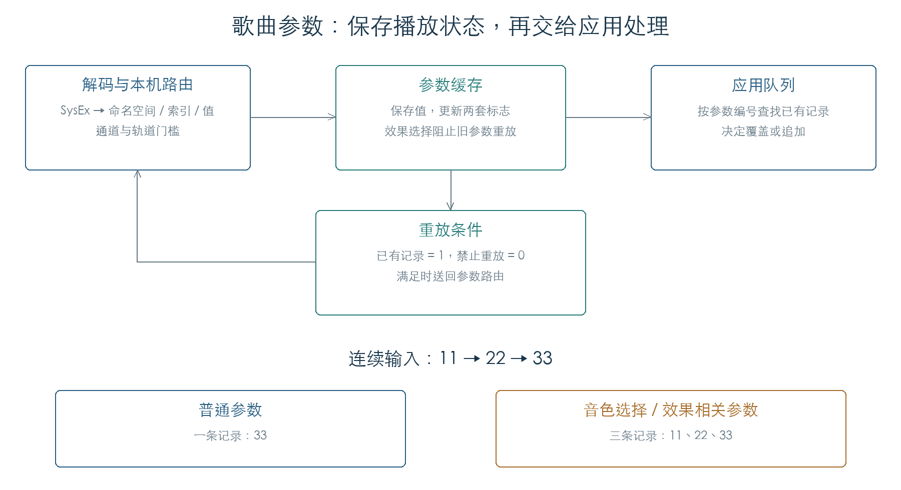

# 歌曲参数缓存与应用队列

歌曲参数消息进入本机后，先保存播放状态，再进入应用队列。普通参数连续变化会合并为最后一个值；音色选择、效果选择和效果参数保留事件顺序。更换效果时，旧效果参数被标记为暂不可重放，后续收到的新参数逐项解除该标记。[E1]

这条链已从原 SysEx 播放函数接通到缓存写入和队列入队。检查覆盖 6320 次地址映射、2220 次写入、216 次清位、40 组重放门槛和七组连续消息。后续[参数出队与内存写入](PARAMETER_DISPATCH.md)继续执行应用队列与三个原参数回调。



## 1. 缓存保存什么

每份缓存占 `0x2224` 字节。前 `0x900` 字节是两套标志，后面连续保存 1609 个四字节值。构造函数 `23D1D0` 从 `C169211C + 槽号 × 0x2224` 选择普通缓存，另一路固定使用 `C1712114`。初始化 `23CDCC` 只清标志，保留值区。[E1]

| 命名空间 | 值区偏移 | 每组项数 |
| --- | --- | --- |
| 100 | `0900` | 14 |
| 108–123 | `0938 + (组号 − 108) × 240` | 60 |
| 124 | `1838` | 47 |
| 125–129 | `18F4 + (组号 − 125) × 288` | 72 |
| 130 | `1E94` | 9 |
| 131–132 | `1EB8 + (组号 − 131) × 288` | 72 |
| 175 | `20F8` | 3 |
| 176 | `2104` | 72 |

表中的地址均为十六进制偏移，步长与项数为十进制。其他命名空间没有缓存值地址。固件参数目录另行决定当前可用索引数；镜像初始状态下，效果参数组 125–129、131、132、176 的目录项数为零，需等待运行时装配。

## 2. 写入与重放的条件

`23D61C` 先核对参数目录，再保存原始 32 位值，并将该项第一套标志置一、第二套标志清零。`23D6E8` 只有在第一位为一、第二位为零时，才把值送回参数路由 `241EBC`。本章将两套位分别称为“已有记录”和“禁止重放”；名称来自已验证的读写行为。[E1]

两套位图分别始于 `+000` 和 `+480`。命名空间 100–135 各占 32 字节，每组可表示 256 个索引。单项偏移为：

```text
32 × (命名空间 − 100) + 4 × floor(索引 / 32)
位掩码 = 1 << (索引 mod 32)
```

效果选择会批量改写从属组的两套位图：

| 选择参数 | 从属参数组 |
| --- | --- |
| 124 的索引 0–4 | 125–129 |
| 130 的索引 0–1 | 131–132 |
| 175 的索引 0 | 176 |

从属组两套位图均被写成全一，旧值仍保留。随后新写入的每个参数只清除自己的禁止位，因此可以逐项恢复重放。28 组状态转换实验覆盖前七个从属组及索引 0、31、32、71；实验在私有内存中临时把目录项数设为 72，真实效果装载流程仍待连通。

## 3. 一处需要继续追踪的地址重叠

位图公式直接用于命名空间 175 时，第一套标志落在 `+960`，第二套落在 `+DE0`。这两个位置已经进入值区，分别对应命名空间 108 的索引 10、112 的索引 58。选择参数 175/0 还会将 `+980…+99F` 和 `+E00…+E1F` 写成全一。[E1]

逐字节检查已复现这些写入，合成 SysEx 也已通过原播放链到达写入函数。实际歌曲是否能触发、当时缓存承担什么用途，仍需追踪装载与运行上下文。当前结论限定为明确的地址重叠和写入行为。

## 4. 哪些更新保留顺序

应用入口 `03A1AC` 在对象 `+20` 开启时，把参数送入 `038A64`，事件类型为 12。记录占 16 字节，包含命名空间、索引、值、类型和标志。普通参数以“命名空间 + 索引”查找旧记录；找到后直接覆盖值。[E1]

类型为 12 且标志非零时，下列参数每次都新建记录：

- 命名空间 108–123 的索引 0；
- 上表中的效果选择参数；
- 效果参数组 125–129、131、132、176。

例如连续输入 `11 → 22 → 33`，普通参数只留下 `33`，上述参数留下三条记录。七组连通实验执行了原 SysEx 解码、路由、缓存写入和入队逻辑；24 组独立入队检查另外组合类型与标志。内存分配、链表和查找容器由受控实现提供。

标志非零且入队后条目数大于 500 时，入口调用出队函数 `03A0FC`。12 组检查覆盖开关、标志和 499/500/501 三个计数。三个原参数的实际字段写入已在后续章节验证；全部参数副作用、声音变化与界面刷新仍需继续检查。

## 证据与复现

**[E1]** KROSS 2 v1.2.4 原指令执行，完整输入哈希、用例结果及截获边界见[机器结果](../../derived/firmware/KROSS2_V124/architecture/stage04/parameter-cache-check.json)。

- [检查脚本](../../tools/firmware_parameter_cache.py) · [缓存布局](../../derived/firmware/KROSS2_V124/architecture/stage04/parameter-cache-layout.arm.txt) · [写入与重放](../../derived/firmware/KROSS2_V124/architecture/stage04/parameter-cache-write-replay.arm.txt)。
- [标志状态](../../derived/firmware/KROSS2_V124/architecture/stage04/parameter-cache-state.arm.txt) · [队列入队](../../derived/firmware/KROSS2_V124/architecture/stage04/parameter-queue-intake.arm.txt) · [应用入口](../../derived/firmware/KROSS2_V124/architecture/stage04/parameter-notification.arm.txt)。
- 运行：`python3 research/tools/firmware_parameter_cache.py --verify-arm`。全部操作限定在私有模拟内存中。
