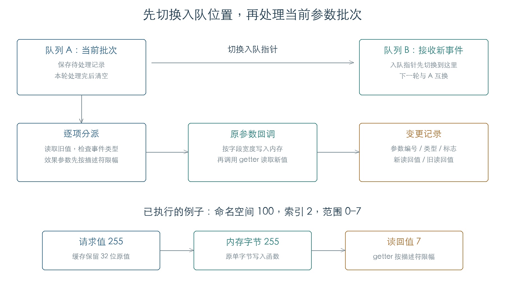

# 参数出队、内存写入与变更通知

应用用两份队列交替接收参数。处理一批事件前，先把入队指针切到另一份队列，再执行当前批次。每条事件按类型调用参数回调，最后把旧值、新值和类型汇成通知记录。歌曲 SysEx 到实际参数内存的连续路径已经接通，覆盖三个原始参数和六次队列轮换。[E1]

本章另完成 32 组出队条件、108 组事件类型、504 组原参数回调和 180 组效果参数筛选检查。列表、内存分配及消息交接使用受控边界；实际声音与页面刷新尚未执行。后续[变更通知与歌曲同步](PARAMETER_NOTIFICATIONS.md)进一步核对操作码 8 和歌曲副本。



## 1. 为什么有两份队列

`03A0FC` 检查应用对象 `+1C` 的处理标志；标志非零时立即返回。否则设为一，再检查普通参数、音色上下文和页面上下文三份待处理列表。三者均为空时清除标志，返回零。[E1]

有待处理内容时，函数保存当前队列，把对象 `+4` 切换到 `+10`、`+14` 指向的另一份队列，随后依次调用：

1. `0395B0`：处理音色上下文准备项；
2. `0397C0`：处理页面上下文准备项；
3. `039D80`：遍历参数记录、调用回调、发出通知并清理旧队列。

完成后清除处理标志，返回一。32 组检查组合两种当前队列、重入标志及三份列表的全部空/非空组合。连续 SysEx 检查执行了两项准备函数的空列表路径；其非空路径还需独立核对。

## 2. 事件类型决定哪些调用发生

单项处理函数 `039BD8` 先通过 `0D5AC4` 读取旧值。后续行为如下：[E1]

| 类型 | 参数写入 | 后续行为 |
| --- | --- | --- |
| 12 | 调用 `207DCC` | 写入前设置播放标志，写入后清零，再调用 `208B68` |
| 14 | 调用 `207DCC` | 生成变更记录 |
| 15 | 请求值与旧值不同时写入 | 写入前把类型改为 14；相同时直接结束 |
| 16、18、19、20 | 调用 `207DCC` | 保留类型，生成变更记录 |
| 本次检查的 0、21 | 不调用写入函数 | 仍生成变更记录 |

类型 12 的临时标志保存在 `C171C4C4`，取自入队记录的标志字节。函数退出前写回零。该标志还被歌曲录制相关代码读取，其完整录制作用另行追踪。

处理后重新读取参数，分配一条 24 字节记录：

| 偏移 | 内容 |
| --- | --- |
| `+00` | 虚表 `C04714B4` |
| `+04 / +06` | 两个 16 位字段：命名空间、索引 |
| `+08` | 事件类型 |
| `+0C / +10` | 新读回值、旧读回值 |
| `+14` | 标志 |

普通类型即使写前写后相等，也会生成记录。已验证的直接跳过条件是类型 15 且请求值等于旧读回值。

## 3. 存储值与读回值可以不同

`207DCC` 按参数目录找到数据地址和描述符，建立临时访问对象，然后以操作码 2 调用描述符中的函数指针。命名空间 100 的索引 0–2 都经过原回调 `1DEA58`、通用分发 `20A9B0` 和写入函数 `20B40C`。[E1]

这三个参数均为单字节字段。当前调用链按字段宽度保存值；getter 按描述符范围返回值。例如索引 2 的范围为 0–7：

| 输入的 32 位值 | 内存字节 | getter 读回 |
| --- | --- | --- |
| 3 | 3 | 3 |
| 255 | 255 | 7 |
| 256 | 0 | 0 |
| `FFFFFFFF` | 255 | 7 |

因此，通知记录中的“新值”来自写入后的 getter。缓存仍能保留原始 32 位请求值。这一结果已在 504 组执行中核对，覆盖三个原参数、七类写事件、两种标志、两个旧值和六个请求值。界面输入端可能另有范围检查；本章没有将异常请求解释为正常用户操作。

## 4. 效果参数在出队时再次筛选

批处理函数 `039D80` 对效果组 125–129、131、132、176 增加三项处理：[E1]

- 条目没有数据地址时跳过；
- 对 127–129，相关算法描述字段 `+1E` 大于 124 时跳过；
- 对通过筛选的条目，按当前描述符的最小值、最大值限制请求值，再调用单项处理函数。

180 组检查使用私有内存中的效果目录和算法描述夹具，覆盖空地址、字段值 124/125、上下界和越界请求。普通组 100 同时作为对照，确认该批处理分支只对效果组限幅。算法字段的业务名称、动态目录装配及真实效果切换仍待核对。

全部条目处理后，函数先逐项调用 `0345AC`，再调用 `034B48`、`207C00` 和 `209904`，最后清空旧队列及查找表。独立批次矩阵在接收端截获；下面的连续检查进一步执行了 `207C00` 和三个原参数的操作码 8 回调。

## 5. 连续播放检查

六个连续周期从原 SysEx 播放入口开始，执行以下调用链：

```text
2564E0  SysEx 播放
  → 242008 / 241EBC / 241D18  参数解码与本机路由
  → 23D61C                    缓存原始值
  → 03A1AC / 038A64           应用队列合并
  → 03A0FC / 039D80           切换队列、遍历批次
  → 039BD8 / 207DCC           读取旧值、调用写回调
  → 1DEA58 / 20A9B0 / 20B40C  写入实际参数字段
  → 24 字节变更记录
```

每个周期向三个参数各发送三次更新。出队前，缓存已经更新，实际参数字节保持旧值，队列只留下三条记录；出队后，三个参数均写入最后一次请求，通知中的新旧值与原 getter 一致。两种初始队列方向都通过检查。

连续检查还执行了原通知回调与歌曲同步门槛。三个工作区字段改变后，歌曲副本仍保持预置字节；缓存位与临时标志阻止了本次播放更新写回副本。通知的 OS 消息交接仍在边界截获。

目前已经解释参数进入应用并写到数据字段的过程。下一步继续通知接收者、效果目录装配、录制标志和定位恢复，再把这些行为接回真实歌曲。

## 证据与复现

**[E1]** KROSS 2 v1.2.4 原指令执行。[机器结果](../../derived/firmware/KROSS2_V124/architecture/stage04/parameter-dispatch-check.json)保存全部矩阵、连续周期、输入哈希和截获边界。

- [检查脚本](../../tools/firmware_parameter_dispatch.py) · [单项处理](../../derived/firmware/KROSS2_V124/architecture/stage04/parameter-record-dispatch.arm.txt) · [批次处理](../../derived/firmware/KROSS2_V124/architecture/stage04/parameter-batch-dispatch.arm.txt)。
- [参数写入入口](../../derived/firmware/KROSS2_V124/architecture/stage04/parameter-live-write.arm.txt) · [通用回调](../../derived/firmware/KROSS2_V124/architecture/stage04/parameter-common-callback.arm.txt)。
- 运行：`python3 research/tools/firmware_parameter_dispatch.py --verify-arm`。执行仅限私有模拟内存，无设备访问。
