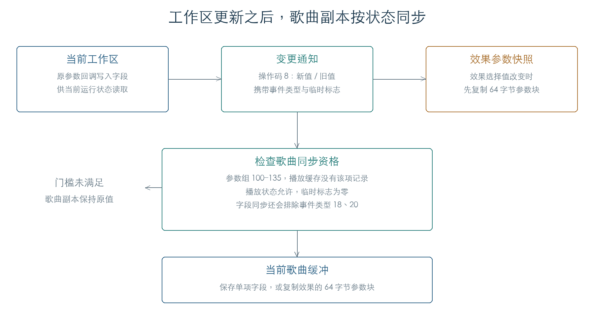

# 参数变更通知与歌曲缓冲同步

参数更新有两个去向：应用出队后，当前工作区接收新值，歌曲缓冲按状态决定是否同步。固件检查已有播放参数、播放轨道状态和临时标志，避免把每次播放更新都写回歌曲。本章恢复这些门槛、单项字段同步和效果参数块复制，并接通变更通知中的操作码 8。[E1]

324 组门槛、1728 组字段同步、192 组效果块复制及 84 组通知检查通过。前章的六个连续 SysEx 周期也已延伸到原通知回调：工作区参数发生变化，受控歌曲副本保持原值。[E1][E2]



## 1. 通知如何再次调用参数回调

`207C00` 遍历前章生成的 24 字节变更记录。有效条目会经过 `205B6C`，以操作码 8 再次调用参数描述符中的函数指针。传入结构包含参数组、索引、上下文、数据类型、事件类型、范围、新值和旧值。此次调用负责变更后的处理；此前的操作码 2 已完成字段写入。[E1]

每条回调执行前，固件把记录标志放到 `C171C4C4`，执行后清零。遍历完成，再构造一条头部类型为 9、子命令为 12 的消息，附带整份变更列表，并以命令 13 交给 `205AC0`。本次在消息交接入口截获，未运行 OS 消息队列。

第二次遍历 `209904` 只为类型 14 的有效记录调用 `2096FC`，参数为命名空间、索引和新值。84 组检查覆盖类型 12、13、14、15、16、18、20，组合两种标志和不同新旧值。后续[参数消息交接](MESSAGE_REPLIES.md)已执行 MMI 的列表复制和回复；各业务参数回调仍需逐项恢复。

## 2. 何时允许同步歌曲副本

参数回调中的辅助函数 `262678` 使用 `2625F8` 判断资格。四个条件必须同时满足：[E1]

| 条件 | 已验证的判断 |
| --- | --- |
| 参数范围 | 命名空间在 100–135 |
| 播放缓存 | 该项“已有记录”位为零 |
| 播放状态 | `C171D516` 为零，或状态对象 `C17146B4 + 14` 非零 |
| 临时标志 | `C171C4C4` 为零 |

这里保留两个播放状态字段的地址。它们的全部设置者尚未核对，当前证据不足以给每种组合命名为具体面板模式。

324 组检查覆盖范围内外的九个参数、缓存位、三种轨道状态、两种覆盖状态和三种临时标志。门槛与原函数返回值一致。

## 3. 单项字段怎样写入歌曲缓冲

资格满足且操作码为 2 或 3 时，辅助函数读取当前歌曲编号 `C1747538 + 208`，从 `C1747538 + 8 + 编号 × 4` 取缓冲地址。参数数据地址随后按以下关系临时重定位：

```text
歌曲字段地址 = 歌曲缓冲基址 + 当前字段地址 − C17456AC
```

固件使用原字段写入函数保存请求值，再恢复访问对象中的原地址。事件类型 18、20 跳过这次同步。1728 组检查覆盖歌曲槽 0、7、127，操作码 1/2/3、事件类型、各门槛及字节截断值；每次返回后原地址均恢复，原工作区未被这段辅助函数改写。[E1]

检查使用受控的有效歌曲指针。空指针、非法歌曲编号及文件装载失败路径仍待验证。

## 4. 效果选择复制一整个参数块

效果选择发生变化时，操作码 8 先调用 `23D434`，将当前 64 字节参数块复制到 `C1690290` 对应偏移处。这个快照动作发生在同步资格判断之前。[E1]

| 选择参数 | 相对 `C17456AC` 的参数块偏移 |
| --- | --- |
| 124 / 索引 0–4 | `0x18 + 索引 × 76` |
| 130 / 索引 0–1 | `0x194 + 索引 × 68` |
| 175 / 索引 0 | `0x220` |

通过资格检查、值确实改变且事件类型不为 13 时，`23D47C` 再把同一块复制到当前歌曲缓冲。命名空间 175 超出同步门槛，因此本章检查中只产生快照。新旧值相等时，两次复制均不发生。

192 组检查逐字节比较源块、快照和歌曲副本，覆盖八个选择参数、缓存状态、临时标志、相等值及类型 12/13/14。这也说明单项参数写入与效果选择使用了不同的保存单位。

## 5. 连回歌曲播放链

[前章连续检查](PARAMETER_DISPATCH.md)现已执行 `207C00 → 205B6C → 原参数回调 → 262678`。三个参数先经 SysEx 更新缓存，再由应用批次写入工作区，最后生成变更通知。缓存位和临时标志使歌曲同步门槛关闭，六个周期内歌曲副本始终保持原值。[E2]

这一结果连通了播放参数更新与歌曲副本保护。完整录制、保存文件、定位恢复及每种效果的声音变化仍需后续检查。

## 证据与复现

**[E1]** KROSS 2 v1.2.4 原指令执行。[机器结果](../../derived/firmware/KROSS2_V124/architecture/stage04/parameter-notifications-check.json)保存矩阵与截获边界。

- [检查脚本](../../tools/firmware_parameter_notifications.py) · [通知上下文](../../derived/firmware/KROSS2_V124/architecture/stage04/parameter-notify-context.arm.txt) · [通知列表](../../derived/firmware/KROSS2_V124/architecture/stage04/parameter-notify-list.arm.txt)。
- [歌曲字段同步](../../derived/firmware/KROSS2_V124/architecture/stage04/parameter-song-mirror.arm.txt) · [效果块复制](../../derived/firmware/KROSS2_V124/architecture/stage04/parameter-effect-copy.arm.txt)。
- 运行：`python3 research/tools/firmware_parameter_notifications.py --verify-arm`。

**[E2]** [连续 SysEx、缓存、出队与回调结果](../../derived/firmware/KROSS2_V124/architecture/stage04/parameter-dispatch-check.json)，`integrated` 中六个周期均包含歌曲副本保持检查。
