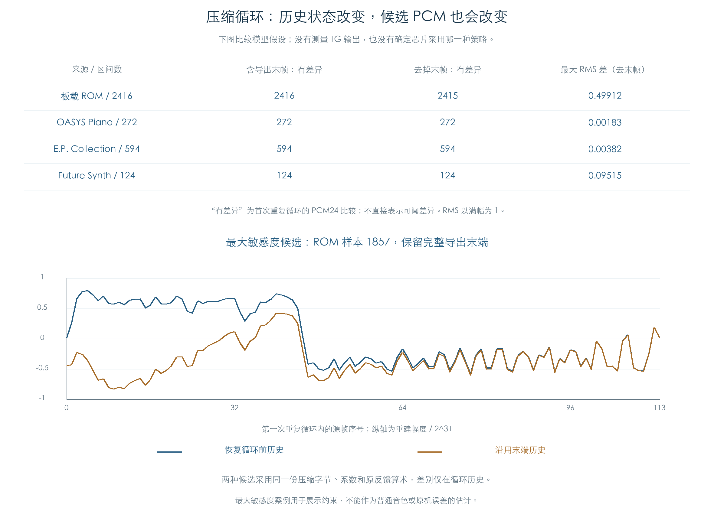

# 压缩采样循环：已知算术与未定状态

KROSS 2 v1.2.4 · 预测器历史、末端候选与证据边界 · 2026-11-02

压缩采样的反馈公式已恢复，但公式本身没有说明 TG 在循环时怎样处理历史。保留末端历史与恢复循环前历史，会从相同压缩字节产生不同 PCM。本轮对板载与三套扩展的 3406 个非单点区间量化了这项差异，尚未确认哪一种是芯片的真实策略。

原 ARM 比较验证的是编码反馈算术。下文的差值来自候选模型之间的比较，不能当作原机误差，也不能用来宣称循环已还原。



## 1 两个独立问题

**末端何时回绕。** 现有源 WAV 保留描述符完整区间，包含可能的末端保护帧。[原启动代码](VOICE_TG.md)向 TG 结束寄存器写入描述符结束值减一。该写入已确认；寄存器比较的时机、端点是否包含以及插值是否另取保护帧，尚无 TG 执行证据。

本轮分别采用完整导出区间 `end=N`，以及去掉最后一个源帧的 `end=N−1`。`end` 在模型中为不包含的上界，循环段为 `[loop, end)`；它们是明确的实验定义。

**历史怎样交接。** 压缩反馈读取前两个重建值。候选策略如下：

| 策略 | 第一次重复循环的初始历史 |
| --- | --- |
| 恢复 | 首次解码进入 loop 之前的两个重建值；loop 为零时取零历史 |
| 保留 | 前一次播放到 end 之前的两个重建值 |

恢复策略逐帧重现已解码的循环段，等价于在这套算术下重复该段 PCM。保留策略从末端状态继续解码同一压缩字节，本轮连续运行三圈。两者均沿用[已恢复的反馈公式](../FIRMWARE.md)、系数、查表、负数截断及两级饱和，没有为候选另调参数。

## 2 首次重复循环的 PCM24 差异

对象为描述符中循环区间超过一个源帧的压缩采样，不包括 PCM16、单点区间、反向、起点偏移或分数步进。这个筛选表示存在可比较的元数据区间，未证明每个实际 Program 都启用正向循环。

| 来源 | 区间数 | 完整末端：PCM24 有差异 | 去末帧：PCM24 有差异 |
| --- | ---: | ---: | ---: |
| 板载 ROM | 2416 | 2416 | 2415 |
| OASYS Piano | 272 | 272 | 272 |
| E.P. Collection | 594 | 594 | 594 |
| Future Synth | 124 | 124 | 124 |
| 合计 | 3406 | 3406 | 3405 |

差异按每帧取高 24 位后比较。不同帧计数没有表达听感大小；很小的量化差也计作不同。结果另外保存 Q31 最大绝对差、以满幅为 1 的 RMS 差及各圈的初末历史。

图下半部取候选差值最大的 ROM 样本 1857，展示完整末端解释下第一圈的 114 帧。它用于说明历史状态确实影响重建，不能代表常用音色的平均情况。末端解释改变后，差异也会改变；较小的候选差值不能据此证明该解释正确。

## 3 算术验证覆盖哪里

3406 个源采样的 104613116 帧，均比较原零历史 C 解码与新增可变历史 C 解码；高 24 位逐帧对应现有 WAV，输入文件指纹保持一致。两种末端的保留策略合计计算 171241524 帧。

每次保留历史进入新一圈时，前十六帧另与独立 Python 比较，共 326976 点。四类来源及实际标志的代表输入、最大差异案例，再取恢复、首圈保留、第三圈保留历史，完成 336 个原 ARM 编码反馈点比较。每点保存原码字、系数所属采样、两个历史值与输出，可独立复算。

这些结果证明指定历史输入下的重建算术一致。它们没有执行 TG 解码、循环判断、插值或硬件状态恢复。总核验明确保存 `TG_loop_state_policy_verified=false`，通过状态不表示芯片循环策略通过。

## 4 插件实现与后续证据

插件使用已解码 WAV 循环时，应把末端定义、循环帧区间及历史策略作为明确的实现选择，保留原地址与标志。当前可以实现并复现参考行为，不能将这项选择描述成已经恢复的 TG 规则。

要确定真实行为，需要能够区分候选的直接证据，例如同一采样在原 TG 循环交接处的输出，或明确描述端点比较与预测历史处理的芯片执行资料。新的 CPU 反馈比较只会继续确认算术，无法单独回答这一状态问题。

本轮只使用现有离线材料，未连接、录制或操作设备，未修改产品或冻结采样。采样插值、TG Filter A/B、效果音频及原机一致性仍各自保留缺口。

## 复现与证据

使用现有带 NumPy 的 Python 环境及本地 C 编译器：

```text
python3 research/tools/firmware_pcm_loop.py --verify-arm
python3 research/tools/firmware_pcm_loop_figures.py
python3 research/tools/firmware_runtime_verify.py --evidence-only
```

- [全部区间、三圈状态及原 ARM 比较点](../../derived/firmware/KROSS2_V124/architecture/stage04/pcm-loop-check.json)
- [20436 行候选差异 CSV](../../derived/firmware/KROSS2_V124/architecture/stage04/pcm-loop-model-differences.csv)、[配图指纹](../../derived/firmware/KROSS2_V124/architecture/stage04/pcm-loop-figure-check.json)
- [检查脚本](../../tools/firmware_pcm_loop.py)、[可变历史 C 实现](../../tools/firmware_pcm_loop.c)、[配图脚本](../../tools/firmware_pcm_loop_figures.py)
- 前序：[原反馈公式](../FIRMWARE.md)、[TG 启动与地址](VOICE_TG.md)、[扩展 PCM](EXPANSION_PCM.md)、[板载源清单](../../output/Factory_ROM_WAV/manifest.json)
