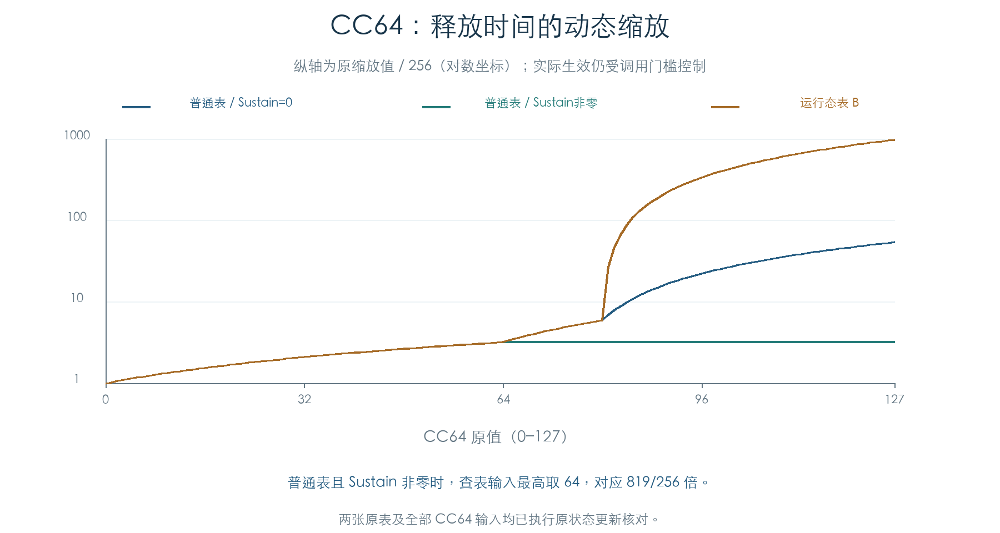
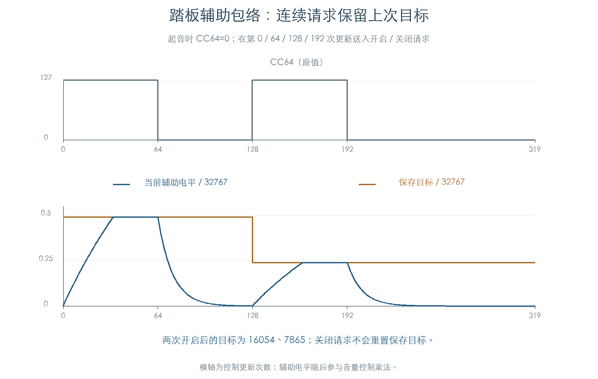

# 踏板对释放时间与辅助包络的影响

KROSS 2 v1.2.4 · 2026-11-02

CC64 的连续值已经接到原音量释放核心，踏板开启/关闭请求也已接到原辅助包络。独立模型保留了剩余时间缩放、系数更新、辅助目标记忆和请求处理顺序，并继续连通 LFO、Mixer 与控制目标。

原厂记录中，725 个 Program 设置了释放缩放位，16 个 OSC 设置了辅助包络位，多数属于钢琴配置。这部分会影响插件的踏板表现。统计描述存储字段；未启用 OSC 和真实可听贡献仍需结合路由与采样判断。

## 1 连续踏板值改变释放速度

原路径要求音色启用释放缩放、当前 Part 允许 Damper 控制，并且 Amp EG 处于下降释放段。满足条件后，每次更新都会读取 CC64，按运行态选择缩放表。



普通表在 Sustain 非零时，将查表输入限制为 64，最高缩放为 `819/256≈3.199` 倍；Sustain 为零时使用完整输入，CC64=127 对应 `13818/256≈53.977` 倍。

另一运行态表在 0–80 与普通表相同，从 81 起明显增大，127 对应 `250698/256≈979.289` 倍。它使用 32 位表项，按 16 位读取会丢失高值。本次执行了两张表的全部 128 个输入，保留 Sustain 分支及调用开关。

这些是控制时间尺度，尚未据此标注实机尾音秒数；运行态表选择器的界面绑定仍待确认。

## 2 踏板变化不重启释放段

设新缩放值为 `k`、原缩放值为 `k_old`，当前剩余时间为 `R`，该段原总时长为 `T`。变化时，原运算为：

```text
R = trunc(R × k / k_old)
重新查系数的时长 = min(2147483647, (T × k) >> 8)
R = R − 24
```

保存的原总时长 `T` 不改写，曲线进度也不清零。本轮先使用旧系数推进曲线，再重新计算后续系数。独立模型保留这个顺序，避免踏板变化时重启释放或跳过一次更新。

4608 组核心检查覆盖两种表、两种 Sustain、全部 CC64、三种曲线和三种基础时间。另有十六条连续轨迹，每条 192 次更新，在释放中依次改变 CC64，核对剩余时间、系数、进度和结束状态。

## 3 辅助包络保存自己的目标

开启辅助模式后，起音时若 Part 允许 Damper 且 `CC64>80`，辅助电平初始化为 32767；否则为零。阈值是严格大于 80，256 组初始化覆盖了控制允许/关闭及全部 CC64。

原 OSC 踏板入口写入开启、关闭请求，EG 刷新入口依次消费。开启请求将保存目标缩小：

```text
新目标 = s32(旧目标 × 16055) >> 15
```

第一次从 32767 得到 16054，第二次得到 7865。开启采用时间索引 52、曲线 0；关闭朝零变化，采用时间索引 62、曲线 10。关闭请求保留保存目标，因此再次开启会继续基于此前目标计算。



两类请求同时存在时，原消费者先处理开启，再处理关闭：保存目标已经缩小，当前段最终为关闭段。四组组合核对了这个顺序。辅助推进入口只处理其指定的上升/下降状态，端点取整和其他状态保持也照原指令保留。

辅助电平随后参与音量控制乘法。图中表示控制状态，未执行踏板采样或 TG 音频。

## 4 原厂配置与连续检查

设置辅助位的配置包括 A000、A001 等钢琴的第二 OSC，以及少量其他存储配置。全部十六个 OSC 分别在两种受控运行态表选择下执行，共三十二条轨迹，每条 320 次更新：先保持、再开启踏板，中途释放，随后关闭踏板并继续检查收尾。

| 检查 | 数量 |
| --- | ---: |
| 踏板缩放核心 | 4608 组 |
| 辅助初始化 | 256 组 |
| 动态释放 | 16 条 × 192 次更新 |
| 辅助请求循环 | 16 条 × 320 次更新 |
| 同时请求 | 4 组 |
| 原厂辅助位配置 | 16 个 OSC |
| 原厂连续轨迹 | 32 条，共 10240 次更新 |

每次比较完整主/辅助 EG 状态，并继续比较 LFO、Mixer、控制目标、随机状态和声部标志。原参数 getter、OSC 请求写入和 EG 消费者均执行原指令，计算函数未替换。

OSC 链表、控制器状态、采样与音高上下文在私有内存中构造。关闭路径的释放许可固定为零，以选择辅助请求分支；另一个管理器释放/分类分支尚未与本章合并。尚未执行物理 MIDI、完整声部装配或 TG 音频，产品代码保持原状。

后续[踏板释放交接](PEDAL_RELEASE_FLOW.md)已单独接通上述管理器与分类分支、原 Amp 释放及 TG 控制字，并核对三类主 EG 在下次声部更新中的交接。本章保留原实验边界。

## 字段与复现

| 已确认字段 | 作用 |
| --- | --- |
| Program `+0x509 bit6` | Amp 下降释放时允许进入缩放路径 |
| Part `+0x19 bit2` | Damper 控制允许条件 |
| OSC 运行态 `+0x4A3` | 非零时使用第二张缩放表 |
| OSC 参数 `+0x2C bit7` | 选择踏板辅助请求与电平路径 |
| Amp EG `+0x32 / +0x33` | 开启/关闭请求；消费后清零 |

上述为原字段关系，未将尚未确定的界面名称写成结论。

- [独立模型与原函数检查](../../tools/firmware_pedal_envelopes.py) · [完整结果、原厂配置与来源哈希](../../derived/firmware/KROSS2_V124/architecture/stage04/pedal-envelopes-check.json)
- [释放核心](../../derived/firmware/KROSS2_V124/architecture/stage04/pedal-envelope-core.arm.txt) · [辅助包络](../../derived/firmware/KROSS2_V124/architecture/stage04/pedal-envelope-auxiliary.arm.txt) · [OSC 请求写入](../../derived/firmware/KROSS2_V124/architecture/stage04/pedal-envelope-requests.arm.txt) · [请求消费](../../derived/firmware/KROSS2_V124/architecture/stage04/pedal-envelope-consumer.arm.txt)
- [配图脚本](../../tools/firmware_pedal_envelope_figures.py) · [缩放表 CSV](../../derived/firmware/KROSS2_V124/architecture/stage04/pedal-release-scales.csv) · [辅助循环 CSV](../../derived/firmware/KROSS2_V124/architecture/stage04/pedal-auxiliary-cycles.csv) · [动态释放 CSV](../../derived/firmware/KROSS2_V124/architecture/stage04/pedal-release-transitions.csv)
- 前置结果：[三类主 EG](ENVELOPES.md) · [音符释放与踏板门槛](VOICE_RELEASE.md)

复现：`python3 research/tools/firmware_pedal_envelopes.py --verify-arm`。配图使用 `python3 research/tools/firmware_pedal_envelope_figures.py`。输入与依赖记录 SHA-256，仅运行现有离线材料。
