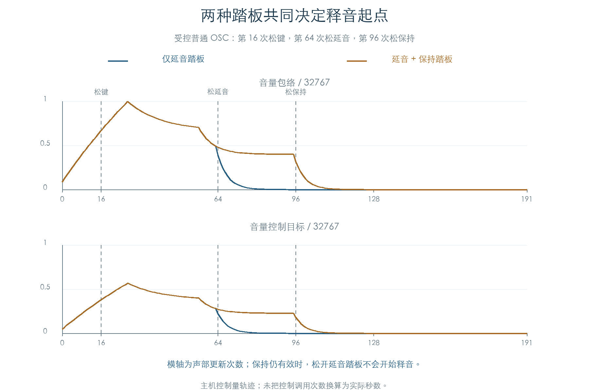
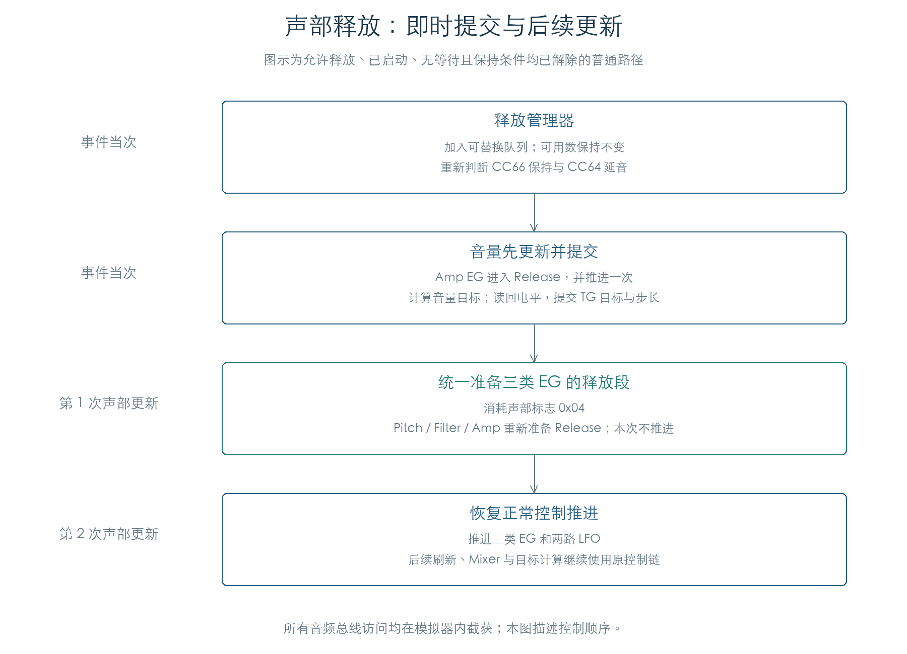

# 松踏板如何进入释音

KROSS 2 v1.2.4 · 插件音源逻辑 · 2026-11-02

延音踏板和保持踏板会共同决定释音起点。松开其中一个踏板后，声部还会检查另一个保持条件。确定可以释放时，固件先更新音量并提交一次 TG 命令，随后在声部更新中准备三类包络的释放段。

## 1 两种踏板如何共同保持声音

单声部释放入口先判断通道保存的音符位图与 CC66 开关，再判断音色是否允许延音及 CC64 是否达到 80。任一保持条件成立，当前包络继续运行。保持过程中仍有 Attack、Decay 等变化，持续电平由音色参数决定。



图中第 16 次更新松键，第 64 次松开延音踏板。只使用延音踏板的声音随即进入释音；同时使用保持踏板的声音持续到第 96 次解除保持。曲线来自原状态推进与独立模型的逐步对照，横轴使用更新次数。

两个阈值需分别保留：普通松键保持条件为 **CC64 ≥80**；辅助包络起音时的非零初始化条件为 **CC64 >80**。后者的两张时间缩放表与请求消费见[踏板包络](PEDAL_ENVELOPES.md)。

## 2 OSC 关闭踏板的三条路径

| OSC 与声部条件 | 原关闭入口的动作 |
| --- | --- |
| OSC 辅助位 `+2C.bit7` 有效；声部已松键且释放许可非零 | 进入释放管理器，再次判断保持条件 |
| OSC 辅助位有效；上述条件未同时满足 | 写入辅助包络关闭请求，等待刷新消费 |
| OSC 辅助位关闭 | 标志 `0x02` 有效时进入释放管理器；其余已分类声部进入分类判断 |

辅助位路径把释放许可读作有符号字节，并检查是否为零。本轮覆盖 `0、1、−1`；负值也能进入许可分支。

分类判断使用 `声部 +244 − 全局有符号偏移` 作为索引。Program `+508.bit6` 开启时，阈值取 `+50D`，否则取 109。只有索引小于阈值且全局位图对应位未置位，才继续进入释放管理器。索引等于阈值时保留声音。本轮执行原比较、位图读取和管理器；这些分类字段的界面名称与真实填充来源仍待确认。

## 3 释音分成两次交接



管理器先把普通声部移入可替换队列，保持可用数量不变。随后执行保持、等待与释放许可判断。尚未启动的声音可能被取消；负等待的声音转为松键触发。

对于已经启动且可以释放的声音，`0x1F8AF4` 当次执行 Amp EG 的 Release 准备与一次推进，再按当前 LFO、增益和辅助电平计算音量目标。声部标志 `0x04` 留给下一次 `0x1F8140`：该次更新清除标志，准备 Pitch、Filter、Amp 的 Release 段，并直接返回。再下一次更新才正常推进三类 EG 和两路 LFO。

插件实现应保留这个交接顺序。把所有包络同时切换并推进，会改变释放起点附近的控制轨迹。

## 4 最终音量命令

原 TG 提交入口读取当前电平，再把目标与有符号步长打包。若读回值恰好等于目标，缓存值会作一步偏移：非零值减 1，零值改为 1。这个处理保证差值非零。

设目标为 `T`，修正后的读回值为 `C`，包络时间标记为 `D`，原 25 项系数表为 `K`：

```text
P = signed32(K[min(D, 24)] × (T − C)) >> 16
S = P + 1    当 P ≥ 0
S = P − 1    当 P < 0
command = ((S & 65535) << 16) | T
```

例如受控普通 OSC 的目标为 5193、读回值为 12345 时，步长为 −11；读回恰为 5193 时，缓存改为 5192，步长为 +1。这些字对应模拟 TG 的 `+418` 写入。TG 内部如何逐采样执行步长仍是独立缺口。

## 5 证据与边界

| 检查 | 覆盖 |
| --- | --- |
| 原 OSC 松键到管理器、保持判断和音量提交 | 3456 组，覆盖六条释放分支 |
| 原关闭踏板与分类路径 | 96 组关闭状态、60 组索引/阈值/位图组合 |
| 开启踏板与保持标记 | 16 组，各执行延音开启及保持开启入口 |
| 原声部更新入口 | 48 组标志、计数等待及时间等待门槛 |
| 连续演奏 | 16 条轨迹，共 3072 次更新 |
| TG 目标与步长 | 10 组，包含正/负差值、非零相等及零值相等 |
| 原厂辅助位 OSC | 全部 16 个，在两种受控缩放表模式下共 4096 次更新 |

本轮只在 TG 总线读写处提供边界回调，另保留固件断言陷阱。OSC 入口、分类计算、管理器、CC66 开关读取、包络释放及 TG 控制字运算均执行原指令；指令入口观察钩子只记录路径。三类主包络、辅助包络、LFO、Mixer、控制目标、声部标志及链表与模型分别比较。

实验从一个明确在用的声部开始；采样、音高、分配器和控制器上下文由检查器构造。原厂参数检查覆盖存储字段，未证明这些 OSC 在某个音符上实际发声。结束声部继续留在受控列表中，本轮没有运行全局完成轮询；完整分配、立体声、真实采样区域装配和后续正常 TG 刷新仍需连接。TG 电平读回由实验指定，没有生成完整 TG 音频，也没有连接设备。

后续[原厂真实声部链](FACTORY_VOICE_CHAIN.md)已接入实际选样、分配与立体声启动；[正常刷新](VOICE_REFRESH.md)进一步执行推进/完成轮询、批次计算与正常 TG 提交。本章的单声部控制模型继续作为独立边界证据。

[原指令检查数据](../../derived/firmware/KROSS2_V124/architecture/stage04/pedal-release-flow-check.json) · [连续轨迹 CSV](../../derived/firmware/KROSS2_V124/architecture/stage04/pedal-release-flow.csv) · [释放交接汇编](../../derived/firmware/KROSS2_V124/architecture/stage04/pedal-release-tick.arm.txt) · [分类汇编](../../derived/firmware/KROSS2_V124/architecture/stage04/pedal-release-classification.arm.txt)

```sh
python3 research/tools/firmware_pedal_release_flow.py --verify-arm
python3 research/tools/firmware_pedal_release_figures.py
python3 research/tools/firmware_runtime_verify.py
```
