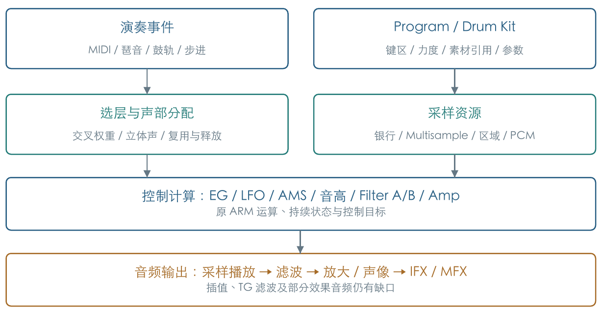
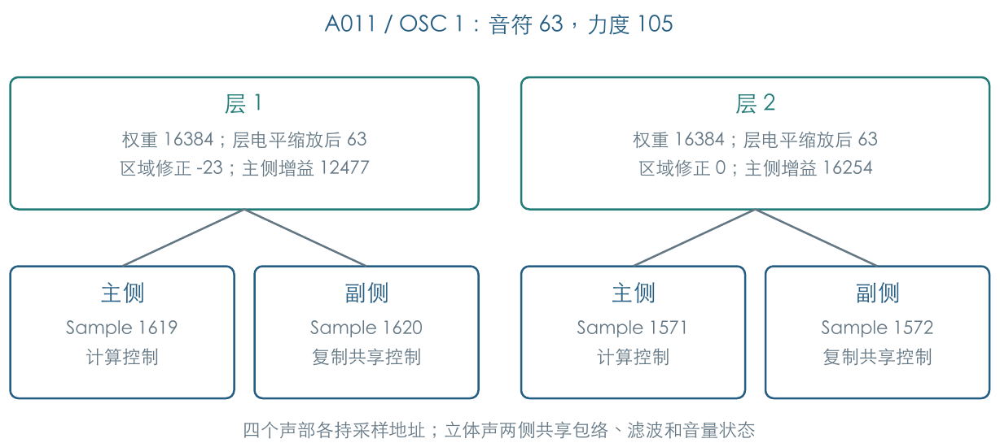
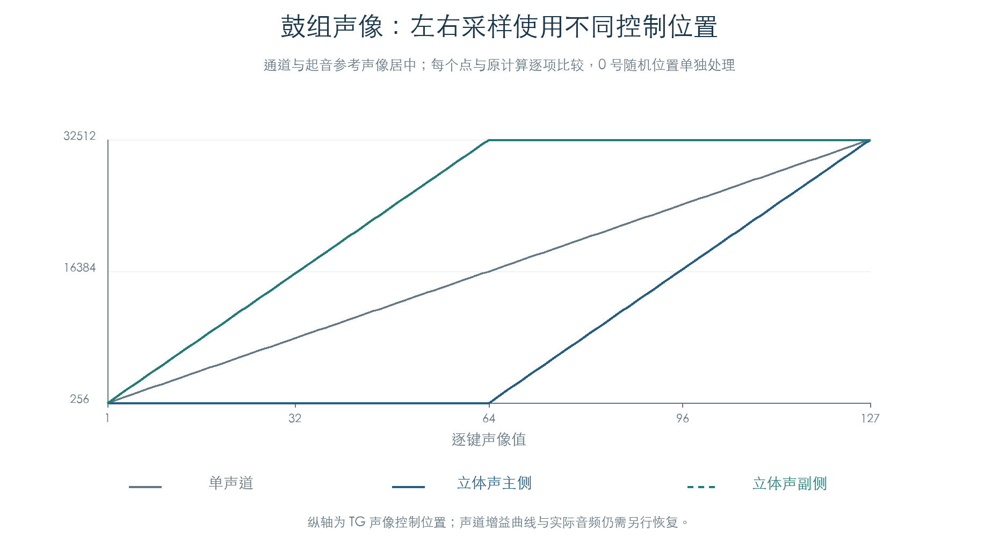
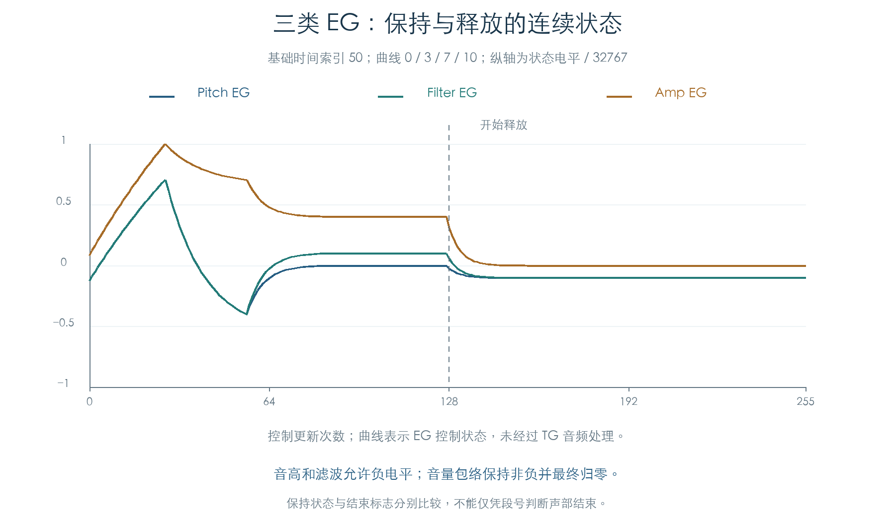
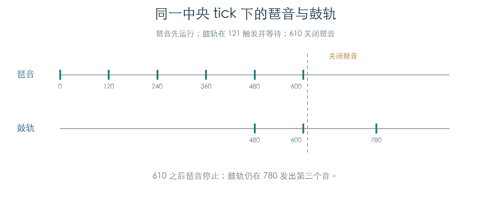
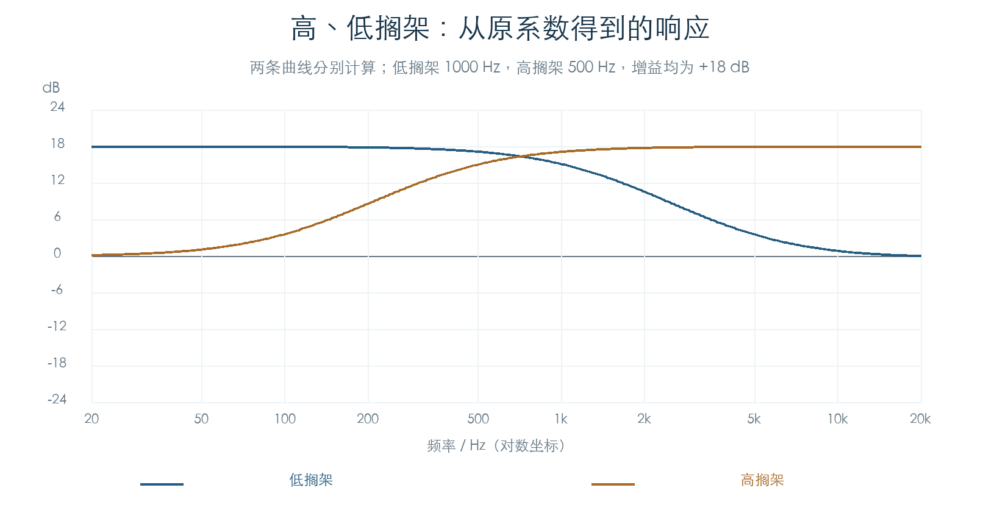
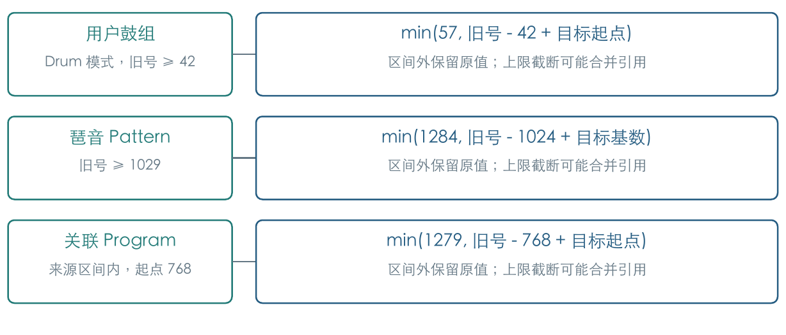

# KROSS 2 音源逆向报告

v1.2.4 · 插件逻辑与验证结果 · 2026-11-02 · 研究版

**摘要**：KROSS 2 音色由采样资源、Program/Drum Kit、演奏控制、调制和效果共同构成。ARM 控制层负责选层、分配声部、计算音高与包络等目标；TG/TGi 执行采样与音频处理。本研究已恢复板载及三套现有扩展库的资源组织，并将原选层、真实采样、声部初始化和控制提交接通。当前主要缺口集中于采样插值、TG 内部滤波、部分效果音频及跨模块连续演奏。本文汇总可用于插件的规则、原指令证据和剩余差异，不把源波形导出或控制检查等同于完整音色还原。

## 1 音源的组成

一个 Program 使用单 OSC、双 OSC 或鼓组模式。OSC 按键区和力度选择采样层，Multisample 再把音高映射到区域与 Sample。包络、LFO、AMS 和键盘跟踪随演奏更新，最后通过滤波、放大、声像和效果形成输出。琶音、鼓轨与步进提供带时钟的音符事件，进入相同音源路径。[E1]



本报告保留会影响音色和演奏的逻辑：资源读取、MIDI、声部分配、采样播放、调制、滤波、效果及必要的音乐发生器。GUI 仅保留参数绑定和操作状态；整机启动、完整内核/驱动、文件系统、固件升级和机内录音归档。完整 DSP 指令集及芯片模拟不列为插件交付条件。

<!-- pagebreak -->

## 2 采样与音色资源

板载 PCM、官方编辑器预载、GM 备份和三个扩展 KEP 已建立来源关联。Program 存储参数与素材引用，WAV 保存解码后的源波形；完整音色仍需执行选层、调音、包络、滤波和效果。[E2]

| 来源 | 已提取内容 | 当前用途 |
| --- | --- | --- |
| 板载 | 4068 个音乐采样、2 个诊断样本；768 个 A-F Program | 全部源波形与原参数；其中 726 个为旋律模式 |
| GM | 265 个完整 Program、9 套鼓组 | 基础音色、变体、回退与低音鼓键映射 |
| OASYS Piano | 32 个 Program、272 个单声道采样 | 钢琴分层与立体声区域 |
| E.P. Collection | 32 个 Program、602 个单声道采样 | 完整源 WAV 与扩展选样 |
| Future Synth | 64 个 Program、195 个单声道采样、4 套鼓组 | 合成音色与跨库鼓采样依赖 |

扩展逻辑银行依次为 2、3、5。层描述符把银行与单声道/立体声选择编码在同一字节；运行时先解析银行，再生成目录与键区索引。三套库共 76 个 Multisample、11 对立体声目录，全部 9728 组音符到区域的查询与独立表一致。

E.P. 与 Future Synth 新增的 797 个 WAV 共 17387114 帧，全部帧通过 C/Python 重建比较，导出后逐字节检查 PCM24。原 ARM 编码反馈另比较 32272 个位置。标称速率通过原 CPU 音高路径核对；这些证据覆盖源数据重建，TG 硬件解码和插值另列缺口。

起点、循环、结束值和区域根音均保留。同一波形可有不同起点，简单去重会丢失起音行为。3406 个非单点压缩区间另比较了循环历史候选：保留或恢复历史会改变 PCM，TG 的末端时机和历史策略仍未确认。[E3]

Future Synth 四套鼓组共有十条启用层引用缺失的逻辑银行 6，其中九条能被非零力度选中。报告保留编号和可达力度，未填入猜测来源或替代波形。[E3]

<!-- pagebreak -->

## 3 选层、区域与声部分配

普通 OSC 最多存四层，每次选取一层或相邻两层。交叉方式有线性、查表和满权重叠加三种：中点权重分别为 16384、23170、32768。原厂 726 个旋律 Program 的 167005 次力度选层已核对。[E1]



A011 的 OSC1 在音符 63、力度 105 时选中两对立体声，各层权重为 16384。层电平 127 经整数缩放后为 63。区域修正不同，使两层主侧中间增益分别为 12477、16254。[E4]

```text
L = (层电平 × 交叉权重) >> 15
A = 32768 + 331 × 区域电平修正
G = clamp(signed32(signed32(A × L) × 129) >> 14, 0, 65535)
```

该式对应第二电平修正为零的旋律路径。G 还要经过力度响应、跟踪、调制与包络，不能直接作为最终音频振幅。整数溢出、移位和限幅顺序均影响边界结果。

立体声主侧计算包络、LFO、Mixer 和音量，副侧复制共享控制块，独立保存右侧采样地址。副侧中间 gain 字段在清零池中仍为零，已复制的音量目标继续有效。零权重层也可能分配声部，提前删除它需核对分配和状态继承的影响。

120 槽的 32 条密集演奏轨迹完成 5632 次更新、6481 次控制提交。候选按缓存评分严格比较，低至 4 时停止搜索；成对抢占清理两侧。三种旋律音色均走过耗尽与再次起音，鼓组对照峰值为 117 槽；TG 完成响应仍由实验提供。[E4]

目录能力还会限制反向播放。497 个板载旋律目录中，118 个允许反向；描述符保存反向位并不保证运行态启用。构造失败时归还预留槽，立体声首侧失败会跳过同层次侧。

<!-- pagebreak -->

## 4 鼓组与演奏控制

鼓组在逐键记录中保存层、调音、电平、声像、发送与独占组。未分配键按原规则向后查找下一个已分配键；末尾没有目标时拒绝发声。42 套原厂鼓组共 3594 个分配键、5239 条存储启用层，其中两条被力度门槛遮住。[E5]

独占组大于零时，新音符分配后关闭同组旧声部，包含立体声伙伴；组号零允许叠加。大部分原厂鼓键忽略 Note Off，11 个 Human BeatBox 键允许响应。Program Hold 与逐键标志还会共同影响释放，插件应保留逐键判断。



鼓采样电平有层与目录两项修正。调音/滤波偏移供再次起音读取；逐键 Attack/Decay 在相应包络段建立时取值，时间索引限制在 0–99。24 条自然推进轨迹确认：编辑保留当前段，后续阶段和新音符读取新值；音量先结束时，声部可在滤波 Decay 前回收。[E6]

单音、Normal/Offset 连奏与 Unison 的 26 条真实采样轨迹完成 4160 次更新。Normal 复用保留初始力度、采样、EG 与 LFO，回退另用共享力度缓存；Offset 按原路径重建。滑音返回的基准还会影响区域查询，20 次新建选区与直接按目标查询不同。[E4] 踏板保持后仍由 Amp 释放交接。

GM 银行解析保留基础音色、变体缺失回退和九套鼓组映射。特殊鼓模式会对低键再次重映射，同时保留原音高距离和键盘跟踪输入；标准鼓组的输入键 24 可映射到键 75。该规则只在已确认的模式条件成立时启用。[E7]

<!-- pagebreak -->

## 5 包络、LFO 与 AMS

三类主 EG 共用整数曲线核心，各自保留阶段语义。Pitch 与 Filter EG 允许负电平，释放后可停在指定 Release Level；Amp EG 释放归零，并按条件请求结束声部。段号相同也可能处于保持或结束状态，回收还需检查结束标志。[E8]



共享核心包含 11 种曲线；基础时间查原表，再应用时间 AMS，单步扣除 24 个内部单位。时间索引很小时存在提高到 8 的分支，极长时长饱和到有符号 32 位上限。图的横轴是调用次数，未将模拟器步骤直接标成实测毫秒。

阶段深度也有差异：Amp Decay 使用一倍时间 AMS，其他受测阶段使用两倍；Pitch Release 不读取这组 Time AMS。阈值重触发比较来源与阈值的交叉方向，正阈值检测向上越过，负阈值检测向下越过。Amp 进入释放后停止自身阈值重触发。

LFO 已恢复 18 种存储波形、Shape/Offset、随机状态、自由/同步速率、Delay/Fade 和两路交叉调制。两路交叉调制保留原更新顺序。七种 AMS Mixer 包含混合、偏移、独立上升/下降平滑、整形、量化与 Gate。它们作为有状态调制源，不能都简化为瞬时线性混合。[E9]

原控制目标串接 EG、LFO、Mixer、音高、Filter A/B 与音量；踏板另对释放剩余时间和辅助包络产生影响。全部存储 OSC 已覆盖专项参数检查，外部来源和复杂演奏组合仍需连续入口验收。

<!-- pagebreak -->

## 6 控制更新与音乐发生器

NRPN 逐键控制已接到自然包络，选择状态保留旧参数/键号。来源 5 保留影子副本；12 条轨迹完成 12288 次更新。RPN 的鼓组粗/微调共用音分字段；弯音补入 MSB 低两位，最大值 32767。[E18]

银行转换与 GM 变体回退接到原 Program 装载，按模式和 Part 权限分发。换音复制活动 CC，并清零该音色的弯音；通道弯音保留。[E19][E20]

换音保留旧声部参数，新音符使用新 Program；双 OSC 变单 OSC 后，旧第二 OSC 仍处理关音。未起音的延迟层可取消，鼓键继续遵守释放权限。[E21]

原管理器分批推进、轮询声部并提交目标。[E10] 受测旧声部继续响应共享音量与弯音；换音清零音色弯音后，其下一批采样步进恢复原值。[E22]

CC121 清零弯音、压力和参数选择状态并关闭踏板，按住的音符保留。CC7/10 缓冲恢复默认值，演奏音量/声像缓存保持原值。[E24]

CC123 按踏板/鼓键规则释放，CC120 强停回收，两者保留控制器。主机省略空节点的 0/4 写入后，96 条轨迹完成 4608 次更新，与原状态及 TG I/O 一致；实机零页映射待查。[E24]

两段附加计算在受测刷新路径中没有后续读取。省略后，72 条轨迹的其余状态及 TG I/O 保持一致，插件可省去相应绑定。[E22]



琶音保留 Pattern、五种内置生成器、Latch、Swing 和 Flam；步进保留 64 步与 Accent。琶音与鼓轨的共同节拍已核对 16 种加入/Key Sync 场景，共推进 23040 tick。[E11]

鼓轨已连接原本机 MIDI 输入、真实鼓组选样和正常刷新。12 条轨迹建立 390 个声部，完成 6720 次控制更新；TG 启停与归零采用即时应答。[E11]

外部 F8、Auto 超时及周期估算已有检查。音乐 tick、控制更新与宿主音频时基仍需对齐，覆盖暂停、定位、同步启动和跨边界关音。

机内录制与歌曲编辑的已有研究作为附录证据保存。插件本轮保留会影响预置演奏的发生器和时钟，不继续展开完整工作站录放、文件保存及 OS 调度。

<!-- pagebreak -->

## 7 滤波与效果

Filter A/B 的截止、共振、Trim、Output、EG 与 AMS 控制运算已恢复。Concert 参数曾有标签错位，现已根据消费者与参数变异纠正：B 的基础 Output 为零，AMS Mixer2 调制 B 输出；它不应被解释成调制 B 截止。[E12]

原函数最终给出控制字。控制字到 Hz/Q、真实极点、饱和与非线性的关系仍未恢复；现有播放器使用可校准的二阶滤波近似。报告不将这些工程假设写成原机传递函数。



四段 EQ 按 Q30/Q22 解码：B2 四倍，高搁架八倍。原系数与独立公式的最大差约 3.364e-5，331 组原厂设置已有双通道静态级联参考。B2 双端点引用已定位，两个主机候选在一组原参数下相差 2.03 dB；实际动态运算与舍入仍待查。[E13]

| 算法 | 已恢复 | 主要音频缺口 |
| --- | --- | --- |
| 四段 EQ | 四段静态系数、缩放、前置电平、调制端点 | B2 动态过渡、芯片舍入与混合 |
| 限制器 | Ratio、阈值、时间、增益、检测来源、侧链 EQ | 检测器、拐点、预读与增益递推 |
| 立体声合唱 | 延迟/Depth、同步速率、相位、有符号干湿、前置 EQ | 延迟插值、LFO 时序及完整音频连接 |
| Hall | 四组延迟地址、衰减表、阻尼控制与 DSP 常数引用 | 扩散、阻尼递推、耦合与完整尾音 |

母带限制器的 25 项常数符合量化 Hann 窗，两组地址闭区间各含 25 单元。94 个原厂槽位的 564 次回调保持该窗；其具体作用、预读与真实延迟仍待恢复。[E14]

135 项定义与 117 份不同载荷仅为资源计数。后续集中常用效果的声音缺口，其余保留目录。[E14]

加载器会清零常数尾部并上传完整占用区，EQ 的 A50/51 初始上传为零；程序尾部保留。局部引用、MFX 修正及合唱波形选择已核对，延迟插值与 Hall 耦合仍待恢复。[E23]

<!-- pagebreak -->

## 8 扩展音色与导入关联

三套库的 124 个旋律 Program、222 个 OSC 完成 3126 组启动检查；四个鼓组 Program 完成 65024 组选层和 1739 组启动检查。记录连接到 572 个现有源 WAV。11 组因逻辑银行 6 缺失暂缓；完整音色音频及持续效果仍待验证。[E15]



原导入修正函数将用户鼓组号按目标起点平移，最大为 57；琶音引用从 1029 起修正，最大为 1284；鼓轨/步进的 Program 引用仅在本次来源区间内平移，最大线性号为 1279。

原分节导入确认四套鼓组按文件顺序连续放置。Future Synth 保存的 `45/45/43/44` 在目标起点 46 下变成 `49/49/47/48`；两个 45 号均连接到第四套 `Nu DISCO Kit`，名称不参与重分配。[E16]

容量不足时，分节函数可只写入前缀却返回成功；校验失败或短读也可能保留先前写入。插件应先校验分节和空间，再一起提交记录与引用。外层安装器的预检和恢复未在此验证。[E16]

插件资源导入应保存源库标识、原编号、目标映射和缺失依赖。采样描述符仍以原 PCM 数据区的相对地址解释，读取 WAV 时由插件自己的资源索引承接。硬件上传重定位、总线和固件装载不再列为后续任务。

<!-- pagebreak -->

## 9 插件实现边界与保留缺口

研究产物已经能提供源采样、参数结构、选层、区域、调音、电平、立体声、主调制和发生器规则。它们支持构建参数驱动的软件音源。逐模块恢复与整套插件接入需要分别验收；本轮保持产品源码及冻结资源原值，未扩大现有产品音色覆盖。[E17]

| 保留的未解项 | 后续验证依据 |
| --- | --- |
| 采样播放 | TG 循环末端/历史策略、插值、反向与起点偏移；比较跳变和持续尾音 |
| Filter A/B | 控制字到传递函数、共振与电平；明确原证据和校准模型的差别 |
| 常用效果 | 限制器检测/增益、合唱插值、Hall 耦合与阻尼；形成实际脉冲或音频结果 |
| 连续演奏 | 多音色共享、Mono/Unison 与发生器组合；长时演奏和关音尾音 |
| 数据完整性 | 缺失银行 6 及跨库引用；缺失项明确标记，导入记录与引用一起提交 |
| 宿主验证 | 真实插件资源接入、离线渲染、宿主项目验收和音色比较 |

现有离线镜像中的 ARM 控制证据不足以单独推出 TG 内部滤波和全部音频运算。报告分别记录原代码证据、主机近似和未解项；后续可围绕具体声音差异补充资料或对照数据。

本轮研究按用户要求于 2026-11-02 结束，报告作为阶段交付。原机音频仍有上述缺口；各章保留实际证据与验证边界，不给出缺少统一分母的总恢复百分比。

<!-- pagebreak -->

## 10 证据、复现与范围

本次统一报告使用仓库现有离线材料。原 ARM 运算在 Unicorn 私有内存执行，边界按各模块记录：有的提供存储或分配，有的提供 TG 读回、总线接口或调制来源。调用边界会改变验证范围，不能把不同模块的矩阵简单相加成全系统覆盖。

当前总核验纳入 86 份原 ARM 模块结果，另核对 EQ 主机参考和五份试听。固件、脚本、输入及文档指纹分别检查；54 份保护文件保持原 SHA-256，阶段 01 PDF 保持原值。总核验不重新运行全部 ARM 矩阵，也不替代原机声音比较。

```text
应用镜像：KROSSAPP.bin，6291456 字节
SHA-256：
3005f0eca3f3772bcb810c526ceebb15562747d3cdcdf5d20faae4a539520c54

python3 research/tools/firmware_runtime_verify.py
```

复现原 ARM 检查时，使用对应章节的 `--verify-arm` 命令，宿主需要允许 Unicorn JIT。仓库提供文档、脚本、图表和报告；固件、采样及派生证据保留本地，相关证据链接用于完整离线工作区。

### 证据索引

- [E1] [演奏控制与选层](RUNTIME_FLOW.md)：MIDI 路径、三种交叉曲线与原厂力度矩阵。
- [E2] [资源总索引](../../RESOURCES.md)：板载、GM、扩展与历史产品验收边界。
- [E3] [扩展采样](EXPANSION_PCM.md)：完整 WAV、银行/区域与缺失层依赖。
- [E4] [声部启动](FACTORY_VOICE_CHAIN.md)、[耗尽抢占](VOICE_PRESSURE.md)与[单音连奏](MONO_LIVE.md)：装配、抢占、回退与滑音选样。
- [E5] [鼓组发声](DRUM_VOICE_CHAIN.md)：重映射、独占组、Note Off 与可达层。
- [E6] [逐键控制](DRUM_CONTROLS.md)、[包络时间](DRUM_ENVELOPE_TIMES.md)、[连续推进](DRUM_ENVELOPE_LIVE.md)：编辑生效时机。
- [E7] [GM 音色](GM_PROGRAMS.md)：银行回退、九套鼓组与低键映射。
- [E8] [主包络](ENVELOPES.md)、[踏板交接](PEDAL_RELEASE_FLOW.md)：时间、重触发及释音。
- [E9] [LFO](VOICE_LFO.md)、[控制目标](LFO_TARGETS.md)、[AMS Mixer](AMS_MIXERS.md)：调制运算与状态。
- [E10] [正常刷新](VOICE_REFRESH.md)：双游标、提交与受控附加绑定。
- [E11] [琶音](ARPEGGIATOR.md)、[鼓轨](DRUM_PATTERNS.md)、[步进](STEP_SEQUENCER.md)、[鼓轨声部](DRUM_VOICE_PLAYBACK.md)：节拍、事件与起音。
- [E12] [滤波控制](../FILTER_CONTROL.md)：字段修正、原控制字与播放器假设。
- [E13] [四段 EQ](EFFECT_EQ.md)、[B2 程序](EQ_B2_PROGRAM.md)：系数、静态参考与动态候选。
- [E14] [路由](EFFECT_ROUTING.md)、[限制器](EFFECT_LIMITERS.md)、[母带窗](MASTER_LIMITER_KERNEL.md)、[合唱](EFFECT_CHORUS.md)、[Hall](EFFECT_HALL.md)：控制与音频缺口。
- [E15] [扩展声部](EXPANSION_VOICES.md)：真实 Sample、源 WAV 与缺失银行暂缓。
- [E16] [导入重编号与放置](RESOURCE_IMPORT.md)：原规则、实际套件关联和容量边界。
- [E17] [归档状态](REVERSE_STATUS.md)、[研究交接](../REVERSE_HANDOFF.md)：本轮范围、结束状态与保留缺口。
- [E18] [MIDI 控制](MIDI_PARAMETERS.md)、[逐键 NRPN](DRUM_NRPN_LIVE.md)：选择保留、调音、压力与弯音。
- [E19] [MIDI 银行转换](MIDI_BANKS.md)：编码、变体列表、特殊鼓标志与空银行。
- [E20] [MIDI 换音装载](MIDI_PROGRAM_LOAD.md)：模式权限、真实 OSC 绑定、控制器保留与弯音归零。
- [E21] [换音连续声部](MIDI_VOICE_HANDOFF.md)：旧参数保留、新音符选样、延迟取消与原关音路径。
- [E22] [换音持续刷新](MIDI_VOICE_REFRESH.md)：控制器权限、共享弯音/音量、踏板与正常 TG 提交。
- [E23] [Hall 引用](HALL_LOCAL_OPERANDS.md)、[合唱程序](CHORUS_PROGRAM.md)、[加载状态](EFFECT_LOAD_STATE.md)：局部字段、槽位修正与初始上传。
- [E24] [控制器重置](MIDI_RESET.md)、[关音与复用](MIDI_STOP_REUSE_LIVE.md)：原关音规则、零页写入与连续适配。

地址均为解压应用镜像内偏移，虚拟基址为 `0xC0000000`。逐模块章节链接到原指令摘录、独立模型、机器结果和 CSV；本报告提供阅读主线，细节以对应证据为准。
