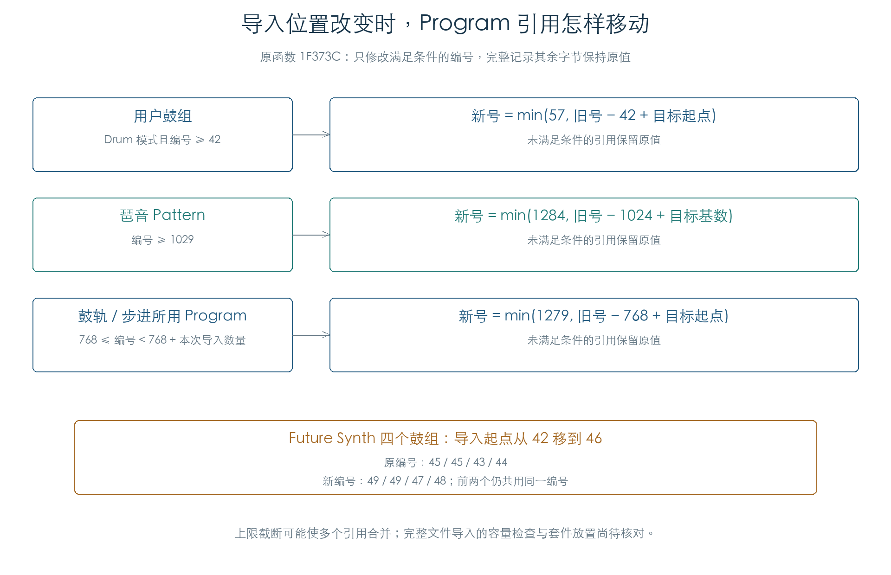

# 导入音色的引用重编号

KROSS 2 v1.2.4 · 插件资源导入逻辑 · 2026-11-02

音色导入到不同位置时，原固件会修正用户鼓组、琶音 Pattern，以及鼓轨/步进所用的 Program 引用。三套扩展库的全部 128 个 Program 已在三种目标位置下完成原指令检查；每次比较完整 2144 字节记录。



## 1 三种编号规则

令 `K` 为鼓组目标起点，`A` 为琶音目标基数，`P` 为本次导入 Program 的线性起点，`N` 为导入 Program 数量。

| 字段 | 修改条件 | 新值 |
| --- | --- | --- |
| 用户鼓组，Program `+566` 的 16 位值 | `mode & 7 == 2`，且原值 ≥ 42 | `min(57, 原值 − 42 + K)` |
| 琶音 Pattern，`+4DC` 的 16 位值 | 原值 ≥ 1029 | `min(1284, 原值 − 1024 + A)` |
| 鼓轨/步进 Program，`+4F2` / `+502` | `768 ≤ 原值 < 768 + N` | `min(1279, 原值 − 768 + P)` |

两个 Program 引用以“低字节索引、高字节银行”保存，计算时使用 `索引 + 128 × 银行`，再拆回两个字节。它们与前两项的普通 16 位整数存储不同。

琶音条件严格从 1029 开始；1028 保持原值。五种内置琶音占用前五个选择值，因此用户 Pattern 区的起点不能直接当作 1024。这里保留原条件和原减数，两者相差五。

调用者按导入设置传入目标：鼓组为 `设置 + 42`，琶音为 `设置 + 1024`，Program 为 `目标银行 × 128 + 首索引`。本轮从原调用点确认参数来源，随后执行完整引用修正函数。

## 2 两个同号鼓组会继续共享

Future Synth 四个鼓组 Program 原始保存值为 `45 / 45 / 43 / 44`。目标起点从 42 移到 46 时，结果为 `49 / 49 / 47 / 48`。这个函数按原值平移，不查看名称，也不把重复引用分配到不同套件。

因此，[上一轮声部检查](EXPANSION_VOICES.md)中的两个 45 号引用可以由本轮规则解释。[后续分节导入](RESOURCE_IMPORT.md)已确认当前格式按文件顺序连续放置，以及容量截断和失败后写入保留；完整实机安装的外层预检与恢复另保留边界。若目标过于接近末端，上限截断可让多个引用合并；插件导入应在资源分配阶段检查空间。

## 3 验证与使用边界

| 检查 | 结果 |
| --- | --- |
| 鼓组修正 | 33152 组：八种模式、完整低字节编号及三个高值、全部 16 个用户目标起点 |
| 琶音 Pattern | 70 组：1028/1029、末端及高值，五个目标基数 |
| 两个 Program 引用 | 2910 组：来源区间、两字段组合、跨银行目标与末端截断 |
| 真实扩展音色 | 128 个 Program × 三种目标，共 384 组；全记录与独立模型一致 |
| 内存边界 | 所有记录前后各 32 字节保持原值；原对象正常析构及释放 |

原函数、类型适配器和引用算术均实际执行；私有存储查询提供被检查的 Program，分配/释放、基类析构和异常登记在边界接管。本轮未执行整个文件导入器，也未改写原文件或产品资源。

插件资源解析需要保留原编号、目标位置和重编号后的引用，特别注意琶音的五项偏移及 Program 银行的七位索引。完整硬件装载和上传无需随本项继续展开。

[检查结果](../../derived/firmware/KROSS2_V124/architecture/stage04/program-relocation-check.json) · [384 组记录指纹与修改位置](../../derived/firmware/KROSS2_V124/architecture/stage04/program-relocation-records.csv) · [原修正函数](../../derived/firmware/KROSS2_V124/architecture/stage04/program-reference-relocation.arm.txt) · [原调用点](../../derived/firmware/KROSS2_V124/architecture/stage04/program-relocation-caller.arm.txt)

```sh
python3 research/tools/firmware_program_relocation.py --verify-arm
python3 research/tools/firmware_program_relocation_figures.py
python3 research/tools/firmware_runtime_verify.py
```
