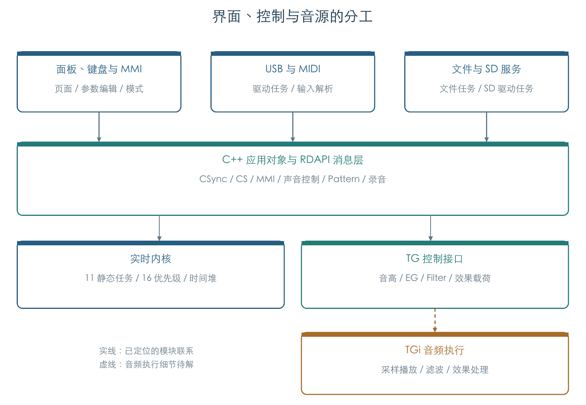

# KROSS 2 音源与系统研究

本轮研究已于 2026-11-02 结束。阅读[研究交接](../REVERSE_HANDOFF.md)与[按主题文档索引](INDEX.md)可快速定位成果。以下保留阶段研究记录。

当前统一报告：[10 页图文 PDF](../../output/pdf/KROSS2-v1.2.4-plugin-report.pdf) · [正文与证据索引](PLUGIN_REPORT.md)。正文按插件声音路径组织，旧架构报告保留为阶段 01 快照。

本轮范围（2026-11-02）：按插件用途提取逻辑，重点为采样、音源控制、滤波和效果。整机启动/内核/驱动、机内文件系统与录音等研究归档；具体条件见[插件交付范围](REVERSE_STATUS.md)。

[母带限制器的固定窗与地址区间](MASTER_LIMITER_KERNEL.md)恢复了 25 项量化 Hann 数值、两组相邻 25 地址单元区间和四处 MFX 字段修正。七槽初始化与 94 个原厂槽位的 564 次原回调通过，窗口保持原值。附原字、候选 FIR 响应、地址 CSV 和配图；窗口的具体音频作用、地址时序与完整限制器仍未确定。

[单音、连奏与滑音选样](MONO_LIVE.md)已完成 26 条真实预置轨迹、4160 次更新，核对 2514 次新建、778 次复用调音及 3292 次滑音初始化。Normal 保留原采样、力度、EG/LFO；Offset 重建，Unison 2/3/4/6 执行真实分发。48 次新建的滑音基准偏离目标，20 次改变区域选择，原查找使用滑音返回基准。附连续图、CSV 与输入指纹；TG 音频及多音色/发生器组合继续保留缺口。

[120 槽密集演奏](VOICE_PRESSURE.md)已完成 32 条轨迹、5632 次更新与 6481 次正常控制提交。12400 次候选调用逐次核对实际队列、缓存评分和活动位；6200 次活动抢占包含 6000 次立体声配对。三种旋律音色用满普通池，标准鼓组最高占用 117 槽，保留为对照。TG 启动/停止均用明确记录的即时响应，实际音频和 Mono/Unison 等组合继续保留缺口。

[压缩采样循环边界](PCM_LOOP_BOUNDARY.md)比较了 3406 个非单点区间的两种末端和两种历史候选。保留与恢复历史会产生不同 PCM；336 个原 ARM 点确认指定历史下的反馈算术。此项量化候选差异，未确定 TG 的循环时机与历史策略；不能把通过算术检查当作芯片循环已还原。附模型图、完整输入指纹与差异 CSV。

[资源分节实际导入](RESOURCE_IMPORT.md)已执行当前格式的 Program、鼓组和琶音记录读取、转换与连续放置。65 组检查和 64 组实际套件关联通过：Future Synth 的重复 45 号均连接第四套 Nu DISCO Kit；容量不足可只写前缀而返回成功，失败也可能保留已写记录。附实际放置图与两份 CSV；外层安装器预检、真实设备和音频不在本项结论内。

[四段 EQ 整链音频参考](EFFECT_EQ_AUDIO.md)已连接 331 组原厂系数的双通道静态级联，分块结果逐位一致，并与另一直接型及整链解析响应对照。附四种模式响应图和五段源弦乐试听，统一保留相对电平。此项属于主机参考；不另计为原 ARM 模块，B2 动态过渡、TG 舍入和原机音频比较继续保留缺口。

[附加计算省略验证](VOICE_AUXILIARY.md)已核对正常刷新中的两段状态：跳过计算且不提供附加绑定后，72 条换音/踏板/批次轨迹完成 6912 次更新、3380 次 TG 提交，其余状态与 I/O 保持一致。剩余原轮询对被省略区间读取为零。插件可省略这条受测路径中的两段计算；原始绑定来源留档，其他入口与实际音频不在此结论内。

[关音后的连续复用](MIDI_STOP_REUSE_LIVE.md)已把主机空节点适配接回换音、踏板和正常刷新。96 条轨迹全部完成 4608 次更新、1652 次 TG 提交；此前中断的 80 条走完，旧有 3008 次更新逐条保持一致。原指令的 304 次私有零页写入对应 152 次空摘除，主机省略后其余状态与 I/O 一致。附轨迹图与 CSV；耗尽抢占、Mono/Unison、发生器组合及实际音频继续验证。

前序最小复现：[停止后复用与主机适配](MIDI_STOP_REUSE.md)将失败缩到成对声部的重复空节点摘除：336 个最小用例中 120 个复现，排除了换音/调制的必要性。允许模拟零页写入时原起音可返回，但会清零 0/4。主机空节点适配的 24 组状态与 TG I/O 和原指令一致，副侧保留字段按原复制分支核对；产品未修改。真实零页映射仍待查，连续组合见上述后续。

[CC120/123 关音与复用](MIDI_ALL_OFF.md)已核对 1888 组状态与 96 条原轨迹：CC123 遵守踏板/鼓键释放设置，CC120 强停回收，两者保留控制器。共完成 3008 次更新、1340 次 TG 提交；16 条完成后续起音，80 条保留 CC120 后立体声伙伴的空链表复现。当时的未映射零页环境在复用处中断；原结果保留，后续主机适配验证见上文。

[合唱局部程序](CHORUS_PROGRAM.md)已将 106 项载荷接到七槽位原初始化，30528 个有效位变异通过。两个 MFX 槽位追加四处程序修正；三角/正弦选择、速率、延迟、深度、EQ 和干湿引用已有图示，309 个原厂槽位关联到对应程序。插值核、读写时序与完整音频继续保留缺口。

[CC121 控制器重置](MIDI_RESET.md)已完成 6848 组状态、40 条持续发声轨迹、2560 次更新和 1728 次 TG 提交。原路径保留按住的音符，按踏板及鼓键权限交接释音；CC7/10 缓冲恢复默认值，音量/声像缓存保持原值，Part 调音和逐键鼓组编辑也保留。附状态图与 CSV；CC120/123 控制已有上述后续；实际音频仍待完成。

[Hall 局部字段](HALL_LOCAL_OPERANDS.md)新增 121 项、七槽位及 3744 个有效位变异检查，恢复局部引用与两项 MFX 修正，附地址/衰减/阻尼的程序顺序图。索引 62/63 和具体音频运算仍未确定。

[换音持续刷新](MIDI_VOICE_REFRESH.md)已连接原 Part/通道绑定与控制器权限，72 条 MIDI 换音轨迹完成 6912 次更新、3380 次正常 TG 提交。旧声部保留来源，继续跟随共享弯音、音量与踏板，附控制轨迹图和 CSV；实际音频仍有缺口；两段附加计算已有上述省略验证。

[MIDI 换音装载](MIDI_PROGRAM_LOAD.md)新增从原 Program Change 到真实 Program/OSC、PCM 区域与鼓键映射的 3596 组检查，覆盖全部 768 原厂和 265 个 GM 源记录。活动 CC 保留、音色弯音归零、模式与 Part 权限分别比较；应用队列、未指定银行布局和持续声部仍待连接。

[连续换音声部](MIDI_VOICE_HANDOFF.md)已进一步连接原 MIDI 起音、换音、新起音和关音：864 条流程、3600 个声部通过，附来源保持图和 CSV。旧第二 OSC 在双转单后仍能关音；正常刷新、完整尾音与耗尽回收继续验证。

[扩展采样](EXPANSION_PCM.md)新增 797 个完整 WAV、原银行/立体声目录及 9728 组区域查询。17,387,114 帧与独立重建一致，原 ARM 反馈另核对 32272 点；Future Synth 附加区恢复为 45 条鼓采样目录。四套鼓组的十条跨库引用中，九条可达但缺少银行 6 来源，附图表单列。继续扩展完整声部和声音算法。

[GM 参数与发声](GM_PROGRAMS.md)已核实 265 条记录、原变体回退和九套鼓组的特殊低音区映射。4096 组银行转换、276130 个字段位置及旋律/鼓组真实采样启动通过，附两幅图。当前进度纠正了旧索引的“仅有名称”状态；名录差异、完整 MIDI 换音与音频缺口分别保留。

[鼓组逐键控制](DRUM_CONTROLS.md)新增原参数写入、独立声像/发送方程与持续刷新。42 套鼓组、72 个代表键配置完成 216 条轨迹和 11946 次 TG 提交，附两幅图。调音与滤波偏移在受测路径中于起音时保存；声像在正常刷新时读入变化。实际声像增益、滤波音频、包络时间修正及其他编辑回调继续保留缺口。

[鼓组发声](DRUM_VOICE_CHAIN.md)已接通全部 42 套原厂鼓组的资源、选层、参数、完整初始化及 TG 启动。682752 组选层、10642 组启动、271 组截音和 43 组松键通过，附两幅图与 CSV。两项独立增益修正、空键重映射、立体声目录及松键权限分别核对；两个被门槛遮住的存储层单列。持续刷新、逐键编辑、GM 映射、扩展银行和最终声音仍有缺口。

[正常声部刷新](VOICE_REFRESH.md)新增双游标、跨声部阶段顺序及原 TG 提交。72 条原厂代表轨迹完成 9216 次更新、4449 次提交；另有 1920 组标志/时间/差值边界通过独立打包方程，附两幅图和 CSV。两处附加参数绑定仍单列，受控变化检查未影响这些路径的音频写入。继续鼓组、扩展资源与芯片内音频算法。

[原厂真实声部链](FACTORY_VOICE_CHAIN.md)新增从原目录、选层、分配、实际采样区域到完整控制初始化与 TG 启动的连通。726 个旋律 Program、1315 个活跃 OSC 各一个范围中点上下文及 312 组边界通过；区域增益、副侧状态共享与反向能力已核对，附两幅图和两份 CSV。完整正常刷新及鼓组继续连接。

[踏板释放链](PEDAL_RELEASE_FLOW.md)已把原 OSC 请求接到分类、管理器、保持判断、Amp 释音与 TG 控制字，并验证下一次声部更新如何交接三类 EG。3456 组松键和十六条连续轨迹通过；十六个原厂辅助位 OSC 又完成 4096 次连续更新，附两幅图。真实采样参数装配及完整 TG 刷新继续连接。

[踏板包络](PEDAL_ENVELOPES.md)新增 CC64 动态释放缩放、辅助初始化与原请求消费。全部控制值和两张表已核对；十六个原厂辅助位 OSC 在两种受控运行态下完成 10240 次连续更新，附两幅图。管理器另一释放分支、真实参数装配和 TG 音频继续连接。

[三类主 EG](ENVELOPES.md)新增原起音、推进、保持、释放和重触发的独立状态模型，并与 LFO/Mixer/目标连接。3840 个参数位置、4608 个执行上下文及 12288 次原厂控制链更新通过，另有共享曲线、时间调制及连续轨迹检查，附两幅图。半踏板、辅助请求及 TG 音频仍待连接。

[七种 AMS Mixer](AMS_MIXERS.md)新增平滑、整形、量化和 Gate 的独立状态模型，全部 3072 块原厂参数已接入原 LFO、Mixer 和三个控制目标。原厂八个计数访问点共 12288 次更新、七条代表连续轨迹及各类边界通过，附三幅图。原 EG 连续状态与完整声部刷新继续连接。

[音源 LFO](VOICE_LFO.md)新增十八种波形、六种随机模式、Shape/Offset、自由/同步相位推进、Delay/Fade 和两路 AMS 输出。[原声部包装器](VOICE_LFO_INPUTS.md)进一步连接 Tone Adjust/控制器、两组频率 AMS、受控状态继承及两路交叉调制。全部 3072 块原厂存储参数经过原 getter 与包装器检查，共附五幅图；完整声部调度与最终音频仍待连接。

[三个 LFO 控制目标](LFO_TARGETS.md)继续连接原音高/采样步进、Filter A/B 与音量，恢复基础深度和 AMS 深度的不同淡入路径。1500 组矩阵、202 个曲线点、12288 次原厂更新及 9216 次代表连续更新通过，新增两幅图。EG/Mixer 状态在本实验中明确指定，最终音频仍待恢复。

音频算法新增：[四段参数 EQ](EFFECT_EQ.md)恢复全部频段的缩放、峰值/搁架方程、B2 调制端点及电平/干湿控制。660 组边界和原厂 331 个启用槽位通过，另以五组主机脉冲核对解析响应。[效果路由](EFFECT_ROUTING.md)已核对全部 768 个 Program 的原槽位分配和刷新，以及 IFX/MFX 的发送、返回、电平与切换顺序。继续常用效果算法和动态过渡。

[普通与母带限制器](EFFECT_LIMITERS.md)新增原参数到控制字的恢复、侧链 EQ 方程、释放系数表及共享调制来源的连续更新。661 个原厂启用槽位通过全部静态回调检查，另有 1728 组标量和 2808 组动态组合。检测器、预读和完整音频行为仍待恢复。

[立体声合唱](EFFECT_CHORUS.md)新增原延迟/Depth、LFO 自由和同步换算、湿声极性与中点补偿，以及全部 244 组前置 EQ 的一阶方程。309 个原厂槽位的初始化及静态回调通过；附三幅图及 CSV。完整延迟和 LFO 音频行为仍待恢复。

[Hall 混响](EFFECT_HALL.md)新增四段延迟地址与衰减表的对应、全部 400 项 RT60 公式、阻尼比例及八项 DSP 常数引用。425 个原厂启用槽位已执行原初始化及全部静态回调，附两幅图和单回路参考数据；完整扩散与耦合网络尚未恢复。

版本锁定：官方 v1.2.4，2026-11-01。[主报告](REPORT.md)与 [PDF](KROSS2-v1.2.4-architecture-report.pdf)为阶段 01 架构快照。

2026-11-02 新增：[步骤实际写入与歌曲副本同步](STEP_SEQUENCER.md)、[录制入口与歌曲音符](RECORDING.md)。原应用编辑提交链已接通；录制已从鼓轨进入队列，再由原消费者生成单小节歌曲音符，包含量化、重复同音配对及停止收尾。GUI 后续仅提取参数、事件与模式逻辑。

最新进展见[阶段 02：从 MIDI 音符到 PCM 声部](RUNTIME_FLOW.md)：恢复了力度交叉层、立体声配对、延迟启动、踏板、消息池及 CSync 回调计时器。原厂 726 个旋律 Program 的 167,005 次选层检查通过。[全系统状态表](REVERSE_STATUS.md)列出各模块尚待恢复的行为。

[阶段 03：声部参数构造](VOICE_PARAMETERS.md)已推进到普通素材区域查找、交叉权重缩放、反向/起始偏移和参数复制，640 组原指令检查通过。

阶段 03 后续：[完整声部初始化与 TG 命令](VOICE_TG.md)覆盖 32,768 组控制输入，连通采样地址打包、包络释放、立体声延迟启动及自动回收；[释放与踏板分析](VOICE_RELEASE.md)记录重复同音高组匹配和保持分支。

[失败路径分析](VOICE_FAILURES.md)新增 256 组预留槽归还检查，以及原参数构造遇到右侧键区缺失时的配对残留。扩展银行和重载失败的可达性仍待核对。

最新结果：[原厂左右键区](FACTORY_REGIONS.md)已由原代码生成目录并完成 63,488 次区域查找，七对板载旋律立体声未见单侧缺项；[声部复用与滑音](VOICE_REUSE.md)核对了双侧抢占、单音连奏入口和 6,144 组滑音初始化。

[单音优先级与松键回退](MONO_KEYS.md)新增 20,112 次按键/音色操作，确认十键记录与共享力度缓存；[Unison](UNISON.md)新增 20,000 组音高计算及 104 组完整控制初始化，并记录固件步进与手册音分示例的差异。

[阶段 04：音乐时钟与同步延迟](MUSIC_CLOCK.md)核对全部 26,001 个合法速度值，连通共享 tick、音源虚调用和声部等待队列。四段连续轨迹共 8,000 次访问，另有 279 组完整声部延迟初始化。

[外部 MIDI 时钟与来源切换](EXTERNAL_CLOCK.md)已核对 F8 的 20 tick 增量、端口筛选、Auto 超时恢复与声部等待，附接收图和连续轨迹。后续[传输命令与定位请求](MIDI_TRANSPORT.md)接通延后分发；[周期估算与速度读回](EXTERNAL_TEMPO.md)完成原 F8 消费者和细分时钟的 10000 次推进。轨道主体与回绕可达性继续检查。

[歌曲位置、拍号与速度轨](SEQUENCE_TIME.md)新增 48 种拍号、全部 16384 个 MIDI 定位值、事件游标和小节内变速检查，并记录转换入口的表长边界。

[序列器音符、时长与 MIDI 输出](SEQUENCE_NOTES.md)新增 8192 组音符检查，恢复每轨关音表、跨小节延音、满表替换与两路消息输出。

[控制事件与通道状态](SEQUENCE_CONTROLS.md)核对 6144 组 CC、全部 16384 个弯音值、Program/Bank 开关、跨轨位置比较与压力/弯音队列合并。

[轨道循环、前奏与跨圈关音](SEQUENCE_LOOPS.md)验证 1600 次定位和 192 次连续推进，核对前奏顺序、循环末尾关音及 16 条轨道的配置装配。

[序列器 SysEx 与参数消息](SEQUENCE_SYSEX.md)恢复七字节分块、固定参数消息、32 位值和路由例外，核对普通消息与循环游标的连通。

[参数缓存与应用队列](PARAMETER_CACHE.md)恢复 1609 个值槽、效果切换后的重放标志和事件合并规则；[参数出队与内存写入](PARAMETER_DISPATCH.md)完成双队列轮换、事件类型分派和三个原参数的 504 组回调检查。六个连续周期已将 SysEx 接到实际参数字段和新旧值通知。[歌曲副本同步](PARAMETER_NOTIFICATIONS.md)进一步覆盖 1728 组字段同步、192 组效果块复制和 84 组通知，确认播放参数写回歌曲的门槛。

[参数消息交接与同步回复](MESSAGE_REPLIES.md)已接通任务 2 与 MMI 的原队列、复制、回复和回收，完成八组任务交接及 240 组回复匹配检查。

[MMI 参数更新与延后处理](MMI_PARAMETERS.md)接通列表副本到操作码 9/24 回调，完成 192 组批次筛选和三组连续接收检查，确认延后期间保留同一参数的最早记录。

本阶段恢复应用入口、176 项初始化回调、11 项静态任务、6 项中断注册和实时调度关键原语。内核与 TOPPERS/JSP 的多处源码结构对应；确切发行版本仍待锁定。原 ARM 检查包括全部 65,535 个非空就绪位图、普通/回绕定时堆、消息队列、对象运行槽和 15,360 个 LCD 像素。

阶段 01 报告同时整理 USB/MIDI、UI/参数、存储/升级、PCM/TG/效果及琶音/鼓轨/步进/序列器，分别注明当时的证据深度。完整引导与 TGi DSP ISA 等历史缺口保留；后续完成条件以本页顶部的插件范围为准。

- [启动、任务与中断表](../../derived/firmware/KROSS2_V124/architecture/stage01/startup.json)
- [可查询符号与 RTTI](../../derived/firmware/KROSS2_V124/architecture/stage01/index.json) · [CSV](../../derived/firmware/KROSS2_V124/architecture/stage01/symbols.csv)
- [有界控制流](../../derived/firmware/KROSS2_V124/architecture/stage01/bounded-cfg.json) · [汇编证据](../../derived/firmware/KROSS2_V124/architecture/stage01/startup-scheduler.arm.txt)
- [结构体字段标注](../../derived/firmware/KROSS2_V124/architecture/stage01/structures.json) · [JSP 源码对应位置](../../derived/firmware/KROSS2_V124/architecture/stage01/rtos-correspondence.json)
- [本轮原 ARM 检查](../../derived/firmware/KROSS2_V124/architecture/stage01/arm-check.json) · [最终完整性检查](../../derived/firmware/KROSS2_V124/architecture/stage01/verification.json)
- [输入与输出指纹清单](../../derived/firmware/KROSS2_V124/architecture/stage01/manifest.json) · [外部原始资料](../../derived/firmware/KROSS2_V124/architecture/stage01/references/sources.json)

派生目录沿用仓库的忽略规则；代码索引和执行结果可按报告附录命令重建。引用包、起始保护清单与人工字段标注随本地研究保留。叙述、图、PDF 与脚本是本轮新增可审阅文件。产品代码、历史输入和验证基线不改写，不执行硬件动作。

图与 PDF 的生成器为 `research/tools/firmware_architecture_report.py`，需要 ReportLab、Pillow、pypdf、Poppler 及 macOS 宋体/黑体；Codex 随附的文档运行时提供前三项与 Poppler。用 `--pdftoppm` 指定渲染器位置。重新生成 PDF 后，`report-check.json` 的视觉检查状态会回到待检查，不能沿用上一版页面验收。

Fingered Portamento 的覆盖、前音门槛和缓存清除另有 184 组检查，见[声部复用与滑音](VOICE_REUSE.md)。下一步继续单音连续演奏、扩展素材失败路径、传输命令状态机和音乐事件消费者。各阶段的复现命令与函数边界见相应正文。
