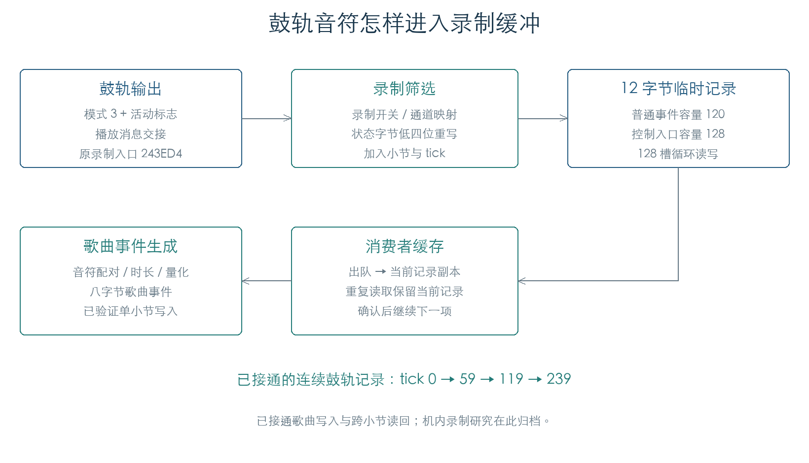
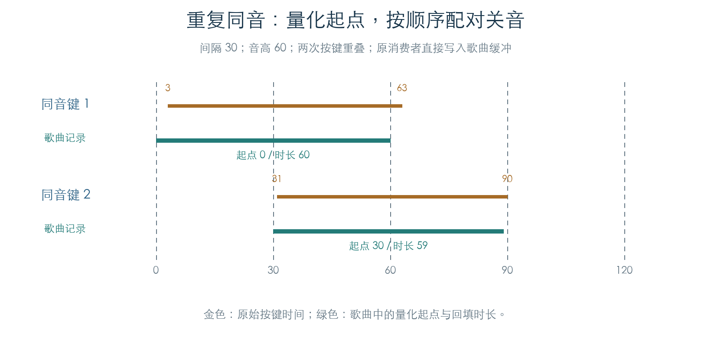
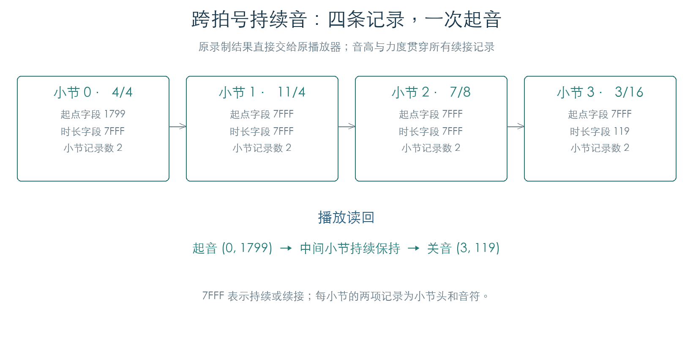

# 序列器录制：事件入口与歌曲音符

KROSS 2 v1.2.4 · 2026-11-02

录制入口先把 MIDI 信息和歌曲位置组成 12 字节临时记录，放入 128 槽环形队列。普通 MIDI 入口在 120 项时停止入队，内部控制入口可以使用余下八槽。鼓轨在 Sequencer 活动状态下同时提交播放消息与录制记录。

## 1 临时记录保存什么

`0x243ED4` 先检查录制标志 `C1714D11` 的位 0。标志开启后，用调用参数的通道替换原状态字节低四位，再查询通道到轨道的映射。映射值 16 表示跳过录制；0–15 继续进入原队列。

| 记录偏移 | 已验证内容 |
| --- | --- |
| `+00` | 状态字节：事件类别与通道 |
| `+01` | 第一数据字节，如音高或控制器编号 |
| `+02` | 第二数据值，保存为 16 位 |
| `+06` | 小节位置，16 位 |
| `+08` | 小节内 tick，16 位 |

其余字节在这个入口没有赋值，不能直接当成有效字段。该结构与[歌曲播放](SEQUENCE_NOTES.md)使用的八字节事件分开；后续消费者生成歌曲音符并回填时长，见第 5 节。

## 2 怎样防止时间倒退和队列覆盖

普通入队函数 `0x2435B4` 比较新事件与前一位置：先比较小节，再比较 tick。新位置较早时使用前一位置；另一个初始标志非零时也固定使用前一位置。比较使用有符号 16 位数，检查包含小节 −1、相等位置及前后边界。

队列位于 `C1714708`，每槽 12 字节；`+600` 为写索引，`+602` 为读索引，`+604` 为项目数。读写索引按 128 回绕。

| 入口 | 拒绝条件 | 返回行为 |
| --- | --- | --- |
| 普通 `2435B4` | 项目数达到 120 | 返回 0，缓冲不变 |
| 控制 `2434C8` | 项目数达到 128 | 返回 0，缓冲不变 |
| 两种入口的状态筛选 | 状态对象 `+14` 非零、`C171C3BE` 位 8 为零且记录类型不为 1 | 跳过写入，仍返回 1 |

因此返回 1 还需要结合状态判断，才能确认事件已入队。400 组矩阵逐字节比较整个队列和时间状态，覆盖两种状态位、120/128 边界、控制记录与普通音符。387 次连续操作进一步填满队列、取出、补入、跨索引边界并清空，取出顺序与独立 FIFO 完全相同。

## 3 队列满时怎样处理关音

录制入口发现普通队列已满时，会检查事件是否为 Note Off。若 `C1714D10` 位 0 为零，调用 `0x25BCB0(映射轨道, 音高)` 清理对应状态。该分支与前节的入队状态位分别判断；入队被状态筛选跳过时不会触发这个满队列分支。

2592 组检查覆盖录制开关、映射值、状态位、队列容量、Note On/Off/CC、三个通道及数据值，核对实际入队内容与清理调用。后续另有 16 组检查执行清理函数本体：匹配的 Note Off 释放第一个活动项，状态位为零时将已写音符时长置零；抑制标志、音高不匹配或力度为零的 Note On 均不触发此项清理。该满队列路径只查看状态类别，尚未经过消费者的零力度转换。

## 4 鼓轨怎样接入，以及消费者怎样取事件

原鼓轨输出 `0x244A60` 在模式 3 且活动标志开启时，将三字节 MIDI 信息交给播放待处理队列，再调用原录制入口。四个连续音符事件在 tick 0、59、119、239 进入真实全局录制队列；随后由原出队函数逐项取回，状态、音高、力度与时间一致。播放消息交接在边界截获。

消费者包装 `0x243410` 还缓存当前记录。首次读取会出队，并复制到 `C1714D14` 和 `C17146F4`；再次读取继续返回同一记录。调用 `0x242C60` 确认后，下一次才读取后续项。连续检查已验证该行为及空队列返回值。

## 5 从临时记录生成歌曲音符

原消费者 `0x25E944` 已接到队列入口。它映射轨道、量化起点，再调用 `0x25C428` 创建八字节音符；Note Off 或力度为零的 Note On 调用 `0x25C740`，更新此前记录的时长。底层追加、字段写入和读回均使用原指令。

| 歌曲音符偏移 | 内容 |
| --- | --- |
| `+00` | 类型 9 |
| `+02 / +03` | 音高 / 力度 |
| `+04` | 时长；尚未关音时为 `7FFF` |
| `+06` | 量化后的起点 tick |

本段给定有效的单小节轨道缓冲。原追加函数将写指针推进八字节，并增加小节事件数；追加下一小节头时，把事件数回填到前一个小节头。64 个音符的检查得到小节计数 65，包含一个小节头。

另一条连续检查把鼓轨输出、录制队列和歌曲消费者一次连接：tick 0/59 的鼓音 36 生成起点 0、时长 59 的记录；tick 119/239 的鼓音 38 生成起点 119、时长 120 的记录。完整 4096 字节轨道缓冲逐字节符合预期，队列与活动表均清空。

### 起点量化与时长分别计算

量化间隔为 `q` 时，普通正位置取最近的网格：`floor((tick + floor(q/2)) / q) × q`。恰好位于中点时向后取整。活动音符表同时保留原始起点；正常松键用原始松键时间减去原始起点计算时长，并限制到量化起点之后的剩余小节长度。

例如间隔 30，第一次同音键在 3 按下、63 松开，记录起点为 0、时长为 60；第二次在 31 按下、90 松开，记录起点为 30、时长为 59。两次关音按活动表顺序匹配各自的起音。4560 组检查覆盖十种间隔、多处中点、三种力度、零时长与小节末尾裁剪，同时核对整个轨道缓冲的未改动区域。

### 容量与停止收尾

每轨活动表有 64 项，空项以 `7FFD` 标记。第 65 次起音返回成功但不追加音符，也不替换已有项。连续检查先加入 65 次同音键，再松开 64 次，确认前 64 个事件按顺序获得时长，活动表清空。音高不匹配的松键保留原音符。

停止收尾辅助函数 `0x25BD58` 使用已存储的量化起点计算剩余时长，清除活动项。原始起点 123、量化起点 120、收尾位置 300 时，时长为 180。六种收尾位置覆盖提前、相等、正常及小节末尾，均与原写入一致。

## 6 跨小节持续音与播放读回

原跨小节入口 `0x25DDC0` 根据拍号表更新小节长度，为轨道和公共事件流追加小节头，再处理尚未松开的音符。首段的时长保留 `7FFF`，后续小节追加同音高、同力度的续接记录，位置字段也为 `7FFF`。松键时，将最后一段时长改为该小节内的持续时间。

1710 组检查覆盖全部 48 种拍号码、混合拍号、一至三次跨小节、三种量化间隔和多处关音边界。原结束辅助函数 `0x25C08C` 回填最后的小节计数，并向轨道与公共事件流追加类型 3 的结束记录。生成器未赋值的保留字节保存原始十六进制，不解释为参数。

其中 144 条录制结果直接送回原游标、活动轨道分派与关音管理器。每条轨迹只产生一次起音和一次最终关音，中间续接没有重复起音；结束后活动表和输出队列清空。本机 MIDI 输出在入口截获，未执行音源。

### 量化落到下一小节

若量化起点达到当前小节长度，原函数先将音符保存在活动表。跨小节后才生成起点为 0 的记录。原始按键间隔继续参与时长计算：1920 tick 小节中，1860 按下、下一小节 120 松开，保存为下一小节起点 0、时长 180；读回关音也位于该小节 180。

若在跨小节前已经松键，活动表另保留结束标志和时长，进入下一小节时生成完整的短音符。14 组边界检查同时核对保存内容与播放输出。

2026-11-02 范围调整：本章作为已完成的补充研究归档。机内录音、高级歌曲编辑及其事件池扩容不再继续深入；插件所需的音色、采样与音乐发生器逻辑保留。

## 证据与复现

- [检查脚本](../../tools/firmware_record_intake.py) · [机器结果](../../derived/firmware/KROSS2_V124/architecture/stage04/record-intake-check.json)
- [原队列与出队汇编](../../derived/firmware/KROSS2_V124/architecture/stage04/record-fifo.arm.txt) · [入队与时间约束](../../derived/firmware/KROSS2_V124/architecture/stage04/record-enqueue.arm.txt) · [MIDI 录制入口](../../derived/firmware/KROSS2_V124/architecture/stage04/record-midi-intake.arm.txt)
- [歌曲音符写入脚本](../../tools/firmware_record_notes.py) · [4560 组歌曲音符、容量和收尾结果](../../derived/firmware/KROSS2_V124/architecture/stage04/record-notes-check.json)
- [录制消费者汇编](../../derived/firmware/KROSS2_V124/architecture/stage04/record-consumer.arm.txt) · [音符创建与配对](../../derived/firmware/KROSS2_V124/architecture/stage04/record-note-pair.arm.txt) · [事件追加与小节计数](../../derived/firmware/KROSS2_V124/architecture/stage04/record-event-append.arm.txt)
- [跨小节检查脚本](../../tools/firmware_record_bars.py) · [1710 组录制与 144 条播放结果](../../derived/firmware/KROSS2_V124/architecture/stage04/record-bars-check.json)
- [小节推进](../../derived/firmware/KROSS2_V124/architecture/stage04/record-next-bar.arm.txt) · [持续音续接](../../derived/firmware/KROSS2_V124/architecture/stage04/record-held-continuation.arm.txt) · [录制结束](../../derived/firmware/KROSS2_V124/architecture/stage04/record-take-end.arm.txt)
- 复现：`python3 research/tools/firmware_record_intake.py --verify-arm`。

歌曲写入复现：`python3 research/tools/firmware_record_notes.py --verify-arm`。音符矩阵只截获临界区入口/出口，消费者与写入函数完整执行；鼓轨连续检查另截获播放消息交接。缓冲预先分配，不经过文件装载或扩容。队列入口检查另截获本机 MIDI 输出及满队列清理函数。OS 调度、真实歌曲文件和最终音源尚未参与。

跨小节复现：`python3 research/tools/firmware_record_bars.py --verify-arm`。临界区和播放时的本机 MIDI 入口为截获边界；音符写入、续接、结束记录与读回均执行原代码。
