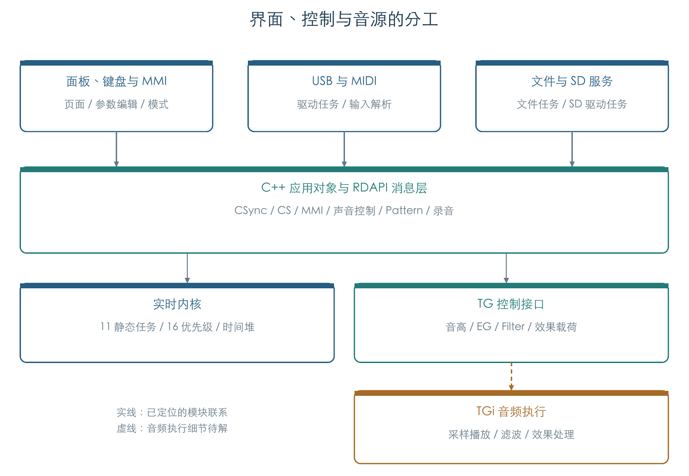
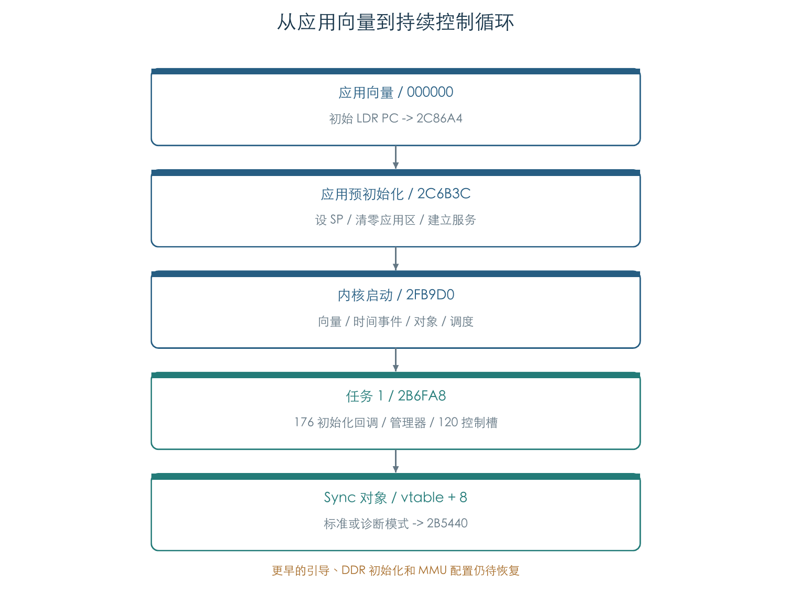
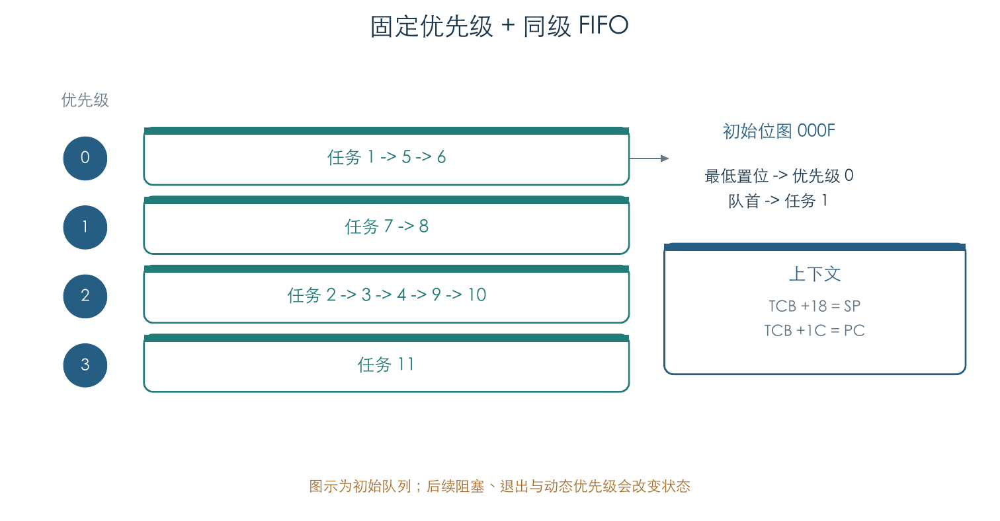
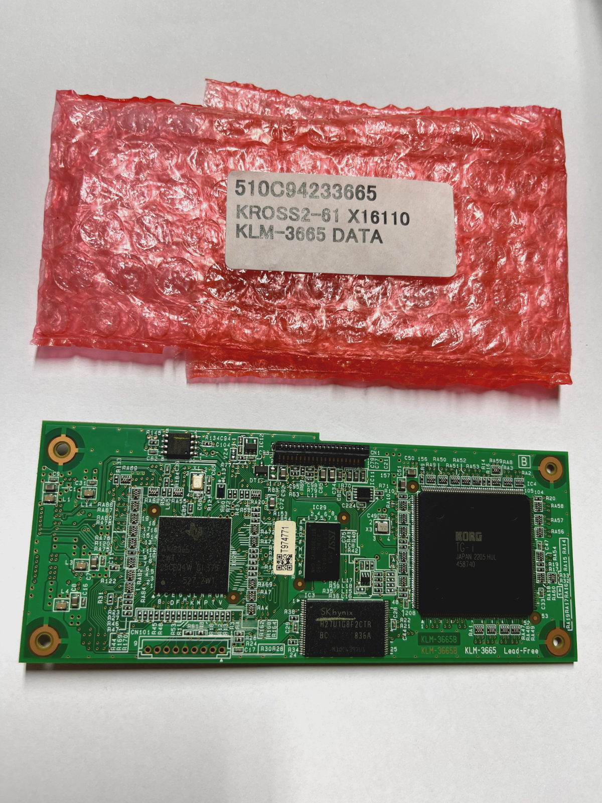
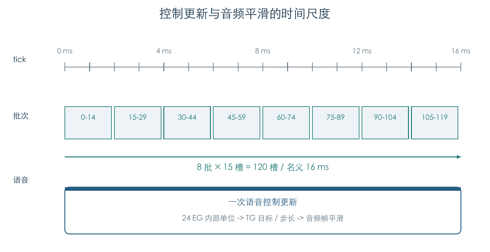
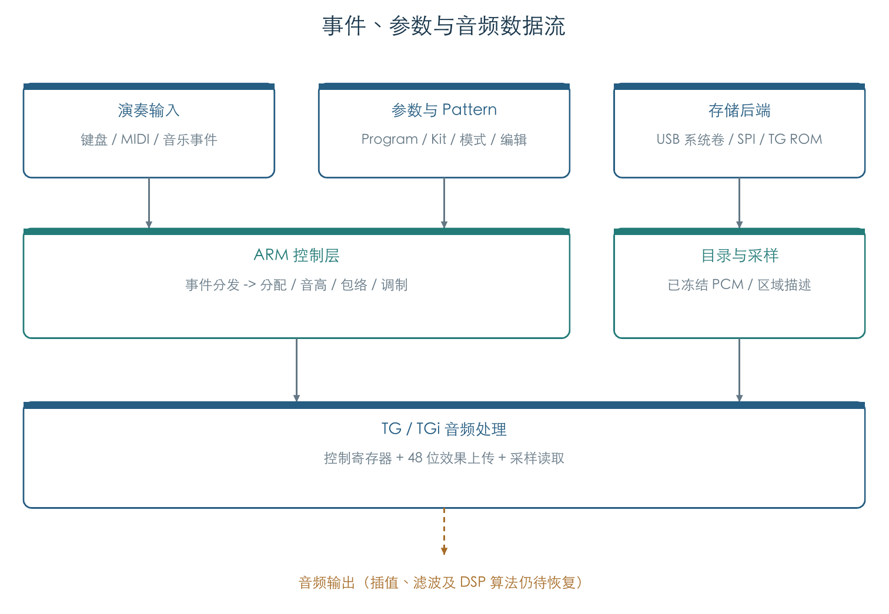

# KROSS 2 固件逆向报告

v1.2.4 · 2026-11-01

**摘要**　KROSS 2 由 ARM 应用和 TG 音源两部分协同工作。ARM 处理界面、演奏事件、存储和声音控制，TG 接收控制参数、采样数据及效果程序。固件配置了 11 个静态任务，采用固定优先级调度；内核结构与 TOPPERS/JSP 高度对应。系统任务先执行 176 项初始化回调，再进入持续控制循环。本文还整理了 MIDI 分发、240×64 显示缓冲、PCM 采样目录及效果上传格式。完整引导程序、音乐功能状态机和 TGi DSP 指令集仍待解析。

## 1 系统结构

KROSS 2 的软件可以分成三层：实时内核负责调度和计时；C++ 应用对象处理界面、音乐事件与文件；TG 接口向音源传送控制值和效果程序。USB、MIDI、文件系统和 SD 卡各有任务入口，声音控制则由系统任务中的 `CSync` 循环推进。[E1][E2]



一次演奏涉及两条数据流：音符、力度和音色参数进入 ARM 控制层，形成音高、包络、滤波等控制值；采样数据和效果程序供 TG 音频执行使用。下文依次说明这套系统如何启动、如何安排任务，以及各模块怎样传递数据。

## 2 启动与任务调度

### 2.1 应用如何启动

应用镜像开头有八项 ARM 异常向量。复位向量读取偏移 `0x20` 的地址，跳到 `0x2C86A4`；该入口设置栈指针，再调用 `0x2C6B3C`。后者清零约 17.48 MiB 内存，建立启动所需的服务和内存池，最后进入实时内核。[E2]



内核建立任务与调度结构后，首先运行任务 1。任务 1 顺序调用 176 个初始化入口，建立管理器和音源对象，然后根据模式选择 `CStandardSync` 或 `CDiagnosticSync`，进入共同的运行入口 `0x2B5440`。这说明 C++ 初始化回调由系统任务执行，持续控制循环也留在同一个任务中。[E2][E3]

```text
应用入口
    设置 SP = C22B5B90
    清零 [C0A00000, C1B7A464)
    初始化硬件相关服务与内存池
    启动内核

任务 1
    按顺序调用 176 个初始化入口
    建立管理器与音源对象
    选择标准或诊断 Sync 对象
    进入 CSync 运行循环
```

初始化表位于 `[0x482FD8, 0x483298)`。其中包含效果定义的全局构造函数：部分效果指针会在这些函数执行后才获得有效值。完整的上电、DDR 初始化、MMU 配置和应用装载还依赖更早的引导程序，这部分原件目前缺失。[E1][E5]

### 2.2 十一个静态任务

任务配置表位于 `0x459370`，每项 32 字节。11 个任务均设置自动激活属性，栈空间合计 117 KiB。下面的优先级采用内核内部编号，数值越小，越先获得执行机会。[E2][E3]

| ID | 入口偏移 | 初始内部优先级 | 栈 KiB | 已恢复职责 |
| --- | --- | --- | --- | --- |
| 1 | `2B6FA8` | 0 | 9 | 系统初始化，随后进入 CSync |
| 2 | `04A38C` | 2 | 18 | CS 处理；tcs.cpp 路径佐证 |
| 3 | `14D75C` | 2 | 18 | 标准/诊断 MMI 对象主循环 |
| 4 | `0CDE1C` | 2 | 9 | 文件系统服务 |
| 5 | `2CC864` | 0 | 9 | CUsbDrv 设备驱动循环 |
| 6 | `2CCD08` | 0 | 9 | CUsbMIDIIn 输入循环 |
| 7 | `26C128` | 1 | 9 | SDCardDriverTask |
| 8 | `01BB10` | 1 | 9 | 诊断音频 I/O；受模式条件控制 |
| 9 | `01BDD0` | 2 | 9 | SosProcess；受模式条件控制 |
| 10 | `01BCC4` | 2 | 9 | SosMainCtrl；受模式条件控制 |
| 11 | `01BC2C` | 3 | 9 | 周期性音频回调；完整语义待恢复 |

这是启动时的配置。运行过程中，任务可以阻塞、退出或调整优先级；部分音频任务还会根据工作模式直接返回。任务 1 的 `CSync` 循环也会调用优先级调整接口。

### 2.3 调度器怎样选择任务

内核为 16 个优先级分别维护双向循环队列。任务进入就绪状态时追加到对应队尾；调度器从就绪位图中找出编号最小的有效优先级，再选择该队列的队首。启动后的首个选中任务为任务 1。[E2]



任务切换时，汇编代码保存 r4-r11、LR、栈指针和继续执行的地址，再恢复选中任务。没有可运行任务时，处理器切换到独立栈，等待中断。IRQ 返回前会检查是否需要换入其他任务。[E2]

任务控制块（TCB）占 32 字节，记录运行状态和恢复执行所需的信息：

| TCB 偏移 | 字段的工作名称 | 证据 |
| --- | --- | --- |
| `+00 / +04` | 双链任务队列 next / prev | 插入与移除指令 |
| `+08` | TINIB 指针 | 初始化与激活函数 |
| `+0C` | 任务状态字节 | runnable 写入 1 |
| `+0D` | 当前内部优先级 | 就绪队列选择 |
| `+0E` | 激活/唤醒/异常相关标志 | 位操作；具体名字参考 JSP |
| `+10 / +14` | 待处理异常 / 等待信息指针 | 异常与超时调用链 |
| `+18 / +1C` | 保存的 SP / 续执行 PC | 汇编上下文切换 |

### 2.4 内核来源

任务初始化顺序、配置表布局、激活栈结构、上下文切换汇编和定时事件堆，都与 TOPPERS/JSP 官方源码对应。这些证据支持将固件内核归入 TOPPERS/JSP 实现家族。[E6]

| 固件入口或结构 | 官方源码的对应行为 |
| --- | --- |
| `0x2FB9D0` | CPU/系统初始化、时间事件、对象、初始化例程、启动调度的顺序 |
| `0x2FBB98` | torder 表驱动 TCB 初始化；TA_ACT 激活任务 |
| 32 字节 TINIB | 属性、exinf、任务入口、初始优先级、栈长、栈址、异常属性与入口 |
| `0x2FBCE0` | 从栈顶依次压入 task 和 exinf，设置 activate_r |
| `0x2FCD30` | 保存 r4-r11/LR、SP 与续执行 PC；恢复选中任务 |
| `0x2FD724` | 16 位就绪位图按最低置位搜索优先级 |
| `0x2FD58C / 0x2FBD5C` | 定时事件最小堆；相对当前时刻处理 32 位回绕 |

本研究使用 JSP 1.4.4.1 源码作比对样本。固件的确切内核版本和 KORG 修改范围尚待多版本比较。TOPPERS 官方将 JSP 定义为符合 μITRON 4.0 的实时内核。[R2]

## 3 中断、计时与任务通信

### 3.1 设备中断

内核启动时保存原有异常向量，清空 101 项中断处理表，再把 IRQ 向量中的地址常量改为 VA `0xC02FCB30`。IRQ 入口读取寄存器 `0xFFFEE904` 获取中断号，调用对应处理函数，最后检查是否切换任务。[E2][E3]

静态中断注册表位于 `0x459260`，共六项。其编号与 TI OMAP-L138 文档的对应关系如下：[R3]

| 中断 ID | 固件处理入口 | TI 对照名称 |
| --- | --- | --- |
| 11 | `1169B8` | EDMA3_0_CC0_INT0 |
| 16 | `116FB8` | MMCSD0_INT0 |
| 21 | `117064` | Timer0 TINT12 |
| 53 | `116EB8` | UART1 |
| 58 | `117260` | USB0 |
| 68 | `1171C8` | Timer2 combined |

软件中的 OmapL108/OmapL137 驱动名，以及定时器和中断控制器地址，共同指向 TI OMAP-L1x 平台家族。公开板卡照片可见 KLM-3665B 和 KORG TGi；主控完整料号、工作频率与 RAM 容量仍需进一步确认。[E4]



### 3.2 定时事件与声音控制周期

内核用最小堆管理定时事件。每个节点保存截止时间和事件指针，事件对象保存回调、参数及自身在堆中的位置。插入、删除后重新调整堆；每次 tick 取出到期事件并调用回调。时间比较采用相对当前时刻的无符号差值，能处理计数器临近 32 位回绕的情况。[E2][E6]

声音控制采用分批更新：每批处理 15 个槽，8 批覆盖 120 个槽。已有执行记录确认了这些批次参数及 Timer0 周期值 24000。若定时器输入为参考平台的 24 MHz，则 tick 为 1 ms，每批间隔 2 ms，全部控制槽更新一轮为 16 ms。这里的时间值依赖时钟假设，尚无实机频率和抖动测量。[E7][R4]



单个控制槽每轮推进 24 个包络内部时间单位。按名义 16 ms 周期换算，每秒推进 1500 个单位。ARM 将新的目标值和步长交给 TG，TG 再跨音频帧平滑处理；因此控制更新周期与音频采样周期可以分别设置。

### 3.3 任务怎样传消息

内核静态配置了 2 个信号量和 13 个事件标志。应用通过 `RDAPI/cosglue.cpp` 包装层组织消息队列、超时目标和消息池。[E2][E3]

消息入队函数 `0x2CD7AC` 把节点追加到队尾，出队函数 `0x2CD7F4` 取出队首，空队列返回零。定时等待分两步：`0x2CD6D0` 设置目标时刻，`0x2CD704` 计算剩余时间并进入内核等待。队列的基本行为已经验证，CSync、CS 与 MMI 之间的具体消息字段仍待恢复。

## 4 界面、显示与参数

### 4.1 页面运行框架

任务 3 根据模式建立 `CStandardMMI` 或 `CDiagnosticMMI`。两个对象的虚表 `+8` 均指向运行入口 `0x143B30`，表明它们共享 MMI 主循环，通过其他虚函数实现模式差异。六组 Sync、MMI、USB 对象的构造指针与运行槽已经逐项核对。[E2][E3]

镜像中的类型信息和源码路径显示了页面、参数编辑单元、弹窗、编码器、按键保持和双击计时器等组件。`pageglobal`、`pageseq`、`pagestepseq` 分别提供全局设置、序列器和步进页面的定位线索。页面切换与焦点管理的完整规则尚待逐页解析。

### 4.2 显示缓冲格式

软件显示缓冲为 240×64、每像素 1 bit，共 1920 字节。图像逐行排列，每行 30 字节，每个字节从最高位开始读取。像素 getter 位于 `0x2C6CD4`，通过 VA `0xC104751C` 取得缓冲指针，并反相返回像素位。[E2]

```text
位索引 = x + 240 × y
字节   = framebuffer[位索引 >> 3]
掩码   = 0x80 >> (位索引 & 7)
像素值 = 0（该位置位）或 1（该位清零）
```

全部 15,360 个像素的寻址和极性已用合成缓冲验证。这为后续重建屏幕内容提供了直接依据；物理 LCD 总线的传输顺序还需分析驱动。[E3]

### 4.3 参数如何连接界面与音源

界面与声音控制共用参数元数据。一个参数描述符占 20 字节，保存类型、显示格式、位移、位宽、标志、上下限和回调；参数单元另存数据地址与描述符地址。显示格式决定数值怎样呈现，位移和位宽决定数值怎样从数据中取出。[E1][E8]

Program 参数命名空间的指针表位于 `0x407BD0`，整数 getter 位于 `0x20AF84`。已有研究恢复了 A-F 共 768 个 Program 的参数和效果设置。USB 备份另有 265 条 GM 原始记录，其完整字段和选样映射仍待验证。[E5][E8]

## 5 MIDI 与 USB

### 5.1 从字节到命令

USB 设备驱动和 USB MIDI 输入分别运行在任务 5、6。输入进入上层后，由 SysEx 字节解析器 `0x2C2E90` 组装消息，再交给 `0x2C11A0` 分发。已有离线检查确认了型号头校验、Exclusive 开关检查、`0x72` 请求族的 29 项跳转表，以及 `0x73` 信息返回族。[E2][E9]



其中 `72/14` 返回银行信息，`72/15` 返回名称信息。名称记录含索引、24 字节名称和标志，可用于恢复音色与采样目录。[E9]

### 5.2 诊断读取

PCM 诊断通过固定位置抽样检查数据，每个 half 读取 65,791 个位置，向外返回校验状态。既有合成执行核对了 328,955 次地址访问。当前保存的低 64 MiB ROM 来自此前单独完成的采集流程。[E9][E10]

普通音符和控制器消息到声部分配器的完整路线、其余 SysEx 命令、USB 端点状态机及 USB 音频流，是通信部分的主要未解内容。

## 6 存储、文件格式与更新

### 6.1 存储分工

固件访问三类存储：USB 可见系统卷保存应用和部分参数文件；SPI SerialFlash 提供引导相关数据；TG 存储接口用于采样区域。[E5]

| 后端 | 已有证据 | 当前缺口 |
| --- | --- | --- |
| USB 可见系统卷 | FAT16 镜像、KROSSAPP.BIN、Program/Pad 文件 | 卷外设备布局、所有文件语义 |
| SPI SerialFlash | 03 命令、三字节地址、64 KiB 块读取；引导逻辑长度 128 KiB | 完整引导原件、实际器件容量和复位流程 |
| TG 存储 | 256 KiB 块接口、低 64 MiB 已冻结 ROM | 其余物理区域和所有扩展存储拓扑 |

USB 镜像的逻辑扇区为 2048 字节，文件按 FAT 链恢复。BPB 声明的卷末端与实际镜像长度存在差异，现有分析以实际取得的字节为限。

### 6.2 容器与加密

官方应用使用 CMP 容器。头部记录解压长度和结果字节和，正文采用 4096 字节环形字典的 LZSS 压缩。v1.2.4 解压后为 6 MiB，压缩输入全部消耗，结果字节和为 `32D233DF`。[E1]

KEP 使用带特定字节序处理的 Blowfish；密钥选择、工厂密钥生成和加解密入口已有原 ARM 对照。USB 备份中的 KSB0 则以长度和字节和描述封装内容。[E1][E5]

### 6.3 更新路径

`BOOTSYS.BIN` 与 `KROSSPCM.BIN` 出现在更新加载和编程调用链中。这部分研究已定位相关读取、写入与校验入口。完整升级状态机、掉电恢复、版本回退及认证机制，还需要结合引导程序继续分析。[E5]

## 7 采样音源与效果

### 7.1 采样目录与解码

已取得的 TG ROM 覆盖低 64 MiB，目录包含 496 个音乐 multisample 和 1014 个 drumsample，已导出 4068 个音乐样本及 2 个诊断样本。固件另有一张 497 项 ROM multisample 元数据表；两张表的收录范围不同，仍需逐项对齐。[E8][E10]

采样重建公式使用两个历史值、两个有符号系数和一张 256 项残差表。饱和边界与负数截断已通过原 ARM 指令核对，所执行的代码来自编码器反馈重建路径。TG 播放时的插值、滤波和混音实现还需单独恢复。[E1]

### 7.2 声音控制

系统任务的 `CSync_run` 经 `0x271324` 推进音源对象。PCM voice manager 配置了 120 个控制槽，并按前述 15 槽一批的方式更新。实际可用复音数还受音色结构和分配规则影响。[E7]

已经恢复的控制计算包括音高指数步进、力度、键盘跟踪、AMS Mixer、振幅包络、滤波包络、截止频率和共振。Concert 合成上下文的 32,512 项初始与释放条件，以及多组轨迹和边界检查，为这些公式提供了执行证据。[E7][E8]

下一步需要接通音符到控制槽的分配过程，查明抢占、复用、持续音、踏板和鼓组独占组如何改变声部状态。这将把已恢复的单项控制计算串成完整演奏过程。

### 7.3 效果定义与程序上传

效果目录包含 135 项定义、2269 个参数，以及按字节去重后的 117 份代码载荷。13 项效果的代码指针由启动构造函数填写。已有加载器对照覆盖全部 135 项，getter 对照执行了 9076 次。[E1][E8]

每个 DSP 代码单元在镜像中占 8 字节。上传器依次读取偏移 0、6、4 的三个 16 位值，写入 TG `+718/+714/+710`，实际传送 48 位。常数通过 `+73C/+738` 传送 32 位。[E4]

至此可以定位效果参数和程序载荷，并复现上传格式。恢复效果音频算法还需要解出 DSP 指令集、执行时序、累加器宽度和延迟内存布局。

## 8 琶音、序列器、录音与诊断

### 8.1 音乐功能

固件保留了 `arpeggiator`、`seqpr`、`seqedit`、`pageseq`、`pagestepseq` 等源码路径，以及 `CArpeggioPatternArray`、模式转换器和资源加载对象。由此可以定位琶音、序列器、步进器及其编辑界面。[E2]

这些模块的下一步分析对象如下：

| 功能 | 需要接通的数据与行为 |
| --- | --- |
| 琶音 | 按键集合、Pattern 步、时值、力度与同步时钟 |
| 鼓轨 | 预置 Pattern、启动条件、Program 与鼓组选择 |
| 步进器 | 16 步编辑状态与逐步输出事件 |
| 序列器 | 轨道、tick、循环、录制及文件事件 |

当前证据主要落在对象、资源和页面入口，播放状态机尚未完整恢复。

### 8.2 音频录制

`SosMainCtrl`、`SosProcess` 和周期性音频回调对应任务 9-11，诊断音频 I/O 对应任务 8。入口已经确认，音频缓冲如何在 DMA、USB 和 SD 写入之间流转仍待追踪。已有 PCM 素材可支持文件层分析，实时录放过程还需要恢复回调关系。[E2][E5]

### 8.3 诊断与错误处理

模式检测决定系统创建标准或诊断版本的 Sync、MMI 和音频对象。错误处理入口 `0x2C5220` 记录错误 ID、任务 ID、源码行号和路径，再显示错误信息。保留在镜像中的这些路径，也是定位模块的重要线索。[E2]

## 9 研究结果与未解问题

应用启动、静态任务表和调度原语已经形成连续的解释：内核建立任务，任务 1 完成 C++ 初始化并进入声音控制循环，其他任务处理界面、通信和存储。参数、采样及效果研究也由此获得了明确的运行位置。

目前的主要缺口集中在三处：应用加载之前的引导流程、音乐事件到声部分配的完整状态机，以及 TGi 内部音频执行。下面列出可继续追踪的入口和检验方法。

| 优先级 | 精确问题 | 现有入口与验收方式 |
| --- | --- | --- |
| 1 | CSync、CS、MMI 之间消息字段和唤醒条件 | `2B5440/04A38C/143B30`；构造离线事件，核对队列与回调 |
| 1 | 普通 MIDI note/CC 到 voice assignment 的完整链 | `2C11A0` 与 pcmvoice；事件到语音槽的差分轨迹 |
| 1 | 120 个控制槽的分配、抢占与复用 | voice manager / cpvmasgn.cpp；合成多音与释放序列 |
| 2 | 琶音/鼓轨/步进的时钟与事件转换 | arpeggiator、seqpr 和页对象；逐步事件预期 |
| 2 | USB 音频、SosProcess 与 DMA 缓冲关联 | ID 11 中断、任务 9-11；静态闭合后才隔离执行 |
| 2 | 文件系统请求到后端 I/O 的消息结构 | 任务 4/7、CUsbDrv；仿真内存盘和错误注入 |
| 3 | 引导器、MMU 与升级验证完整链 | 缺失引导原件；先整理现有备份及官方资料 |
| 3 | TGi DSP ISA 与最小音频算子 | 48 位载荷及上传器；优先找可证明的单算子语义 |

## 附录 A 数据与验证方法

### A.1 输入与地址约定

分析使用官方 v1.2.4 应用 `KROSSAPP.bin`、此前取得的 TG 低 64 MiB ROM 和 125 MiB USB 备份。应用长度为 6,291,456 字节，虚拟装载基址为 `0xC0000000`。正文代码地址默认表示应用文件偏移，带 VA 的地址表示运行时虚拟地址。[E1][E5][E10]

主要运行时地址如下：

| 地址或区间（VA） | 当前解释 | 依据 |
| --- | --- | --- |
| `C0000000..C0600000` | 6 MiB 应用镜像装载区 | 镜像长度与代码指针 |
| `C0A00000..C1B7A464` | 应用启动清零区，末端不含 | `0x2C6B40..0x2C6B5C` |
| `C1B5CA7C..C1B79E7C` | 11 个静态任务的连续栈区 | 任务配置表；共 117 KiB |
| `C1B79EF4` | TCB 表首址，每项 32 字节 | 任务初始化与 get_tid |
| `C1B7A31C` | 16 个优先级的双链就绪队列 | 初始化循环与调度搜索 |
| `C1B7A3A0 / C1B7A3A8` | 当前任务 / 选中任务指针 | 保存及恢复上下文 |
| `C22B5B90 / C22B9B8C` | 应用入口栈顶 / 空闲与中断路径栈址 | 直接装载 SP 的常量 |

清零区精确长度为 18,326,628 字节，静态任务栈位于其中。以上均为程序使用的虚拟地址，物理内存布局仍待确认。

完整输入 SHA256：

```text
ARM  3005f0eca3f3772bcb810c526ceebb15562747d3cdcdf5d20faae4a539520c54
ROM  c9d4c9b4dd0f915b45a553e6b66d2cab7e51b80f4b2189fb6db4d91b1ccc94a5
USB  6cd9b98ca73626535106418bef26c12fa2ae361b92376ab73e958e23ae30c378
```

### A.2 分析方法

静态分析先核对输入哈希，再解析向量、配置表和直接分支；从已知入口遍历控制流，单独记录虚调用、尾分支和未解析出口。索引现有 541 个命名入口，其中 77 个为本阶段新增；另含 675 项 RTTI 候选、666 张主虚表候选和 660 个有界代码作用域。索引数量用于定位代码，函数的语义恢复程度仍按各项证据评估。[E2]

动态检查通过 Unicorn 在私有内存中执行选定的原 ARM 函数，并与独立计算结果比较。执行范围限于下表；应用复位、内核主入口、实际任务体和设备 IRQ 保持静态分析，复杂基类及定时回调在边界处截获。工具版本为 Capstone 5.0.7、Unicorn 2.1.4。[E3]

### A.3 验证结果

| 检查 | 执行范围 | 结果与边界 |
| --- | --- | --- |
| 输入与静态表 | 官方应用哈希、8 向量、11 任务、176 构造、6 中断 | 通过；版本锁定 |
| 向量安装 | 私有低地址页、101 项表清零、IRQ literal 更新 | 通过；未触发 IRQ |
| 任务初始化 | TCB、初始栈、FIFO 组、首个选中任务 | 11 项通过；未执行任务体 |
| 位图搜索 | 1..65535 全部非空 16 位位图 | 全部一致；不覆盖全部抢占时序 |
| 内核 IPC 初始化 | 2 信号量、13 事件标志 | 通过；未穷举等待竞争 |
| 定时最小堆 | 两个时钟基点，各 9 插入/3 删除/32 tick | 通过；含临近回绕与同期限事件 |
| RDAPI 消息队列 | 7 项 FIFO 与空队列 | 通过；不含多任务竞争 |
| 对象运行槽 | Sync、MMI、USB 的 6 组构造/vptr/运行入口 | 通过；复杂基类已截获 |
| LCD 寻址 | 240×64 全部内部像素 | 15,360 项一致；验证寻址和极性 |

位图搜索逐项覆盖全部 65,535 个非空输入。时间堆分别从 0 和 `0xFFFFFFF0` 开始，各插入 9 项、删除 3 项并推进 32 tick，检查堆索引、触发时间和回调参数。同期限事件检查是否按时触发，未要求固定先后顺序。

音源、滤波、采样和效果部分引用此前保存的执行结果，本阶段核对其文件与固件版本身份。全套系统启动、硬件响应、真实抢占时序和实机音频一致性尚未验证。研究过程使用离线文件与私有模拟内存。

## 附录 B 复现与文件索引

在项目根目录运行以下命令。原 ARM 检查需要支持 Unicorn JIT 的环境。

```sh
python3 research/tools/firmware_architecture_index.py
python3 research/tools/firmware_architecture_verify_arm.py
python3 research/tools/firmware_architecture_verify.py
```

查询符号或指定入口：

```sh
python3 research/tools/firmware_architecture_index.py --query CStandardSync
python3 research/tools/firmware_architecture_index.py --entry 0x2fbb98 --bytes 0x100
```

派生数据位于 `research/derived/firmware/KROSS2_V124/architecture/stage01/`：

| 文件 | 内容 |
| --- | --- |
| `startup.json` | 启动、任务与中断配置 |
| `index.json` / `symbols.csv` | 符号、类型信息及可导入索引 |
| `bounded-cfg.json` | 已遍历的控制流与未解析出口 |
| `structures.json` | 结构体字段标注 |
| `rtos-correspondence.json` | 固件与 JSP 源码对应位置 |
| `arm-check.json` / `static-check.json` | 原指令执行与静态检查结果 |
| `verification.json` / `manifest.json` | 完整性检查与文件指纹 |

## 证据索引与参考资料

E2、E3 为本阶段新增分析，其余 E 项为既有研究材料。路径均相对项目根目录。

- **E1** `research/docs/FIRMWARE.md`、`FIRMWARE_MAP.md`；官方镜像、容器、参数和效果索引。
- **E2** `research/derived/firmware/KROSS2_V124/architecture/stage01/{startup,index,bounded-cfg,static-check}.json` 与 `startup-scheduler.arm.txt`；本阶段静态结构。
- **E3** 同阶段 `arm-check.json`；本阶段 8 组隔离执行检查，源脚本 `research/tools/firmware_architecture_verify_arm.py`。
- **E4** `research/docs/HARDWARE.md`、`research/derived/verification/dsp-transport.json`、`research/assets.json`；芯片照片及上传证据。
- **E5** `research/docs/USB_BACKUP_ANALYSIS.md`、`research/derived/acquisitions/KROSS2_local_20261101-022845/`；USB 文件与 SPI 读取研究。
- **E6** 本阶段 `references/jsp-1.4.4.1/`；官方源码比较，重点 `kernel/task.{c,h}`、`time_event.c`、`startup.c`、`config/armv4/cpu_support.S`。
- **E7** `research/docs/VOICE_TIMING.md`、`research/derived/verification/voice-timing-arm-comparison.json`；既有调度参数与 TG 平滑检查。
- **E8** `research/docs/FACTORY_SOUNDS.md`、`VOICE_CONTROL.md`、`FILTER_CONTROL.md`、`ROM_DECODING.md` 与对应历史验证；音源控制和资源证据。
- **E9** `research/docs/ROM_MIDI_DISPATCH.md`、固件 `rom/dispatch/dispatch-check-arm.json`；历史协议与校验执行。
- **E10** `research/docs/ROM_ACQUISITION.md`、`research/RESOURCES.md`、`research/docs/PROGRESS.md`；当前资源与历史采集边界。
- **R1** [KORG 官方 KROSS System Updater](https://www.korg.com/us/support/download/software/0/754/3833/)。本文实际输入固定为 v1.2.4。
- **R2** [TOPPERS/JSP 官方说明](https://www.toppers.jp/en/jsp-kernel.html)与[官方源码下载目录](https://toppers.jp/jsp-download.html)。源码比对包版本为 1.4.4.1。
- **R3** [TI OMAP-L138 数据手册 SPRS586J](https://www.ti.com/lit/ds/symlink/omap-l138.pdf)，2017-01 修订；用于中断 ID/MMIO 对照。
- **R4** [TI Timer64 表](https://downloads.ti.com/dsps/dsps_public_sw/sdo_sb/targetcontent/tirtos/1_21_00_09/exports/docs/products/bios_6_37_00_20/docs/cdoc/ti/sysbios/timers/timer64/doc-files/TimerTables.html)；用于名义时钟估算。
- **R5** [KLM-3665B 卖家原图页面](https://www.ebay.com/itm/156522112587)；本地照片 SHA 见资产登记。

公开资料查阅日期：2026-11-01。
