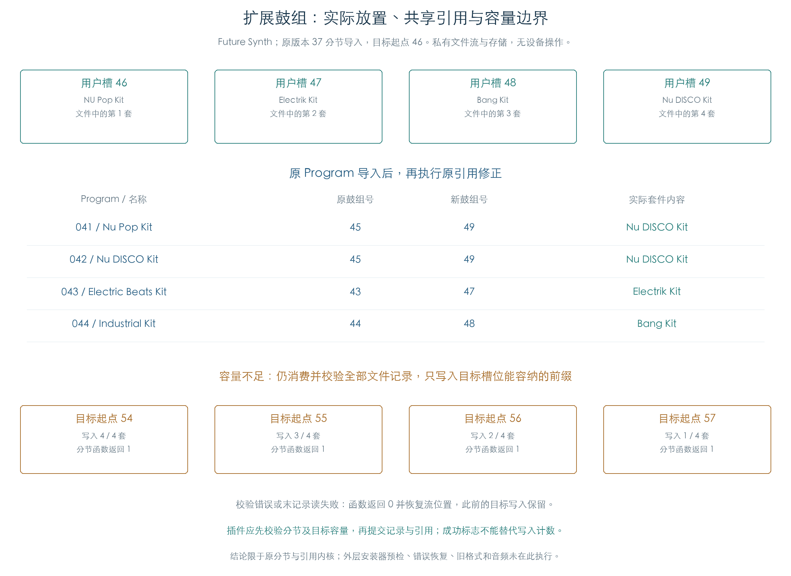

# 扩展资源的实际放置与导入边界

KROSS 2 v1.2.4 · Program、Drum Kit 与琶音分节 · 2026-11-02

原分节导入函数按文件顺序向目标槽连续写入。Future Synth 的四套鼓组及导入后的 Program 已接到原重编号函数，确认两个 45 号引用继续共享第四套 `Nu DISCO Kit`。文件名或 Program 名称不会重新分配套件。

容量不足时，分节函数仍可能返回成功，只写入能容纳的前缀。校验失败或最后一条记录读失败时，已完成的目标写入也保留。插件需要分别检查校验、容量和实际写入数量，再提交资源与引用。



## 1 原分节函数做了什么

`1F32C0` 读取 32 字节头，核对类型，逐条读取、转换、写入并累计校验和。当前三套扩展均使用格式号 37；原类型适配、格式转换器及转换工厂初始化均实际执行。

| 分节 | 文件记录步长 | 当前内部记录 | 本轮目的地 |
| --- | ---: | ---: | --- |
| `1KBP` Program | 2144 | 2140 | 用户银行 6 或 9；允许延续至银行 9 |
| `1KBD` Drum Kit | 8728 | 8728 | 用户银行 1，索引 0–15，对应鼓组号 42–57 |
| `1KBA` 琶音 Pattern | 552 | 552 | 用户银行 1，索引 0–255 |

Program 文件记录多出的四字节属于对齐部分。读取与校验包括完整 2144 字节，当前转换后的目标仅写 2140 字节；前后保护区保持原值。其他两种当前记录无需这段尾部对齐。

目标索引到达银行容量后归零，银行号加一。超出调用者给定的末银行后，后续记录继续读取、累计校验和，停止向目标写入。原 `2A6A6C` 容量查询未替换。

此内核不核对头中“声明载荷字节数”与记录总长是否相等。将声明值增加八字节、保持记录和校验不变，三种分节都仍成功；完整容器解析必须在选择分节时核对该字段。

## 2 Future Synth 的实际套件关联

四套鼓组的原文件顺序为 `NU Pop Kit、Electrik Kit、Bang Kit、Nu DISCO Kit`。在目标起点 46 的受测调用中，它们分别写到 46、47、48、49。

再将原导入器实际写出的 64 个 Program，交给[原引用修正函数](PROGRAM_RELOCATION.md)。其中四个鼓组 Program 的结果如下：

| Program | 名称 | 原引用 | 新引用 | 实际套件内容 |
| --- | --- | ---: | ---: | --- |
| 041 | Nu Pop Kit | 45 | 49 | Nu DISCO Kit |
| 042 | Nu DISCO Kit | 45 | 49 | Nu DISCO Kit |
| 043 | Electric Beats Kit | 43 | 47 | Electrik Kit |
| 044 | Industrial Kit | 44 | 48 | Bang Kit |

这里按真实字段和导入结果连接，保留名称差异。两个同号引用继续共享套件，各 Program 的其他参数与效果仍可不同。

全部 16 个用户起点均完成同样连接，共 64 组原 Program 引用对照。起点不高于 54 时，四套全部写入；55、56、57 分别只写入三、二、一套，分节函数都返回 1。原修正另将越界鼓组号限制到 57：起点为 57 时，四个 Program 最终都引用槽 57，其实际内容为第一个 `NU Pop Kit`。

这个结果说明，重编号的上限截断无法补回未导入的套件。插件应在放置资源之前确认空间充足，保留源编号和共享关系。

## 3 失败时保留哪些状态

| 私有输入 | 分节返回 | 实际目标写入 |
| --- | ---: | --- |
| 文件有效，目标空间足够 | 1 | 全部记录 |
| 文件有效，目标空间不足 | 1 | 能容纳的前缀 |
| 头校验和错误 | 0 | 已读完并写出的记录保留 |
| 载荷内容改变、校验不变 | 0 | 改变后的目标记录也已写入 |
| 最后一条记录缺一字节 | 0 | 之前的完整记录保留 |
| 头不足 32 字节或类型不符 | 0 | 无记录写入 |
| 合法零记录分节 | 1 | 无记录写入 |

返回 0 时，原函数把流位置恢复到进入分节之前的位置。私有检查明确区分流回退和目标回滚：前者发生，后者未发生。三种分节共九组失败后保留写入的用例通过。

读取边界约定为：请求无法完整满足时，私有文件流返回失败且不推进位置。这是本轮提供的流接口行为；原外层安装器可能还有预检、事务或错误恢复，本项没有据此判断真实安装时会留下半成品。

## 4 验证范围与插件实现

65 组分节检查覆盖三套库、全部鼓组目标、Program 跨银行、琶音尾部、有效零记录及错误输入。其中十组有效文件因目标空间不足只写前缀；九组失败已发生写入。每组比较完整目标区域，未写槽和逐记录保护字节保持初始值。

文件读/定位/查询、目标存储查询、私有分配及工作缓冲在接口处提供。分节循环、类型布局、容量查询、当前格式转换、校验与原引用算术继续执行。原输入文件和产品资源未修改。

插件可据此采用明确的导入顺序：先完整解析分节与依赖，检查校验和及目标容量，在临时资源集中建立编号映射，最后一起提交记录和引用。缺失银行 6 继续单列；本项没有生成缺失素材。

结论限于当前 37 号格式和所列目标设置。外层分节搜索、安装界面设置、旧格式、实际存储提交、PCM 硬件上传及原机声音未在此执行；完整文件系统和硬件安装仍属归档范围。

## 复现与证据

```text
python3 research/tools/firmware_resource_import.py --verify-arm
python3 research/tools/firmware_resource_import_figures.py
python3 research/tools/firmware_runtime_verify.py --evidence-only
```

- [65 组完整结果及 64 组实际套件关联](../../derived/firmware/KROSS2_V124/architecture/stage04/resource-import-check.json)
- [分节用例 CSV](../../derived/firmware/KROSS2_V124/architecture/stage04/resource-import-cases.csv)、[实际套件关联 CSV](../../derived/firmware/KROSS2_V124/architecture/stage04/resource-import-kit-links.csv)、[配图指纹](../../derived/firmware/KROSS2_V124/architecture/stage04/resource-import-figure-check.json)
- 原指令：[分节导入](../../derived/firmware/KROSS2_V124/architecture/stage04/resource-section-import.arm.txt)、[当前格式转换](../../derived/firmware/KROSS2_V124/architecture/stage04/resource-current-converter.arm.txt)、[容量](../../derived/firmware/KROSS2_V124/architecture/stage04/resource-storage-capacity.arm.txt)、[调用设置](../../derived/firmware/KROSS2_V124/architecture/stage04/resource-import-call-site.arm.txt)
- [检查脚本](../../tools/firmware_resource_import.py)、[配图脚本](../../tools/firmware_resource_import_figures.py)、[先前引用重编号](PROGRAM_RELOCATION.md)
