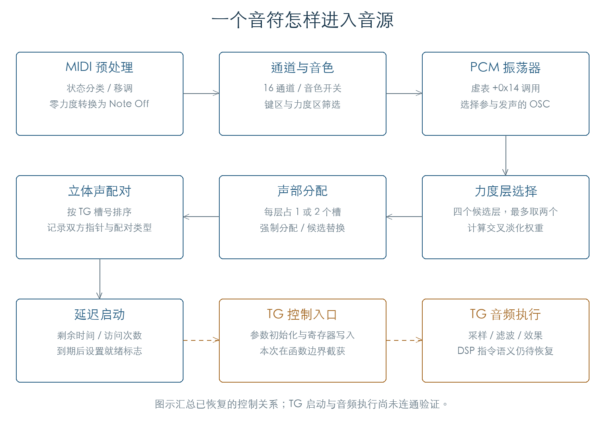
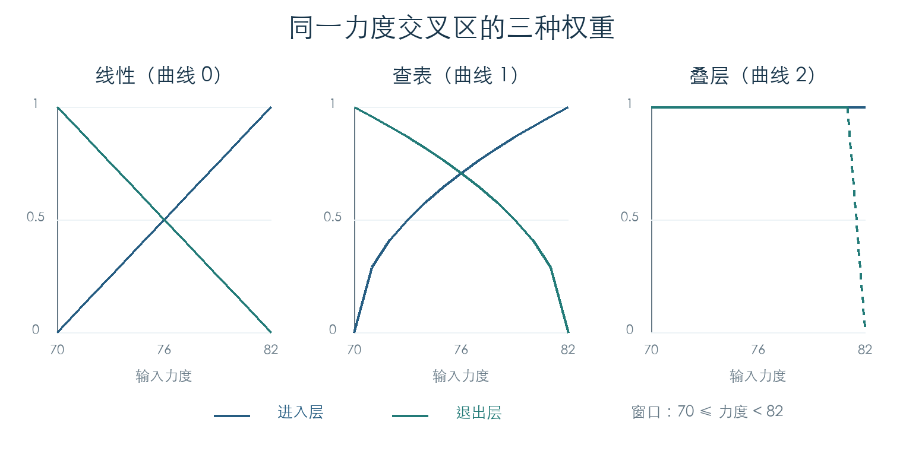

# 从 MIDI 音符到 PCM 声部

KROSS 2 v1.2.4 · 阶段 02 · 2026-11-01

**摘要**　一个音符依次经过 MIDI 预处理、通道分发、音色筛选、振荡器调用、力度选层和声部分配。普通振荡器包含四个力度候选层，一次最多选择两个；每层按单声道或立体声占用一个或两个控制槽。本文恢复这条调用链、三种交叉淡化计算、立体声配对与延迟启动规则，并补充踏板、任务消息和软件定时器的行为。原厂 726 个旋律 Program 的 167,005 次选层检查全部通过。TG 音频执行仍需继续解析。

## 1 演奏事件经过哪些模块



MIDI 入口 `0x2C1A6C` 按状态字节分流：`00–7F` 交给内部命令处理，`80–EF` 进入通道消息处理，`F0–FF` 进入系统消息处理。通道事件最终由 `0x271500` 送到对应的通道对象。每个通道对象占 436 字节，共 16 个。[S1]

| 环节 | 入口偏移 | 已恢复行为 |
| --- | --- | --- |
| MIDI 预处理 | `2BDF5C` | 条件移调、零力度 Note On 转换、调用预处理入口 |
| 通道消息转交 | `2BDB7C` | 控制消息过滤、力度曲线处理、包装声音事件 |
| 声音通道 | `26EC34` | 按键位图、音色列表、踏板与控制器分发 |
| 音色 Note On | `274590` | 键区和力度区筛选，记录最近音符与力度 |
| 振荡器分发 | `2737F8` | 遍历振荡器列表，经虚表槽 `+14` 调用 |
| PCM 振荡器 | `1F62F0` | 根据演奏模式调用声部管理器 |
| 选层与装配 | `1FDC8C` | 选择力度层、申请控制槽、建立立体声配对 |

连通检查从 MIDI 总入口进入，执行原始跳转和虚表调用，在声部管理器入口截获。2,352 组情况覆盖三个通道、两种键区/力度区、四种振荡器选择值及双振荡器配置。此次固定为复音分支；单音、连奏和 Unison 分支仍待连通验证。[S1]

### 1.1 Note On 和 Note Off

通道先检查音符奇偶筛选，再设置 128 位按键位图。Note On 只发送给当前启用的音色；Note Off 会发送给通道上所有关联音色，包含后来被禁用的音色。这样，先前启动的声音仍能收到释放事件。[S1]

零力度 Note On 在 MIDI 预处理和通道层都能转成释放行为。预处理函数先保存原状态分类，因此消息字节改为 Note Off 后，当次预处理回调仍沿原 Note On 分支执行。46,080 组输入验证了这个顺序。

音色层的键区和力度区都包含端点。键区通过后，`+46` 处的计数先增加，随后才检查力度区。这个计数因此包含被力度区挡住的按键，不能直接当成发声数。

### 1.2 哪个振荡器参与发声

音色元数据 `+1C` 的第 2–3 位控制选择：0 表示全部，1/2/3 分别选择列表中第一、第二、第三个振荡器。Program `+508` 的低三位为 3 时，强制调用全部振荡器。实际对象数量由列表决定。

分发期间通过 RDAPI 把当前任务优先级设为 5，结束后恢复先前值。这里的 5 是接口参数；与内核内部优先级编号的换算需另行对照。

## 2 力度层与交叉淡化

`0x1FD718` 从四个候选层中选择素材。前三层各保存一个起始力度，函数按顺序查找第一个满足“输入力度 ≥ 起始力度”的层；均不满足时选择第四层。处于交叉区时，还会选择紧邻的下一层。[S2]

设输入力度为 `v`，当前层起始力度为 `b`，交叉宽度为 `w`。双层区间为 `b ≤ v < b+w`；达到上端点后只保留当前层。权重使用整数，32768 表示单位权重。

```text
t = floor((v - b) × 32768 / w)

曲线 0：当前层 = t，下一层 = 32768 - t
曲线 1：分别对上述两个值查表并插值
曲线 2：两个层的权重都为 32768
曲线 3：进入与曲线 0 相同的计算分支
```



曲线 1 使用 `0x40585C` 的 129 项无符号 16 位表，按低八位进行线性插值。全部 32,769 个有效输入都与独立整数公式一致。图中的纵轴表示选层权重；后续还要乘以层音量、包络及调制结果。

### 2.1 普通音色与鼓组

普通音色的每个候选描述符占 8 字节。鼓组先经过按键重映射，再从 68 字节键记录中取 12 字节层描述符。两条路径共用末端的交叉权重计算。鼓组表有 24 字节头部；键记录 `+30/+34/+38` 保存前三层的力度边界，`+41` 的 bit 2 参与入口筛选。

输出包含 4 字节头部和最多两个 20 字节层记录：

| 层记录偏移 | 内容 |
| --- | --- |
| `+00` | 16 位交叉权重 |
| `+04` | 普通层描述符或鼓键记录指针 |
| `+08` | 普通 PCM 区域或鼓层描述符指针 |
| `+0C` | 立体声第二侧区域或鼓键区域指针 |
| `+10` | 立体声标志 |

普通音色验证了 32,768 组层选择；鼓组验证了 16,384 组，包括层边界、交叉宽度、曲线和单/立体声标志。键区、力度区、振荡器索引和静音入口另外检查了 1,764 组。两个端点逆序存储时，函数仍接受它们之间的闭区间。[S2]

### 2.2 用原厂参数复核

从原有 `PRELOAD.KRS2all` 读取 A–F 的 768 个 Program，取其中 726 个旋律音色的 1,315 个有效振荡器配置。在音符 60 上逐一输入力度 1–127，获得 **167,005 次原 ARM 选层结果**，全部符合恢复的规则。[S3]

其中 44,446 次返回两个描述符标志均有效的候选层，涉及 272 个 Program。另有 8,972 次返回的两个候选中只有一个具有有效标志。最终参数构造函数还会检查描述符、区域和采样是否可用；完整发声数量需结合这些下游检查确定。

逐 Program 的层号、权重、描述符标志和参数哈希保存在机器映射中。这里使用一个固定音符验证力度选择，尚未遍历每个 Program 的全部键区和采样装载状态。

## 3 声部如何分配和配对

管理器 `0x1FDC8C` 先计算需要的槽数：每个单声道层占一个槽，立体声层占两个槽。两个立体声层合计需要四个槽。随后调用 `0x1FCA9C` 批量强制分配，并逐个建立声部参数。[S2]

### 3.1 强制分配顺序

分配器使用 12 字节双链节点，声部对象间距为 588 字节。已恢复的顺序如下：[S1]

1. 有可用计数时，取普通候选队列的首项。
2. 遍历编号 7 至 0 的类别队列，取最高编号非空队列的首项。
3. 在普通候选队列中按 TG 状态和评分字段选择。
4. 再对另一条活动候选队列执行同样选择。

评分位于声部 `+23C`，为无符号 16 位。扫描只接受 TG 状态位为 1、评分严格更小的项；找到评分不超过 4 的项就提前结束。没有更优项时使用队首。阶段 03 已追到写入来源：该字段缓存 TG 寄存器 `+428` 的读回值，详见[参数与评分读回](VOICE_PARAMETERS.md)。读回值代表的物理量仍待确定。

八个类别队列及分级批量入口都已执行验证。不过，当前普通 Note On 调用的是强制分配入口；分级批量入口尚未找到直接调用或对齐的绝对地址引用。暂不为这些类别赋予乐器声部优先级含义。

### 3.2 立体声配对与返回链

每对立体声槽先按 TG 槽号升序排列。第一侧写入配对类型 1，第二侧写入类型 2；双方 `+230` 互相指向，第一侧 `+18` 另记第二侧 TG 槽号。

1,024 组装配检查覆盖正序/逆序 TG 编号、16 种立体声组合、交叉区内外和延迟标志。原指令完成选层、分配、配对与列表操作；参数构造、TG 启动和 TG 复位在函数边界截获。返回链固定保留首个节点，后续节点插在它后面。例如四个依次生成的槽，返回顺序为 `0 → 3 → 2 → 1`。[S2]

### 3.3 延迟启动

声部有两项等待状态：`+234` 保存按传入时间增量递减的值，`+208` 保存按访问次数递减的有符号 16 位值。前者非零时先处理前者；归零后，后续访问才递减后者。满足启动条件时设置标志字 `+10` 的 bit 3。

这两项机制的递减、归零和就绪置位已验证。物理时间单位与调用频率还需要沿调用方核对。

## 4 延音与保持踏板

通道对象 `+118` 保存当前按键位图，`+128` 保存保持踏板捕获的位图。每个位图有 128 位。[S1]

| 输入 | 条件 | 通道层动作 |
| --- | --- | --- |
| CC64 延音 | 新值 0–79 | 对关联音色调用释放入口；重复低值也调用 |
| CC64 延音 | 旧值 0–79，新值 80–127 | 调用延音开启入口 |
| CC64 延音 | 旧值和新值均 ≥80 | 保留状态，不重复调用开启入口 |
| CC66 保持 | 从 <64 变为 ≥64，CC64 <64 | 复制当前按键位图，无即时音色回调 |
| CC66 保持 | 从 <64 变为 ≥64，CC64 ≥64 | 保持位图全部置位，并调用开启回调 |
| CC66 保持 | 从 ≥64 变为 <64 | 清空保持位图，调用关闭回调 |

5,376 组检查覆盖旧值、新值和延音组合。CC64 的回调门槛为 80，CC66 捕获逻辑判断 CC64 时使用 64。后续需要结合半踏板控制及音色侧处理解释这两处门槛。

## 5 消息池与 CSync 回调计时器

RDAPI 对象建立 **500 个可用消息节点**，每个 16 字节；另建立 13 份队列/截止时间记录，对应编号 0–12。静态任务表中的任务编号为 1–11，其余记录用途继续追踪。[S1]

发送函数先把节点接到目标队列，再设置事件位 `0x80000000`。任务上下文和中断上下文调用不同的内核入口。接收函数先尝试取节点，队列为空时等待事件；唤醒后再次检查。模拟空唤醒后，原函数正确重试并取到随后到达的消息。

CSync 另有 **48 个回调计时器**，每个记录占 24 字节。分配时把延迟转换为 `uint32(delay+1)>>1` 次访问；每次遍历递减，首次减到零时触发。初始计数为零的记录不会自行到期。计时器到期后先从集合移除、释放槽，再调用 `callback(token, user_arg)`。

令牌只保留低 31 位，已验证从 `0x7FFFFFFF` 回绕到 0。该定时器池与 RDAPI 消息队列是两套独立结构。函数 `0x2B50CC` 的实际职责为推进这些回调计时器。

## 6 验证范围与下一步

| 检查 | 数量或覆盖 |
| --- | --- |
| MIDI 状态分流 | 1,024 组 |
| 音符预处理 | 46,080 组 |
| 通道/音色 Note On 与 Note Off | 24,576 组 |
| MIDI 至 PCM 管理器连通 | 2,352 组 |
| 踏板转移 | 5,376 组 |
| 普通音色/鼓组交叉层 | 32,768 / 16,384 组 |
| 原厂旋律音色选层 | 167,005 组 |
| 立体声装配与延迟入队 | 1,024 组 |
| 查表权重函数 | 32,769 个输入 |
| 分配器评分选择 | 256 组 |

所有执行都在合成内存中完成。表中数量分别描述各函数或路径的覆盖，不能相加为整机测试次数。尚未执行完整内核启动，也未输出 TG 音频。

下一步继续进入声部参数构造 `0x1F6958`、TG 启动 `0x1F7278` 和音符释放链，恢复单音/连奏、Unison、踏板保持、抢占及失败回收。全系统尚未完成的模块与验收条件列在[研究状态表](REVERSE_STATUS.md)。

## 证据与复现

地址均为 `KROSSAPP.bin` 文件偏移，运行地址需加 `0xC0000000`。输入 SHA-256：

- 固件：`3005f0eca3f3772bcb810c526ceebb15562747d3cdcdf5d20faae4a539520c54`
- PRELOAD：`71bf82f1183e36422f31fb253be8a3010435f46d6fb7f3bd35d432116adb557b`

[S1] [运行路径原 ARM 结果](../../derived/firmware/KROSS2_V124/architecture/stage02/arm-check.json)，[入口与引用索引](../../derived/firmware/KROSS2_V124/architecture/stage02/index.json)。

[S2] [选层、声部装配与延迟检查](../../derived/firmware/KROSS2_V124/architecture/stage02/note-layers-check.json)，[选层汇编](../../derived/firmware/KROSS2_V124/architecture/stage02/note-layer-selection.arm.txt)，[装配汇编](../../derived/firmware/KROSS2_V124/architecture/stage02/note-voice-assembly.arm.txt)。

[S3] [原厂逐力度选层映射](../../derived/firmware/KROSS2_V124/architecture/stage02/factory-note-layer-map.json)。

```sh
python3 research/tools/firmware_runtime_flow.py --verify-arm
python3 research/tools/firmware_note_layers.py --verify-arm
python3 research/tools/firmware_runtime_figures.py
python3 research/tools/firmware_runtime_verify.py
```

执行前两个命令需要可运行 Unicorn JIT 的宿主环境。图生成器需要 Pillow。脚本记录自身、固件和公共执行辅助代码的哈希；变更后须重新执行对应检查。
