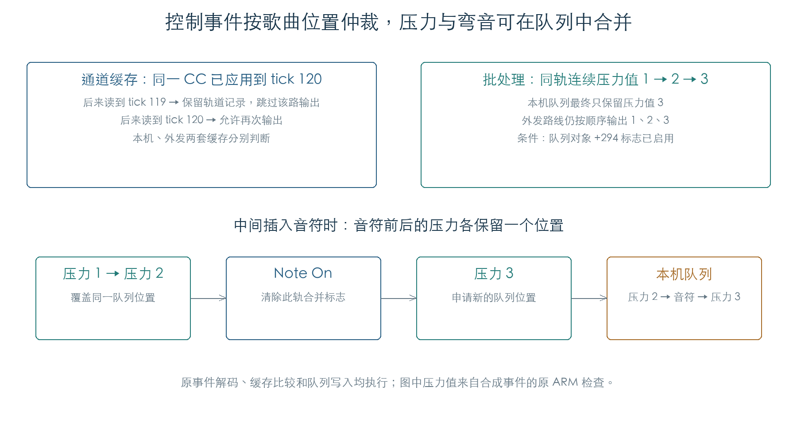

# 序列器控制事件与通道状态

普通轨道的控制事件沿用八字节记录。类型 `0A` 至 `0E` 分别生成复音压力、CC、Program Change、通道压力和弯音消息。固件同时维护每轨记录状态，以及本机、外发两套通道状态；多轨共用一个通道时，后读出的旧事件会被位置缓存挡住。[E1]

本章核对了 6144 组 CC、384 组压力/弯音组合、全部 16384 个弯音值、144 组 Program/Bank 配置及 96 组位置比较。事件解码、缓存和消息生成均执行原指令，输出停在消息队列与端口缓冲接口。[E1]

## 1. 记录字段与输出消息

`+0` 是事件类型，`+6…+7` 是小端起始 tick。顺向解码器 `256810` 在起始位置到达后读取其余字段。以下表格使用十六进制事件类型及 MIDI 状态；`n` 为通道 0–15。[E1]

| 类型 | `+5` | `+4` | MIDI 输出 |
| --- | --- | --- | --- |
| `0A` | 音高 | 压力 | `An 音高 压力` |
| `0B` | CC 编号 | 值 | `Bn 编号 值` |
| `0C` | Program 编号 | 内部 Bank 编号 | 可选 Bank Select，再发送 `Cn Program` |
| `0D` | 通道压力 | 此分支忽略 | `Dn 压力` |
| `0E` | 弯音低七位 | 弯音高七位 | `En LSB MSB` |

`0E` 的字段顺序值得注意：低七位保存在后面的 `+5` 字节。16384 个合法弯音值均已从记录还原为正确的 MIDI 两字节顺序。

所有 128 个 CC 编号都可进入输出。128 编号 × 16 通道 × 3 个数值的检查覆盖 6144 组组合。原消息格式化函数会将 Program Change 和通道压力缩为两个 MIDI 字节；内部队列仍占四字节，其中还包含内部标签。

## 2. 每轨与每通道保存 41 类状态

固件从 `4509A6` 的映射表，将下列 38 个 CC 编号映射到状态槽 0–37：

`1, 2, 4, 5, 7, 8, 10, 11, 12, 13, 14, 16, 22, 23, 24, 25, 64, 65, 66, 67, 70–81, 91–94, 118, 119`。

其余三个槽依次保存 Program/Bank、通道压力和弯音。其他 CC 直接进入输出路线，不经过这 41 类状态的位置比较。复音压力也走直接输出分支。[E1]

| 状态表 | 按什么索引 | 数值起址 | 小节起址 | tick 起址 |
| --- | --- | --- | --- | --- |
| 轨道记录 | 轨道 × 41 + 类别 | `C172272C` | `C172220C` | `C1721CEC` |
| 本机通道 | 通道 × 41 + 类别 | `C171FE2C` | `C171F90C` | `C171F3EC` |
| 外发通道 | 通道 × 41 + 类别 | `C171E9AC` | `C171E48C` | `C171DF6C` |

每个数值项占四字节，小节与 tick 各占两字节。数值项 `FFFFFFFF` 表示尚未应用过该类状态。表格记录的是本次实际读取和写入的布局；数值项未使用的高位不作为语义字段。

## 3. 多轨共用通道时怎样避免状态倒退

读取一条受缓存管理的事件时，固件先更新轨道记录，再分别检查两路输出。若该通道已应用的同类事件位置晚于当前记录，就跳过这一路；若更早或相同，则更新缓存并输出。[E1]

例如，通道 3 的 CC7 已应用到小节 0、tick 120。另一轨随后交来 tick 119 的 CC7 时，这条记录仍进入该轨状态表，但不会覆盖已应用的通道状态。tick 120 的记录则可以再次输出。比较依据为歌曲位置，当前分支没有要求数值发生变化。

96 组检查覆盖 CC、Program、通道压力和弯音，以及本机和外发缓存。两路开关与跳过掩码另有 40 组检查。

## 4. Program 与 Bank Select

类型 `0C` 先把内部 Bank 编号交给 `2410C4` 转换，再按 `C1DCD62B` 的两位配置决定输出：[E1]

- bit 1 启用 Bank Select，依次发送 CC0 与 CC32。
- bit 0 启用 Program Change，发送两字节消息。

本次覆盖内部 Bank 编号 0、1、127、139：前三者转换为 MSB 0、LSB 等于原编号；139 跳过 Bank Select。Program Change 仍由独立开关控制。配置 0–3、三个通道和三个 Program 编号共 144 组通过。

其他内部 Bank 编号会进入附加查询路径，扩展银行及 GM 银行的完整映射尚待核对。

## 5. 压力和弯音的队列合并

队列对象 `C171BD04 +294` 标志开启后，`25F294` 和 `25F350` 可以合并同轨的通道压力或弯音。第一条消息申请位置，并保存该位置索引；后续同类消息覆盖这一项，保留最新值。外发字节路线仍逐条发送。[E1]

音符登记会清除该轨的两类合并标志。因此，“压力 1、压力 2、Note On、压力 3”在本机队列中成为“压力 2、Note On、压力 3”，音符前后的控制值各占一个位置。关闭合并标志时，四条消息全部保留。两类控制、标志开关和有无中间音符共 8 组检查通过。

这里确认了合并函数及原解码器的组合行为。该标志在完整录放与编辑流程中的设置条件仍需继续追踪。

## 证据与复现

**[E1]** 版本锁定为 KROSS 2 v1.2.4。固件、脚本与辅助模块 SHA-256 见[检查结果](../../derived/firmware/KROSS2_V124/architecture/stage04/sequence-controls-check.json)。

- [检查脚本](../../tools/firmware_sequence_controls.py) · [控制事件反汇编](../../derived/firmware/KROSS2_V124/architecture/stage04/track-control-decode.arm.txt)。
- [Bank 转换](../../derived/firmware/KROSS2_V124/architecture/stage04/track-program-bank-convert.arm.txt) · [队列合并](../../derived/firmware/KROSS2_V124/architecture/stage04/track-control-coalescing.arm.txt)。
- 运行：`python3 research/tools/firmware_sequence_controls.py --verify-arm`。合成记录和全局表均位于私有模拟内存；端口接口被截获。

音符与关音表见[序列器音符](SEQUENCE_NOTES.md)。后续仍需恢复 SysEx、定位后的状态恢复、循环、记录生成与文件装载，再把这些事件接入完整音源和录放状态机。
