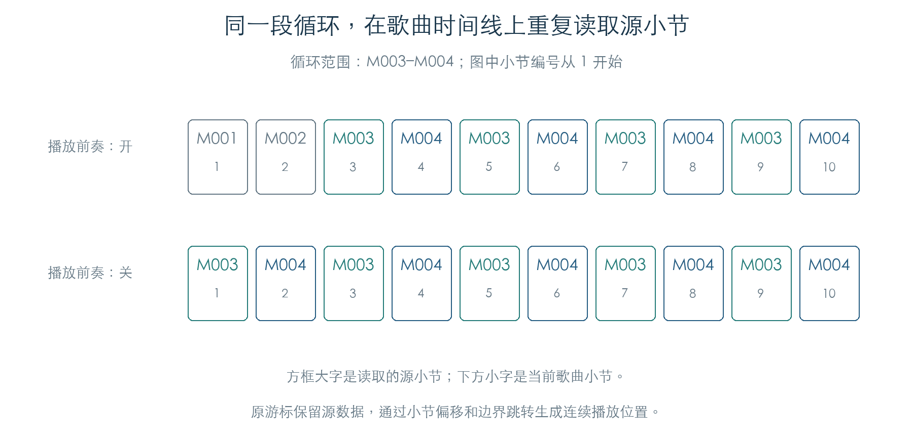

# 轨道循环、前奏与跨圈关音

KROSS 2 的轨道循环通过事件游标实现。源事件留在原处，游标重复读取选定小节，并把事件的小节号换成当前歌曲位置。开启 Play Intro 时，循环之前的小节先播放一次；关闭时，歌曲从循环起点开始取数。[E1]

原指令检查已覆盖 400 组小节换算、1600 次定位、162 次指针移动、64 组歌曲元数据装配，以及 192 次连通音符解码器的播放推进。结果与参数手册的前奏示例一致。[E1][E2]

## 1. 歌曲时间与源小节怎样对应

设循环起点为 `S`，终点为 `E`，长度 `L = E − S + 1`；当前歌曲小节为 `B`。以下公式使用从零开始的小节号，适用于本次检查的非负位置和合法范围。[E1]

| 设置 | 读取的源小节 |
| --- | --- |
| 关闭循环 | `B` |
| 开启循环，关闭前奏 | `S + B mod L` |
| 开启循环，开启前奏，`B < S` | `B` |
| 开启循环，开启前奏，`B ≥ S` | `S + (B − S) mod L` |

例如，界面选择 M003–M004 后，关闭前奏得到 M003、M004、M003、M004；开启前奏得到 M001、M002、M003、M004、M003、M004。换算由 `2416D0` 执行。

定位函数 `241748` 先换算源小节，再用原事件查找函数定位 tick，并设置已经循环过的小节数。检查覆盖循环起止点、圈内位置、圈后位置，以及 tick 0、1、120、121；定位结果同时核对了事件指针和累计偏移。

## 2. 游标保存哪些状态

每个轨道游标占 40 字节，16 个对象从 `C1714408` 起连续排列，虚表位于 `C04719EC`。[E1]

| 偏移 | 长度 | 用途 |
| --- | --- | --- |
| `+04` | 4 | 当前源事件指针 |
| `+08 / +0A` | 各 2 | 循环起点 / 终点小节 |
| `+0C / +10` | 各 4 | 循环开关 / 前奏开关 |
| `+14` | 4 | 原始事件流起点 |
| `+18` | 4 | 循环起点事件 |
| `+1C` | 4 | 循环终点下一小节的边界事件 |
| `+20` | 2 | 循环长度 |
| `+22` | 2 | 已循环的小节偏移 |

顺向移动 `241874` 每次加八字节。走到边界事件时仍允许读取一次；继续移动越过边界后，才回到 `+18`，并把 `+22` 增加一个循环长度。反向移动 `2418B4` 越过循环起点且偏移大于零时，回到边界事件，并减去一个循环长度。首圈偏移为零时可继续向前奏区域退回。

当前事件读取器 `2418FC` 将八字节事件复制到 `C17146AC`，在副本中调整小节号。普通事件的原始字节保持不变。类型 `0F` 返回原指针，保留读取后续 SysEx 数据的条件；完整 SysEx 行为仍待验证。

## 3. 循环末尾怎样处理延音

普通播放用时长 `7FFF` 表示跨小节延音。当这样的音符位于循环范围的最后一个源小节时，`2418FC` 会在返回的副本中将时长改成 `1DFF`，即十进制 7679。原音符解码器随后按当前小节长度截断结束 tick。[E1]

因此，延音可以持续到该小节结束，但在下一圈开始前会收到 Note Off。连续播放实验使用 4/4 拍，将 M004 的音符设为延音：该音符从 tick 120 持续到小节末，下一歌曲小节的 tick 0 发出关音，然后按循环顺序播放 M003。前奏开关的两种状态都通过检查。

其他源小节的 `7FFF` 保持原值，可继续使用[跨小节续接机制](SEQUENCE_NOTES.md)。本次另有 12 组副本检查，确认修改仅作用于循环末小节的返回事件。

## 4. 循环配置怎样从歌曲进入游标

`24E91C` 遍历歌曲中的 16 份轨道记录，每份 36 字节。从歌曲对象 `+7C8` 开始，各轨的主要字段如下：[E1]

| 轨道记录偏移 | 含义 |
| --- | --- |
| `+00` | 事件流指针，由 `2883D4 → 287F74` 读取 |
| `+1C` bit 15 | 循环开关 |
| `+1C` bit 14 | 前奏开关 |
| `+20 / +22` | 循环起止小节 |

配置通过 `24157C` 写入游标，并计算起点与边界指针。64 组装配检查执行了原元数据遍历和指针读取，覆盖两种开关的四种组合；空事件流会把范围和开关清零。这里的歌曲对象由检查脚本构造，尚未经过磁盘文件加载。

## 5. 歌曲终点仍限制循环

读取器会检查调整后的小节号。全局字节 `C1714D11` 的 bit 0 为零时，边界取拍号表头中的歌曲小节数减一；为一时，边界取 998。超过边界的小节标记会转成类型 `03` 的结束事件，并写入最后有效小节号。[E1]

16 组边界检查验证了这两条分支。该全局标志在完整操作状态机中的设置条件仍需继续追踪，暂不赋予具体界面模式名称。

## 证据与复现

**[E1]** KROSS 2 v1.2.4 固件。版本及脚本哈希、所有轨迹见[机器结果](../../derived/firmware/KROSS2_V124/architecture/stage04/sequence-loops-check.json)。

- [检查脚本](../../tools/firmware_sequence_loops.py) · [游标反汇编](../../derived/firmware/KROSS2_V124/architecture/stage04/track-loop-cursor.arm.txt) · [轨道配置装配](../../derived/firmware/KROSS2_V124/architecture/stage04/track-loop-setup.arm.txt)。
- 运行：`python3 research/tools/firmware_sequence_loops.py --verify-arm`。原游标、顺向调度器、音符解码、关音表和消息队列在私有内存中执行；外发缓冲接口被截获。

**[E2]** [KROSS 2 Parameter Guide](../../downloads/KROSS2_Parameter_Guide.pdf)，印刷页 113，PDF 第 121 页，Track Play Loop / Play Intro。

已验证的范围涵盖轨道循环与音符输出。完整录制、循环编辑、定位后的控制状态恢复、歌曲文件加载和物理音源执行仍需接通。
