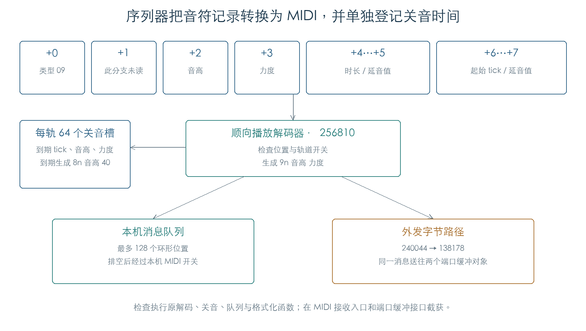
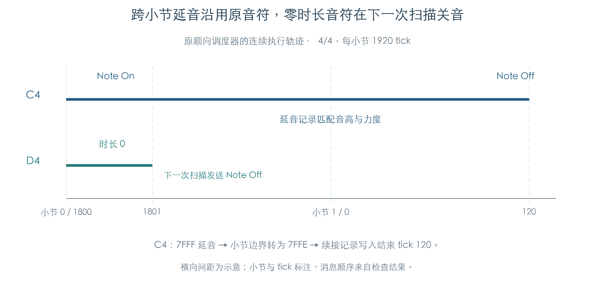

# 序列器音符、时长与 MIDI 输出

KROSS 2 的普通轨道用八字节记录保存音符。顺向播放时，固件按歌曲位置读出记录，生成 Note On，同时把结束时间放入该轨道的关音表。关音扫描到达结束时间后生成 Note Off，释放表项。每条轨道有 64 个表项；音源的声部分配另行处理。

本章已用原 ARM 指令核对 8192 组音高、力度和通道组合，以及时长、跨小节延音、输出开关、满表替换和连续调度。检查推进到本机 MIDI 入口与外发端口缓冲接口；歌曲文件装载和最终声音尚未接入这组实验。[E1]

## 1. 一条音符记录保存什么

以下偏移相对于八字节记录起点，多字节字段按小端读取。这里只描述顺向解码器 `256810` 的类型 `09` 分支。[E1]

| 字节偏移 | 含义 | 已核对行为 |
| --- | --- | --- |
| `+0` | 事件类型 | `09` 进入音符分支 |
| `+1` | 此分支未读取 | 其他事件类型会使用这一字节 |
| `+2` | 音高 | 0–127 原样进入消息 |
| `+3` | 力度 | 0、1、64、127 均原样进入消息 |
| `+4…+5` | 时长或延音标志 | 普通时长加起始 tick；`7FFF` 表示继续延音 |
| `+6…+7` | 起始 tick或续接标志 | 普通值与当前位置比较；`7FFF` 进入续接查找 |

普通音符在“起始 tick ≤ 当前 tick”时处理。起始 tick 达到或超过当前小节长度的记录被跳过。结束 tick 取“起始 tick + 时长”与小节长度的较小值；时长 `7FFF` 单独保留为延音状态。240 组时值组合验证了这些边界。[E1]

该分支也会输出力度为零的 `9n` 消息。这里确认的是解码结果；后续 MIDI 预处理对零力度的转换见[演奏控制](RUNTIME_FLOW.md)。记录生成器是否会写入这些边界值仍待追踪。

## 2. 音符何时结束

关音表位于 `C171C4C8`，每轨占 256 字节，共 16 轨。一个表项占四字节：结束 tick 两字节、音高一字节、原始力度一字节。`C171D4C8` 的 16 个字节分别保存各轨活跃表项数。[E1]

`2562F8` 扫描指定轨道。普通表项的结束 tick 小于或等于当前 tick 时，函数发送 `8n 音高 40`，把表项置为空闲，并减少计数。它还返回剩余普通音符中最早的结束 tick；没有这类音符时返回 `7FFE`。释放消息中的 `40` 是十六进制，即力度 64。

| 状态值 | 用途 | 处理 |
| --- | --- | --- |
| 普通 tick | 小节内结束位置 | 到期发送 Note Off |
| `7FFD` | 空闲 | 可接收新音符 |
| `7FFE` | 等待跨小节续接 | 普通到期扫描保留 |
| `7FFF` | 延音至下一小节 | 小节标记把它改为 `7FFE` |

显式清音函数 `256408` 会释放所有活跃表项，包括两个延音状态。到期扫描已核对 180 组组合，显式清音已核对 16 组组合。[E1]

## 3. 跨小节延音怎样接续

小节标记到达时，普通残留音符会被关闭，`7FFF` 表项改为 `7FFE`。随后，起始字段为 `7FFF` 的音符记录会搜索 `7FFE` 表项，要求音高与力度同时相同。找到后，它用自己的时长字段更新结束 tick，全程不再发送 Note On。[E1]

图中 C4 在小节 0 的 tick 1800 开始，跨到小节 1 后续接至 tick 120，最后只发出一次 Note Off。同一位置开始的 D4 时长为零；原调度器先扫描旧音符，再读新事件，因此它在下一次扫描，即 tick 1801，才被关闭。该顺序已通过连续调用 `257850` 验证。

若续接记录的力度不同，原有表项仍保持 `7FFE`。这解释了力度参与查找的实际效果；真实录制与编辑流程怎样保证续接一致，仍需检查记录生成路径。

## 4. 64 个表项用满以后

新音符通常占用第一个 `7FFD` 表项。表已满时，固件选取结束 tick 最小的表项；并列时保留扫描到的第一个。它先发送该音符的 Note Off，再尝试登记新音符。13 组满表实验覆盖了首、中、末位置和两路输出开关。[E1]

这 64 项限制作用于单轨等待关音的音符记录。一个 MIDI 音符进入音源后，还可能产生多个 OSC、力度层、立体声声部或 Unison 声部，因此不能用这张表推算整机复音数。

## 5. 本机与外发消息分别怎样处理

解码器有三组轨道位掩码：`C171D4D8` 跳过音符，`C171D4DC` 禁用本机队列路线，`C171D4DA` 禁用外发路线。后两路同时禁用时，新音符不占关音表项。16 组开关组合还核对了本机 MIDI 总开关在队列排空时的作用。[E1]

本机队列位于 `C171BD04`，有 128 个四字节环形位置。消息低字节保存内部标签，其余三个字节保存 MIDI 状态与数据。`25F184` 排空队列，再由 `2BD874` 检查本机使能并进入 `2BD7B4`。本次在该入口截获消息。

外发路线经 `240044` 拆成 MIDI 字节，`138178` 将每个字节送到 `C10051B8` 和 `C1B5AE1C` 两个缓冲对象。本次执行了原拆包与分发代码，在 `2B7E80` 缓冲接口截获数据；物理端口驱动未运行。

队列满时，两类消息处理不同：

- **Note On：** `25F410` 达到队列阈值就跳过写入，返回值仍表示本机路线可用。上层据此登记音符结束时间。阈值为 0、1、32、128 的实验均复现这一行为。
- **Note Off：** 入队前检查实际队列是否已有 128 项；若已满，先执行原排空循环，再写入关音消息。满队列实验与读写指针回绕实验均通过。

这些实验说明局部队列行为。常规播放是否会积压到该阈值，取决于完整任务调度与队列刷新频率，目前尚未据此认定实际演奏会丢失音符。

## 6. 通道与逐轨调度

`257850` 遍历 `C171D518` 标出的活跃轨道，先调用到期扫描，再调用顺向事件解码器。轨道参数的通道值 0–15 直接使用；值 16–31 由 `2928A8` 读取全局通道字节。双轨连续实验覆盖通道 3 与三个全局通道，在 tick 120 发出 Note On，在 tick 240 发出 Note Off。[E1]

参数手册第 100 页将歌曲描述为 16 条 MIDI 轨、一条速度轨及歌曲设置，并列出 Note、Program Change、Pitch Bend、After Touch、CC 和 SysEx 数据。这与当前恢复出的轨道数组和独立速度游标一致。[E2]

## 证据与复现

**[E1]** 固件 `KROSSAPP.bin` v1.2.4；SHA-256 `3005f0eca3f3772bcb810c526ceebb15562747d3cdcdf5d20faae4a539520c54`。检查详情见[机器结果](../../derived/firmware/KROSS2_V124/architecture/stage04/sequence-notes-check.json)。正文函数地址均为文件偏移；全局数据地址为运行地址。

- [检查脚本](../../tools/firmware_sequence_notes.py)：原解码器、真实虚表游标、关音表、环形队列、通道读取和字节分发。
- [顺向解码反汇编](../../derived/firmware/KROSS2_V124/architecture/stage04/track-forward-decoder.arm.txt) · [关音扫描](../../derived/firmware/KROSS2_V124/architecture/stage04/track-note-expiry.arm.txt) · [输出队列](../../derived/firmware/KROSS2_V124/architecture/stage04/track-output-queue.arm.txt)。
- 运行：`python3 research/tools/firmware_sequence_notes.py --verify-arm`。使用私有模拟内存及合成事件，不访问硬件。

**[E2]** [KROSS 2 Parameter Guide](../../downloads/KROSS2_Parameter_Guide.pdf)，印刷页 100，PDF 第 108 页。

下一步恢复普通控制事件、轨道循环与真实歌曲加载，再将本机 MIDI 接收入口接入已验证的音源路径。完整录放、编辑、SMF 转换和存储仍在后续范围内。
