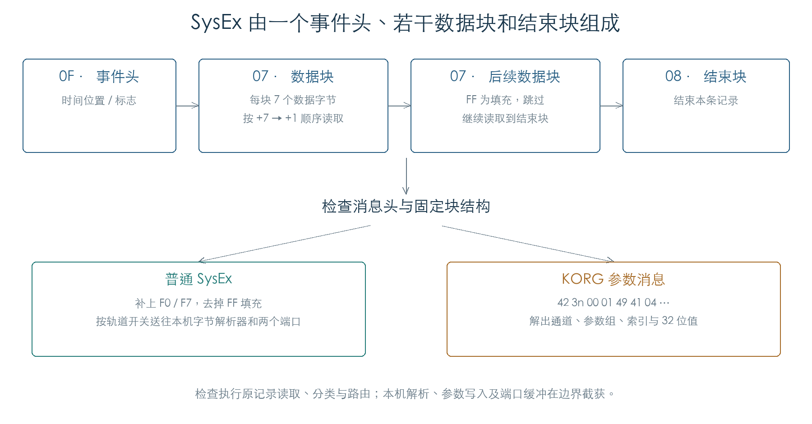

# 序列器 SysEx 记录与参数消息

序列器用连续的八字节块保存 SysEx：类型 `0F` 记录时间，类型 `07` 保存数据，类型 `08` 结束消息。播放函数会区分普通 SysEx 与固定格式的 KORG 参数消息。普通消息还原为 MIDI 字节；参数消息直接解码，再按轨道状态决定本机更新或外发。[E1]

本章完成 1820 组消息分类、160 组普通消息播放、420 组参数解码及 2816 组参数路由检查。另将 SysEx 接入原顺向解码器和循环游标，核对到期与轨道跳过条件。[E1]

本章执行边界之后的路径已继续恢复，见[参数缓存与应用队列](PARAMETER_CACHE.md)和[参数出队与实际内存写入](PARAMETER_DISPATCH.md)。后续检查执行了原缓存函数，并将三个参数接到原回调；本章的独立路由矩阵仍保留原截获边界。



## 1. 记录怎样还原成字节

`2564E0` 从事件头后的第一个数据块开始读取。每个 `07` 块的七个字节按偏移 `+7、+6、…、+1` 输出，和内存中的排列方向相反。`FF` 字节被跳过，可用于填满最后一个块；`08` 块结束读取。[E1]

函数在有效数据前发送 `F0`，末尾发送 `F7`。160 组检查覆盖空数据、1–64 字节长度及七字节分块边界，并组合两端轨道与本机/外发开关。另有七组检查逐个移动 `FF` 的位置，确认填充值在块内任何位置都会被跳过。

普通消息的外发路线由 `C171D4DA` 的轨道位控制。本机路线还要求 `C1DCD62A` bit 0 开启，并且 `C171D4DC` 对应位清零。本次执行了原字节整理、开关判断和双端口分发；本机字节解析器 `2C2E90` 与端口缓冲接口 `2B7E80` 被截获。

播放开始时，固件保存计数字节 `C171696C` 的值；每处理完一个数据块，比较该字节是否变化。若变化，停止读取后续块并补发 `F7`。10 组受控变更实验确认检查粒度为整个七字节块。计数变化的完整业务来源仍待追踪。

## 2. 哪种消息会进入参数分支

分类函数 `23DA1C` 要求三个连续的 `07` 数据块，后接 `08` 结束块；首块按播放顺序必须为：

```text
42  3n  00  01  49  41  04
```

其中 `n` 是低四位通道。分类函数没有检查参数值是否合理。1820 组检查覆盖首块七个字节的全部 256 种取值，以及四处块类型的变更。[E1]

识别成功后，`242008` 按下表解码后续内容。表中顺序为还原后的 SysEx 数据顺序，不含 `F0/F7`。

| 数据位置 | 含义 | 组合方式 |
| --- | --- | --- |
| 0–6 | 固定头 | 上述七字节 |
| 7–8 | 原始参数组 `G` | `高字节 × 128 + 低字节` |
| 9–10 | 参数索引 `I` | 同上 |
| 11–15 | 32 位值 `V` | 依次放入 bit 28、21、14、7、0 |

值的第一个字节使用低四位，其余四个字节各承载七位。原函数 `23CF20` 拼回完整 32 位模式；检查覆盖 `7FFFFFFF`、`80000000` 和 `FFFFFFFF`，高位没有丢失。参数目录与本机调用使用的命名空间号为 `G + 100`。

## 3. 参数边界检查在哪里

事件头 `+1` 的 bit 0 清零时，`2564E0` 会检查 `G + 100 ≤ 178`，并读取固件参数目录中的条目数，要求索引小于条目数。bit 0 置位时跳过这道入口检查。20 组检查覆盖有效索引、最后一项、越界一项及超范围参数组。[E1]

下游参数写入函数 `23D61C` 还有参数组与索引检查。本次在该写入入口截获，未运行全部参数副作用，因此入口标志的行为不能扩展解释为“任意参数都会写入”。标志由哪个录制或编辑流程设置，后续继续追踪。

## 4. 参数消息怎样选择输出路线

`241EBC` 读取轨道参数字节 `+2` 的高三位状态。对本次选取的普通参数组，状态与路由关系如下：[E1]

| 状态值 | 本机参数路线 | 外发路线 |
| --- | --- | --- |
| 0 | 关闭 | 关闭 |
| 1 | 开启 | 关闭 |
| 2 | 开启 | 开启 |
| 3、4 | 关闭 | 开启 |
| 5–7 | 关闭 | 关闭 |

本机路线还要求本机 MIDI 开关开启、轨道未屏蔽，且消息通道等于全局通道。外发路线检查自己的轨道掩码。接收本机消息后，原调用链先调用 `23D61C`，再通知应用层 `03A1AC`；本次分别记录了这两个边界的参数，确认二者接收相同的命名空间、索引和值。

另有两项明确例外：命名空间 135 不进入本机参数路线；命名空间 108–123 的索引 34 可以绕过本机/外发轨道屏蔽位。此例外仍受其他条件限制。2816 组路由检查覆盖状态、开关、通道匹配、普通参数与这两类分支。各参数的界面含义仍需与参数目录和回调逐项对应。

外发参数函数 `241DA4` 会重新生成完整的 `F0 … F7` 消息。本次按原位模式核对了序列化结果和两个端口缓冲对象收到的字节。

## 5. 接入顺向播放与循环

普通轨道解码器只在 SysEx 的起始 tick 到达后调用播放函数，轨道跳过掩码会抑制该事件。循环游标遇到类型 `0F` 时返回原事件指针，使后续数据块仍可连续读取。[E1]

24 组连通检查组合普通/参数消息、到期前后、跳过开关和循环开关，输出与独立播放函数一致。异常块类型在静态代码中会进入诊断停留分支；本次只执行结构完整的记录，文件读取器对损坏数据的处理尚未验证。

参数手册第 152 页列出的可录制 SysEx 包括外部消息、面板参数修改和主音量消息。当前结果解释了普通字节流与专用参数事件在播放端的分流；录制端、真实歌曲加载及每类参数实际作用仍待连通。[E2]

## 证据与复现

**[E1]** KROSS 2 v1.2.4 固件。完整哈希、边界声明和路由矩阵见[机器结果](../../derived/firmware/KROSS2_V124/architecture/stage04/sequence-sysex-check.json)。

- [检查脚本](../../tools/firmware_sequence_sysex.py) · [记录播放](../../derived/firmware/KROSS2_V124/architecture/stage04/track-sysex-play.arm.txt) · [消息分类](../../derived/firmware/KROSS2_V124/architecture/stage04/track-sysex-classify.arm.txt)。
- [参数值解码](../../derived/firmware/KROSS2_V124/architecture/stage04/track-sysex-value.arm.txt) · [参数路由与外发](../../derived/firmware/KROSS2_V124/architecture/stage04/track-sysex-routing.arm.txt)。
- 运行：`python3 research/tools/firmware_sequence_sysex.py --verify-arm`。仅执行私有模拟内存中的原代码，不访问设备。

**[E2]** [KROSS 2 Parameter Guide](../../downloads/KROSS2_Parameter_Guide.pdf)，印刷页 152，PDF 第 160 页。
