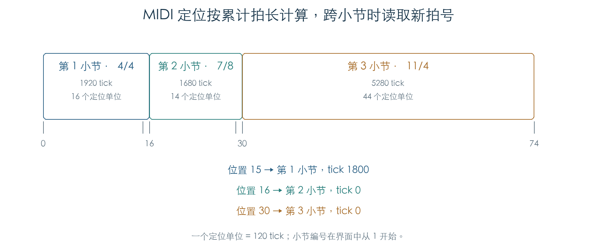
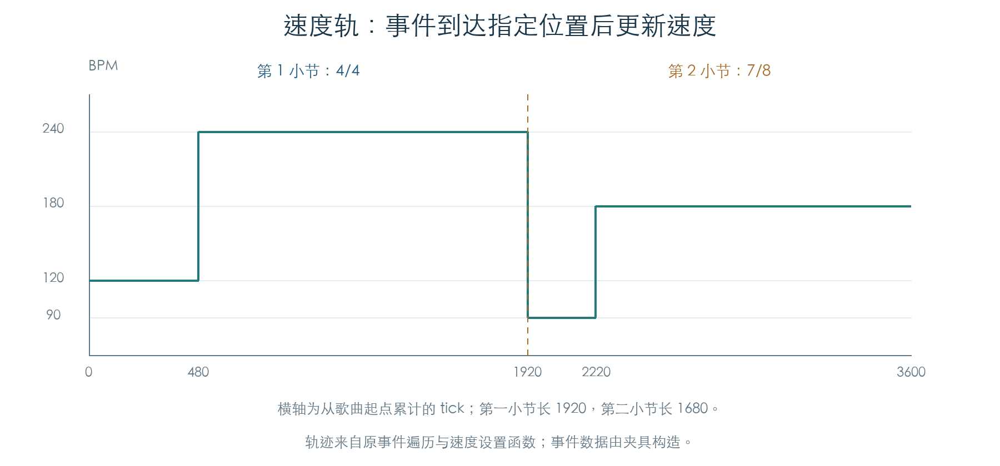

# 歌曲位置、拍号与速度轨

KROSS 2 v1.2.4 · 阶段 04 · 2026-11-01

歌曲位置由“小节索引 + 小节内 tick”表示。拍号表为每个小节保存一个字节，定位时按各小节长度逐项换算。MIDI Song Position Pointer 的一个单位对应 120 tick，四分音符为 480 tick。速度轨通过固定 8 字节事件，在指定位置改变速度。



## 1 拍号表与位置换算

拍号字节的低四位保存“拍数减一”，高四位取 1、2、3，分别对应分母 4、8、16。48 种有效组合与手册允许的拍号范围一致。[S1]

| 拍号 | 每拍 tick | 每小节 tick | MIDI 定位单位 |
| --- | --- | --- | --- |
| 4/4 | 480 | 1920 | 16 |
| 7/8 | 240 | 1680 | 14 |
| 11/4 | 480 | 5280 | 44 |
| 5/16 | 120 | 600 | 5 |

初始化函数 `0x260658` 写入 1,000 项 `0x13`，即默认 4/4。前两个字节另作状态字段。长度查询 `0x2606E4` 和拍长查询 `0x2606C0` 读取固件中的固定表。

MIDI 定位转成内部位置时，`0x26078C` 依次扣除完整小节的定位单位，剩余值乘以 120 得到小节内 tick。反向转换 `0x260700` 累加此前各小节，再加上当前 tick 除以 120 的整数部分，最后限制在 16383。

因此，内部位置可以精确到单个 tick；发送 MIDI 定位时会向下取整到 120 tick。例如第一个小节的 tick 119 转成位置 0，tick 120 才转成位置 1。

混合拍号表采用 4/4、7/8、11/4、9/8 循环，全部 16,384 个 MIDI 定位值均已执行原转换。另在小节边界及抽样点执行反向转换，共 875 组核对。

## 2 播放边界与转换边界

内部单 tick 前进/后退函数会跨小节移动。前进到末尾后，位置停在索引 998 的最后一个 tick；退到开头后，停在索引 0、tick 0。界面小节从 1 编号，因此对应第 1–999 小节，与手册一致。[S2]

独立限位函数 `0x262EC8` 还处理负值和特殊录放状态。负小节位置归零；普通状态限制到第 999 小节末尾。另两类状态从各自的操作边界字段取得小节上限，并截到该小节起点。当前只确定了这些分支的数值行为，具体录放模式仍待关联。

MIDI 转换入口自身没有表长参数，也没有 1,000 项的停止条件。受控实验将前 1,000 项设为 1/16，表后另填识别数据，再输入定位值 2000：原函数返回索引 2000，并读取了初始化范围之外的 1,001 个字节。后续限位发生在转换之后。

这确认了转换入口对表后数据的依赖。实验使用隔离内存中的构造数据；真实歌曲装载、表后布局和调用条件还需要连通检查，当前不据此宣称实机故障。

## 3 八字节事件怎样查找

轨道游标以 8 字节为步长。查找入口 `0x2414C0` 从轨道起点寻找目标位置处或其后的第一条事件。

| 类型码 | 当前已确认的行为 |
| --- | --- |
| 1 | 小节标记；`+6` 为小节索引，`+4` 可用于跳过该小节的事件块 |
| 2 | 另一种小节标记；按单条记录继续扫描 |
| 3 | 结束标记；查找在此停止 |
| 9 | 定位时将时间字段 `0x7FFF` 解释为 0；业务含义待查 |
| 11 | 速度事件；`+4` 为速度原值，`+6` 为小节内 tick |

事件时间与目标时间相等时，查找返回该事件，保留边界上的事件供后续执行。类型 1 可以直接跳过较早的小节，避免逐条扫描整个事件块。反向位置函数从当前记录向前寻找小节标记；小节内时间由另一入口读取。

构造轨道覆盖两类小节标记、相同时间的重复事件、特殊时间值和结束标记。60 组查找与 11 组反向位置读取均已核对。这里只确定游标规则，普通音符和控制事件的字段解释继续恢复。

## 4 速度事件的执行

速度轨消费者 `0x266578` 使用同一套 8 字节游标。遇到小节标记时，读取该小节拍号并更新长度；速度事件只有在当前 tick 与事件 tick 相等时生效。尚未到达的事件保留在游标处，已经错过的事件继续向后扫描。



实验轨道在第一小节起点设置 120 BPM，tick 480 改为 240 BPM；第二小节切到 7/8，起点设置 90 BPM，tick 300 改为 180 BPM。原事件遍历、拍号读取与速度设置函数已连通，分别核对事件前一 tick、事件时刻和小节边界。

消费者依据速度模式字节采取不同处理：值 0 保存事件速度并提交给发生器，值 1 只保存轨道速度，值 2、3 不采用该事件速度。前两种行为分别符合手册的 Auto 和 Manual 说明；外部时钟切换将该字节设为 3。[S2] REC 的完整记录路径仍待恢复。

## 5 证据与剩余工作

本次原 ARM 检查包括 48 种拍号、16,384 次 MIDI 定位转换、875 次反向转换、1,152 次位置移动、160 组限位，以及事件查找和四种速度模式轨迹。速度轨数据由夹具构造；结束操作与临界区边界被截获。

下一步连通真实歌曲装载、普通轨道事件解码与发声，以及定位后的事件状态恢复。完整循环、录音、量化与编辑行为尚未完成。

- [机器结果与事件轨迹](../../derived/firmware/KROSS2_V124/architecture/stage04/sequence-time-check.json)
- [位置换算](../../derived/firmware/KROSS2_V124/architecture/stage04/song-position-conversion.arm.txt) · [位置限位](../../derived/firmware/KROSS2_V124/architecture/stage04/song-position-bounds.arm.txt)
- [事件游标与查找](../../derived/firmware/KROSS2_V124/architecture/stage04/tempo-event-iterator.arm.txt) · [速度轨消费者](../../derived/firmware/KROSS2_V124/architecture/stage04/tempo-event-consumer.arm.txt)
- [传输请求与延后分发](MIDI_TRANSPORT.md) · [外部周期估算](EXTERNAL_TEMPO.md)
- [S1、S2：KROSS 2 Parameter Guide](../../downloads/KROSS2_Parameter_Guide.pdf)，印刷页 110（Time Sig）、103（Location、Tempo Mode）。

```sh
python3 research/tools/firmware_sequence_time.py --verify-arm
python3 research/tools/firmware_runtime_verify.py
```
