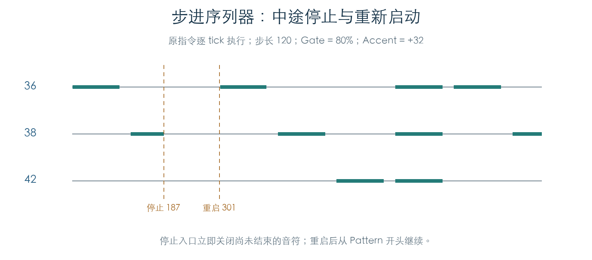
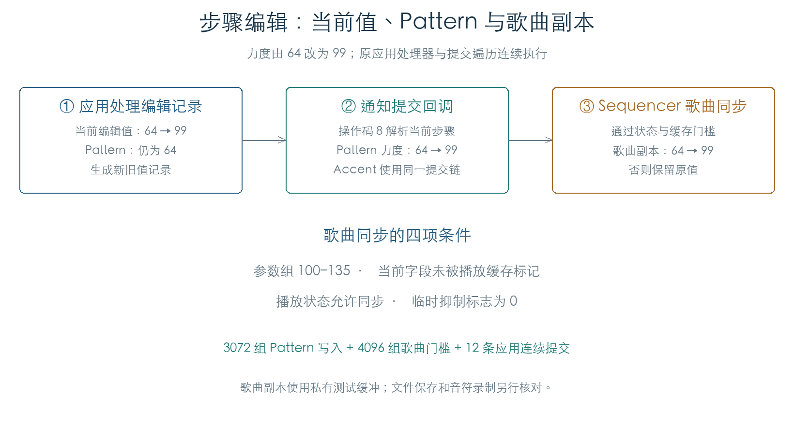

# 步进序列器的数据与播放逻辑

KROSS 2 v1.2.4 · 2026-11-02

步进序列器使用第三个琶音引擎，固定分配 12 个鼓音高，以 Tone 位图选择每步发声的鼓。它与 A、B 琶音共用步进、Swing 和活动音符管理代码，另有独立的开关、Accent 和播放位置通知。

## 1 原厂 Program 中的记录

官方预载的 768 个 A–F Program 都包含步进数据。以每个 2140 字节 Program 为基准，步进块位于 `+298`，Pattern 位于 `+2AC`。块长 572 字节，由 20 字节控制信息和 552 字节 Pattern 组成。

| 块内偏移 | 内容 |
| --- | --- |
| `+04` | 调制区；`+05` Accent，`+06` 普通力度，`+07` Swing |
| `+08` | 十二字节引擎控制参数 |
| `+14` | Pattern：64 个八字节步、12 个固定音高、长度和 Swing 分组 |

768 个 Pattern 均设置固定音高与全 Tone 触发，实际有 74 份不同内容。763 个长度为 16，三个为 32，两个为 12。每个音高字段的低七位参与发音，高位还保留乐器分组信息，当前输出检查保留原值并按低七位计算音高。

原绑定路径在传入引擎前调用 `0x28C87C`，统一设置 Sort、Latch、Gate 80%、逐步力度及有效键区，同时保留 Resolution。原指令核对了八种 Resolution 的规范化结果。

## 2 Accent 怎样改变力度

每步的 Tone 位图保存于步骤 `+04`，Accent 标志位于 `+06`。发音前先应用普通力度调制，再对标记步骤应用 Accent。两次计算都以 1 和 127 为目标端点，按 64 份插值；负值朝 1 缩减，正值朝 127 增加。

例如原力度 64、普通调制 −32 时得到 33；若该步还开启 Accent +32，会在 33 的基础上再次增加。Accent 关闭的步骤只经过第一次计算。6350 组检查覆盖所有合法初始力度、正负边界、零值及 Accent 开关，与原函数逐项相符。

Gate 在绑定时统一为 80%。因此普通步骤的关音点为本步起点加上步长的 80%。首步还受正时间差门槛控制：本实验在时钟递增前启动，首音出现在 tick 1，后续边界保持 120、240 等原位置。

## 3 启动、停止与重新开始

启动入口 `0x003D98` 先检查第三引擎已绑定，再重置播放状态，并注入一个力度为 64 的触发键。固定音高与 Latch 让 Pattern 持续运行。实际起动还需要步进开关管理器处于开启状态。

停止时，原入口关闭活动表中的音符，清理触键和待发音状态。中途停止无需等到 Gate 到期。重新启动会从 Pattern 开头播放。

连续实验在 tick 187 停止、301 重启，记录 20 个起音/关音事件。停止区间没有新增音符，原停止入口将未到期的音符立即关闭。81 组两圈播放检查另外覆盖不同长度、Resolution、普通力度及 Accent；起音和关音均与独立计算相同。

## 4 原厂数据验证与当前边界

全部 768 个 Program 的内嵌 Pattern 已送入原步骤解码器，共执行 12328 个有效步骤。每步输出音高、力度和时间与原始 Tone 位图、固定音高表及调制值对应；停止后活动音符表清空。机器结果为每个 Program 保存来源切片与输出事件的指纹。

播放位置通知 `0x006018` 也参与执行。前述声音事件检查提供空闲上下文；后续状态与编辑写入检查见下节。完整银行装载、音符录制、歌曲文件保存及最终音源执行仍需继续连接。

## 5 播放位置与步骤编辑

步进播放完成一步后，原通知函数按当前模式选择参数组：Program 为 `08`，Combination 为 `2B`，Sequencer 为 `6B`。上下文状态为 1、2、5、6 时，会读取当前步的力度和 Accent，并更新编辑位置的参数；其他状态只推进步计数。

| 参数编号 | 作用 |
| --- | --- |
| `F2` | 当前步骤编号 |
| `F3` | 当前步骤力度 |
| `F4` | 当前步骤 Accent |
| `F5` | 当前步骤分组位置 |

原函数将步骤按 16 或 12 项分组。在分组起点，只有分组位置与此前状态匹配时才更新 F5。状态 1、2 还提交另一组位置参数并刷新指示；状态 1 每步另调用录制指示路径。2016 组比较覆盖三种模式、七种状态、两种分组和多处边界，核对了所有写回请求及步计数。

编辑也有反向映射。若当前选择步骤为 `s`，修改 F3 时请求写入编号 `0x1A + 3s`，修改 F4 时请求写入 `0x1C + 3s`；新旧值相同则不提交写入。三种参数组、全部 64 步及值边界共 3072 组检查通过。

### 编辑分两段提交

当前编辑值与 Pattern 分开存放。以力度 64 改为 99 为例，应用处理器先把 F3 改为 99，并生成包含新旧值的 24 字节变更记录；此时 Pattern 仍为 64。通知遍历随后以操作码 8 调用 F3 回调，回调根据 F2 取得步骤编号，再通过原参数服务把该步力度改为 99。

原通知适配器 `0x205B6C`、编辑回调、嵌套参数写入 `0x209894`、描述符访问和底层字节写入均已执行。3072 组检查覆盖三种模式、64 步及力度/Accent 边界；每次比较完整 552 字节 Pattern，确认只改动目标字节。另有 12 条连续流程执行 `0x39BD8 → 变更记录 → 0x207C00 → 0x205B6C → 编辑回调`，覆盖三种模式的首末步骤和两种字段。原通知消息头与目标参数通知也逐项核对。

### Sequencer 模式怎样同步歌曲

Sequencer 的步骤字段位于歌曲工作区内。底层写入还调用 `0x262678`，根据播放缓存、播放状态和临时抑制标志决定是否同步当前歌曲副本，条件见[歌曲缓冲同步](PARAMETER_NOTIFICATIONS.md)。通过门槛时，目标地址为歌曲缓冲基址加上字段相对 `C17456AC` 的偏移；未通过时，当前 Pattern 仍可改变，歌曲副本保持原值。

4096 组检查覆盖全部 64 步、力度与 Accent、四项二值状态及新旧值是否相等。每次同时比较完整 Pattern 与 2048 字节歌曲缓冲，确认同步门槛与目标位置。这里的歌曲副本使用受控有效指针；列表存储与消息交接由测试环境提供，文件装载/保存、OS/MMI 输入以及音符录制尚待连接。

## 证据与复现

- [检查脚本](../../tools/firmware_step_sequencer.py) · [机器结果及 768 项来源记录](../../derived/firmware/KROSS2_V124/architecture/stage04/step-sequencer-check.json)
- [规范化汇编](../../derived/firmware/KROSS2_V124/architecture/stage04/step-normalize.arm.txt) · [启动/停止汇编](../../derived/firmware/KROSS2_V124/architecture/stage04/step-start-stop.arm.txt) · [力度汇编](../../derived/firmware/KROSS2_V124/architecture/stage04/step-velocity.arm.txt)
- [上下文与编辑检查脚本](../../tools/firmware_step_context.py) · [上下文及写回请求结果](../../derived/firmware/KROSS2_V124/architecture/stage04/step-context-check.json) · [原参数映射汇编](../../derived/firmware/KROSS2_V124/architecture/stage04/step-context-fields.arm.txt)
- [实际写入与歌曲同步脚本](../../tools/firmware_step_live_write.py) · [3072 组写入、4096 组同步及 12 条连续提交结果](../../derived/firmware/KROSS2_V124/architecture/stage04/step-live-write-check.json)
- [琶音基础与共享时钟](ARPEGGIATOR.md) · [KROSS 2 Parameter Guide](../../downloads/KROSS2_Parameter_Guide.pdf)，印刷页 55–57。

运行 `python3 research/tools/firmware_step_sequencer.py --verify-arm`。实验只使用现有官方预载及固件，在 Unicorn 私有内存中执行；最终音符输出截获于分配层。输入和工具 SHA-256 随机器结果保存。

编辑链复现：`python3 research/tools/firmware_step_live_write.py --verify-arm`。
