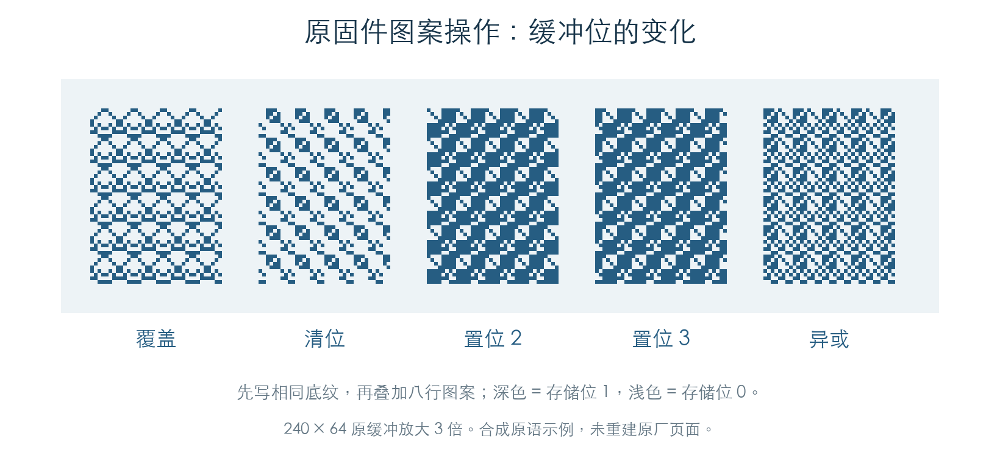

# 从矩形刷新到显示缓冲

范围说明：本章保存已完成的绘制研究，作为技术附录。按 2026-11-02 的范围调整，后续只提取 GUI 业务逻辑，不扩展字体、图标或逐页画面还原。

界面刷新已经接到实际像素写入。背景清除路径 `0DD1DC → 0DCFF4 → 0E4F88 → 0E4C70` 会按裁剪矩形修改 240×64 的单色缓冲；另一个入口 `0E2EFC` 用八行图案进行覆盖、清位、置位或异或。[E1]



图中每块先写入相同底纹，再执行对应操作。图像来自模拟内存中的原函数输出；深色表示存储位 1，浅色表示 0。它用于展示像素操作，未重建任何原厂页面。

## 1. 坐标和裁剪

绘制函数读取对象 `+28/+2A` 的位置偏移，将局部矩形转换为屏幕坐标。对象的绘图上下文提供一组可绘制区域，每一项都与目标矩形求交，随后只写入交集。[E1]

矩形采用左闭右开、上闭下开边界。例如 `(7, 2, 9, 3)` 修改第 2 行的两个像素，恰好跨过字节边界。图案入口会把转换后的坐标写回调用参数；清除入口保留传入矩形，并把转换后的矩形记入 `C1004824`。

上下文区域列表由检查程序提供。原交集计算、坐标换算、掩码生成和内存写入均已执行。检查包含多个相邻区域和重叠区域；重叠部分会按列表顺序重复处理，因此两次异或会恢复原位。

## 2. 每个像素怎样保存

缓冲指针位于 `C104751C`。每行 30 字节，共 1,920 字节，每个字节按最高位到最低位排列：[E1]

```text
字节位置 = 30 × y + floor(x / 8)
位掩码   = 0x80 >> (x mod 8)
```

写入函数分别计算左端和右端掩码，保留矩形外的位；中间完整字节直接处理。576 组清除检查包含八种起始位、六种宽度、三个位置偏移和四组裁剪列表。另检查整屏、右下角、最后一行、单像素和零面积边界。所有结果与独立逐像素模型一致，缓冲前后各 32 字节的保护区保持原值。

## 3. 图案填充格式

`0E2EFC` 的参数块如下：[E1]

| 偏移 | 内容 |
| --- | --- |
| `+00` | 操作编号 |
| `+04` | 覆盖模式；值为 2 时直接反转目标位 |
| `+08` | 四个 16 位矩形坐标 |
| `+10` | 八个 16 位图案行，使用各行低八位 |

图案行由**屏幕 y 坐标模 8**选取，位由屏幕 x 坐标模 8 选取。因此图案对齐到屏幕，不随每个矩形的左上角重新开始。

| 操作编号 | 对目标位的处理 |
| --- | --- |
| 0 | 用图案位覆盖 |
| 1 | 图案位为 1 时清零 |
| 2、3 | 图案位为 1 时置一 |
| 4 | 与图案位异或 |
| 超出 0–4 | 普通模式不写入 |

`+04` 为 2 时，原函数跳过上述编号分派，直接反转矩形内的所有位。1,920 组检查覆盖六种编号、两种模式、跨字节宽度和四组裁剪列表；图案行高八位刻意写入非零值，验证其不参与结果。

## 4. 连续刷新检查

16 组检查从刷新状态函数 `0DD1DC` 开始，执行绘制分派、背景矩形换算和清除，最终比较整个缓冲。模式设为零，仅触发背景处理；对象 `+6` 的 `40` 位打开时，背景清除被跳过。[E1]

本章在上下文激活与归还边界记录调用。[窗口遮挡检查](UI_OCCLUSION.md)已执行原上下文构造、矩形池、区域生成和回收，并接到像素写入。文本、图标、完整页面画面和 LCD 物理传输未纳入本章验证，也不再作为后续 GUI 完成要求。

## 证据与复现

**[E1]** KROSS 2 v1.2.4 原指令检查：[机器结果](../../derived/firmware/KROSS2_V124/architecture/stage04/ui-bitmap-check.json)、[检查脚本](../../tools/firmware_ui_bitmap.py)。

- [图案写入](../../derived/firmware/KROSS2_V124/architecture/stage04/ui-bitmap-pattern.arm.txt) · [矩形清除](../../derived/firmware/KROSS2_V124/architecture/stage04/ui-bitmap-clear.arm.txt)。
- [原函数输出的 1,920 字节示例](../../derived/firmware/KROSS2_V124/architecture/stage04/ui-bitmap-pattern-sample.bin)。
- 复现：`python3 research/tools/firmware_ui_bitmap.py --verify-arm`。使用私有模拟内存，无设备访问。
