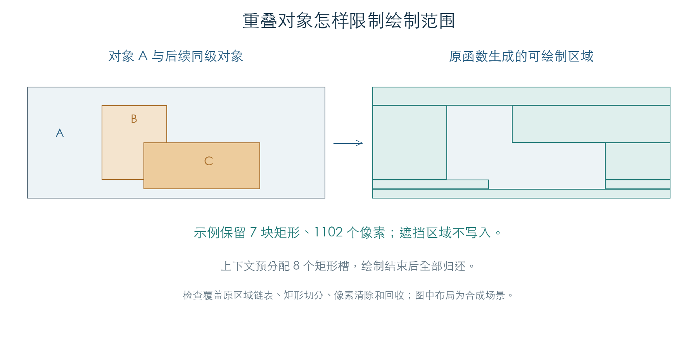

# 窗口遮挡与可绘制区域

绘图上下文保存对象当前可以写入的矩形区域。激活上下文时，固件先裁剪对象边界，再减去后续同级对象占据的矩形；绘制函数遍历剩余区域，把像素写入限制在这些范围内。[E1]



本章执行了原上下文构造、固定容量链表、迭代、切分、借用和归还。堆分配/释放与异常登记在模拟边界处理。1,323 组矩形减法和 216 组“上下文生成 → 像素清除 → 归还”的连续检查通过。[E1]

## 1. 一个上下文拥有八个矩形槽

上下文构造函数 `0D88DC` 建立两个容量为八的链表，并分配八块 8 字节矩形数据。矩形在空闲列表和活动区域列表之间移动，正常绘制期间不增加矩形槽。[E1]

| 上下文偏移 | 内容 |
| --- | --- |
| `+04` | 矩形池；其中保存空闲列表 |
| `+08` | 当前可绘制区域列表 |
| `+0C` | 遮挡检查起点；为零时查找对象所属的顶层分支 |
| `+10` | 上下文已激活标志 |

`0DBC5C` 从全局上下文列表借出一个对象，写入控件 `+2C`。`0DBD20` 激活它，`0DBD74` 归还它。归还前，`0D9594` 把全部活动矩形送回空闲列表，并清零上下文 `+0C/+10`。连续检查逐次核对八个矩形的所有权，未发现丢失或重复归还。

矩形池耗尽时，取出函数 `0D88A8` 返回零。固定列表自身也会在节点满时拒绝追加。切分调用方如何处理耗尽，见第 4 节。

## 2. 遮挡检查从哪里开始

激活函数 `0D927C` 从对象 `+14` 取得屏幕矩形。全局裁剪开关打开时，再与 `C10042C0` 的矩形求交；有面积交集才加入活动列表。[E1]

随后按以下规则处理遮挡：

- `C10042A8` 非零时跳过遮挡切分。
- 正在激活全局根对象时，同样跳过。
- 其他对象使用上下文 `+0C` 指定的分支；该字段为零时，由父链查找顶层分支。
- 从这个分支的**下一个同级对象**开始，沿同级链处理。这个循环不递归遍历同级对象的子树。
- 候选遮挡对象 `+6` 的 `10` 或 `40` 位非零时跳过；本循环不检查其 `+8` 的 `10` 位。

遮挡矩形由候选对象的局部尺寸和屏幕偏移换算。检查用 A、B、C 三个同级对象和 B 的一个子对象验证了起点、标志和遍历范围；把起点改为 B 后，只减去 C。四组补充检查覆盖根对象和空裁剪结果。即使活动区域为空，激活标志仍会设为一。

## 3. 矩形怎样切开

`0D8E84` 接收当前可绘制矩形与遮挡矩形。二者没有面积交集时保留原矩形；被完全覆盖时返回零，由调用方移除并回收；部分覆盖时缩小原矩形，并按需要从池中取出额外矩形。[E1]

遮挡块完整位于内部时，会留下上、下、左、右四块互不重叠的区域。新块被插入活动列表头部，原矩形保留其中一块。1,323 组检查覆盖各方向交叠、包含、边缘接触和负坐标，用独立像素集合比较：

```text
剩余区域的并集 = 原矩形覆盖的像素 − 遮挡矩形覆盖的像素
```

检查同时要求剩余矩形互不重叠、没有零面积矩形、活动与空闲矩形总数始终为八。

216 组连续检查进一步让原像素清除函数直接使用生成的区域列表。整个 1,920 字节缓冲与独立模型一致，缓冲两端保护字节保持原值。每轮结束后，原归还路径恢复全部八个空闲槽。

## 4. 八槽耗尽时的原代码行为

合成对象区域为 `(0,0,64,24)`，后续四个同级对象分别覆盖：

```text
(4,4,10,10)   (20,4,26,10)   (36,4,42,10)   (4,15,10,21)
```

前三次切分后仍可完成检查；第四次切分过程中，活动列表达到八项，空闲槽为零。`0D88A8` 返回空指针，切分函数未检查返回值，在 `0D91D0` 尝试向地址 `00000006` 写入两个字节。模拟器在该访问处停止。[E1]

此结果也通过完整原激活入口 `0D927C` 和原同级遍历复现，未用替代切分逻辑。对象位置与数量来自人工构造。原厂页面是否允许这组布局、上层是否约束遮挡数量，尚未确定，不能据此断言真实页面会触发同一故障。

## 证据与复现

**[E1]** KROSS 2 v1.2.4 原指令检查：[全部矩形与上下文结果](../../derived/firmware/KROSS2_V124/architecture/stage04/ui-occlusion-check.json)、[检查脚本](../../tools/firmware_ui_occlusion.py)。

- [矩形池构造](../../derived/firmware/KROSS2_V124/architecture/stage04/ui-context-pool.arm.txt) · [矩形减法](../../derived/firmware/KROSS2_V124/architecture/stage04/ui-context-subtract.arm.txt)。
- [上下文激活与回收](../../derived/firmware/KROSS2_V124/architecture/stage04/ui-context-activate.arm.txt) · [借用和归还](../../derived/firmware/KROSS2_V124/architecture/stage04/ui-context-borrow.arm.txt)。
- 复现：`python3 research/tools/firmware_ui_occlusion.py --verify-arm`。只使用私有模拟内存，无设备访问。
