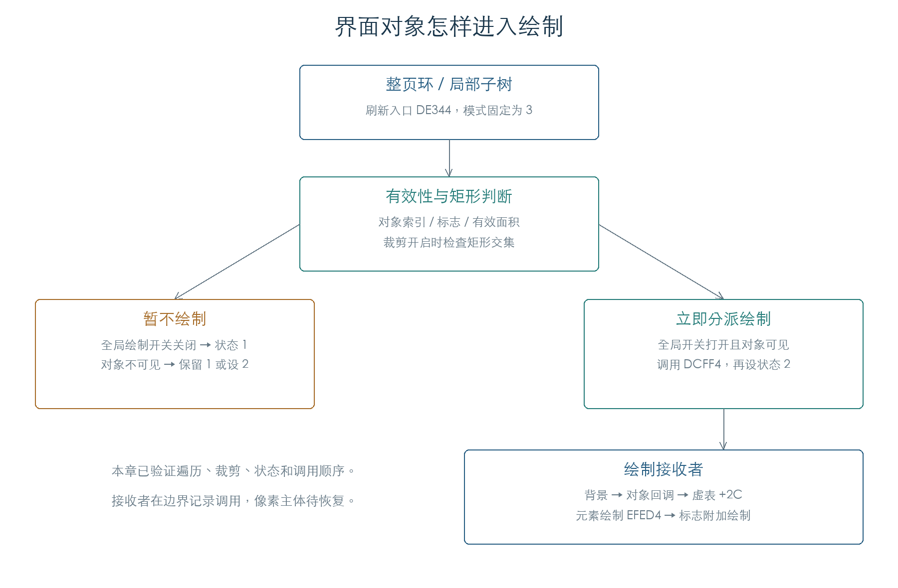

# 界面裁剪与刷新分派

KROSS 2 的界面对象先经过有效性、标志和矩形范围检查，再进入绘制分派。全局绘制开关关闭时，对象被标记为待刷新；开关打开且对象可见时，原代码立即调用绘制入口。[E1]

## 1. 怎样判断对象需要绘制

`0DCE7C` 检查对象 `+14` 开始的四个有符号 16 位坐标，依次为左、上、右、下。以下任一条件会返回零：[E1]

- 对象为空，或节点索引为 `FFFF`。
- 对象 `+6` 或 `+8` 的 `10` 位被置位。
- 右边不大于左边，或下边不大于上边。
- 裁剪开关 `C10042B8` 打开，且对象矩形与 `C10042C0` 中的裁剪矩形没有面积交集。

矩形只接触边缘时不算相交。2,496 组检查包含零面积、反向坐标、边缘接触、局部相交和 16 位坐标极值。

函数还通过输出参数报告部分裁剪。该结果需要同时满足：对象可见、裁剪打开、`C10042A0` 非零、虚表 `+10` 返回非零、对象 `+6` 的 `40` 位打开、虚表 `+8C` 返回零，且对象未完全落在裁剪矩形内。这里保留字段与槽位名称，具体对象类型含义尚待对应。

## 2. 立即绘制与待刷新状态

`0DD1DC` 接收对象、绘制模式和背景处理参数。它先调用可见性检查，再读取全局 `C10042B0`。[E1]

| 条件 | 绘制动作 | 对象 `+40` |
| --- | --- | --- |
| 全局开关为零 | 暂不绘制 | 设为 1 |
| 开关非零，对象可见 | 调用 `0DCFF4` | 设为 2 |
| 开关非零，对象不可见，原状态为 1 | 暂不绘制 | 保留 1 |
| 开关非零，对象不可见，原状态为其他值 | 暂不绘制 | 设为 2 |

函数随后把部分裁剪结果写入对象 `+38`，调用 `0DBD74` 归还绘图上下文。128 组状态检查覆盖旧状态 0、1、2、7、四种绘制模式和两种背景参数。状态 2 本身不能证明屏幕已经更新；不可见对象也会进入这个状态。

## 3. 绘制分派的执行顺序

`0DCFF4` 按以下顺序分派绘制工作：[E1]

1. 激活对象的绘图上下文。背景参数非零时，按 `40` 标志决定是否调用背景处理 `0E4F88`，并清零 `+38`。
2. 对象 `+1C` 有回调时，以操作码 1 调用它。
3. 模式包含位 1 时，把对象 `+24/+26` 设为一，再调用 `+1C` 的操作码 2。回调返回零或没有回调时，调用虚表 `+2C`。
4. 模式包含位 2，且虚表 `+10` 返回非零时，调用 `0EFED4`。
5. 对象 `+6` 的 `80` 位决定是否调用虚表 `+30`；`+6/+8` 的 `20` 位决定是否调用虚表 `+34`。

640 组检查核对了顺序和回调截断行为。原分派函数已执行；本章在背景、控件绘制函数和图形上下文边界记录调用。[显示缓冲检查](UI_BITMAP.md)已接通背景清除和矩形图案写入，[上下文检查](UI_OCCLUSION.md)已恢复区域生成和回收。按范围调整，字形、图标、线框及完整画面还原不再继续扩展。

## 4. 整页刷新与局部刷新

`0DE344` 经 `0DE2A8` 对每个选中的对象调用 `0DD1DC`，绘制模式固定为 3。每个图形上下文还会得到其所属的顶层分支对象。[E1]

整页刷新从对象环读取 `R → A → D → E → B → F → C`。A 不可见时，D、E 仍会被独立检查。局部刷新 A 时采用子树遍历；A 不可见会使遍历停止，D、E 在本次刷新中被跳过。这项区别来自遍历函数的控制流。

32 组连续检查执行了顶层分支查找、整页/子树遍历、可见性判断和状态写入，覆盖绘制开关、不可见父对象以及嵌套全局状态。像素绘制主体、上下文生命周期和焦点查询使用受控接收者。

`C10042AC` 在刷新期间设为一：旧值为零则恢复零，旧值非零则保持一。整页刷新同样暂时打开 `C10042A8`；局部刷新保留原值。结束时 `C1004294` 清零。全局绘制开关打开时，还会检查待处理列表；非空列表的实际消费尚未纳入本章检查。

## 证据与复现

**[E1]** KROSS 2 v1.2.4 原指令检查：[全部矩阵与连续轨迹](../../derived/firmware/KROSS2_V124/architecture/stage04/ui-refresh-check.json)、[脚本](../../tools/firmware_ui_refresh.py)。

- [可见性判断](../../derived/firmware/KROSS2_V124/architecture/stage04/ui-refresh-visibility.arm.txt) · [刷新与绘制分派](../../derived/firmware/KROSS2_V124/architecture/stage04/ui-refresh-draw.arm.txt)。
- [树刷新入口](../../derived/firmware/KROSS2_V124/architecture/stage04/ui-refresh-tree.arm.txt) · [顶层分支查找](../../derived/firmware/KROSS2_V124/architecture/stage04/ui-refresh-top-level.arm.txt)。
- 复现：`python3 research/tools/firmware_ui_refresh.py --verify-arm`。执行仅限私有模拟内存。
