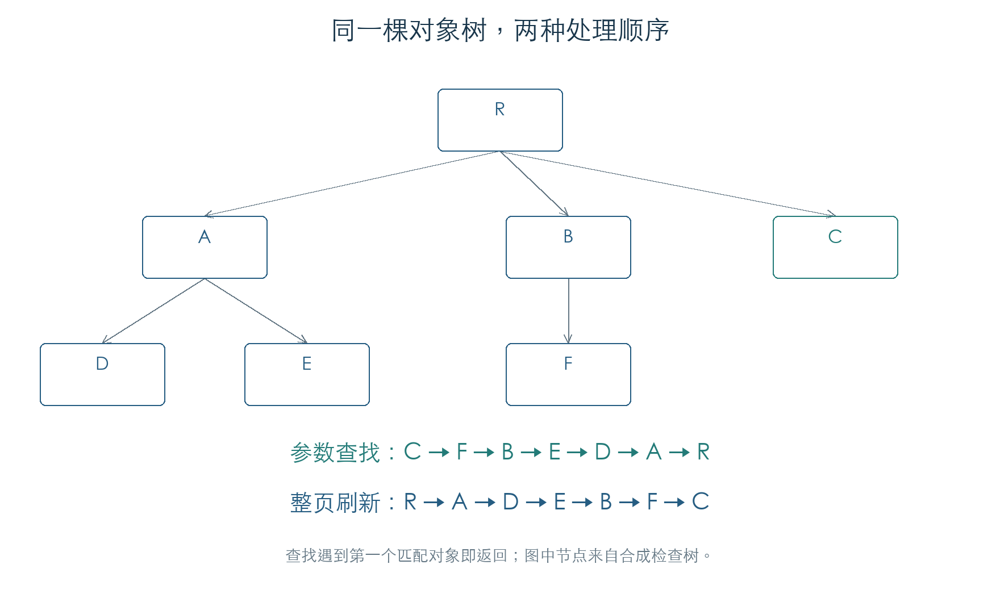

# 参数怎样找到界面控件

MMI 用“参数组 + 索引”在当前界面树中查找控件。查找只返回一个对象；多个控件绑定同一参数时，树的遍历顺序决定谁先收到通知。普通编辑框、按钮和参数面板共用编号匹配函数。[E1]



## 1. 对象树与节点池

树构造函数 `0DFCBC` 建立一个 384 项数组，每项 28 字节，共申请 10,752 字节。控件自身 `+A` 保存节点索引，`FFFF` 表示无效。节点保存以下关系：[E1]

| 节点偏移 | 内容 |
| --- | --- |
| `+04` | 父节点 |
| `+08` | 第一个子节点；空闲节点使用同一字段串联 |
| `+0C` | 下一个同级节点 |
| `+10 / +14` | 独立环形遍历链的前项、后项 |
| `+18` | 控件对象 |

`0E09FC` 插入根对象，`0E0A70` 追加子对象。验证树为 `R(A(D,E),B(F),C)`；原函数完成节点分配、父子关系和环形链连接。控件索引由检查程序写回，完整控件构造函数尚未执行。

`0E0AF8` 删除一棵子树：先断开父子关系和环形链，再逐项调用对象虚表 `+0C`，把节点送入空闲队列。删除 A 时，对象回调顺序为 D、E、A；随后添加三个对象，依次复用这三个节点，分配计数保持为七。对象析构的内部操作由检查接收者代替。

## 2. 参数查找顺序

`0DE090` 把两个 16 位编号组合后，调用树搜索 `0E158C`，选择模式 1。搜索函数先递归处理后续同级节点，再处理子节点，最后检查当前对象。图中的查找顺序为：[E1]

```text
C → F → B → E → D → A → R
```

搜索遇到第一个匹配对象就返回。256 组检查穷举了七个对象的全部匹配组合及两种遍历模式；512 组参数查找进一步执行原匹配函数，并改变对象 `+6/+8` 标志。通用编号匹配不读取这些标志，参数查找可以命中被刷新逻辑排除的对象。

谓词 `0DE030` 排除空指针和索引为 `FFFF` 的对象。内部对象失效不会自动剪掉其子树；搜索入口使用的根索引失效时，则直接返回空结果。

通用匹配函数 `0EFE8C` 比较控件 `+58/+5A` 的参数组和索引。25 组边界检查还确认：`0DE090` 在组合编号前对索引做有符号扩展，索引不小于 `8000` 时，组号会变成 `FFFF`。已研究的正常参数索引远低于这个范围。

## 3. 收到变更后，哪些对象进入刷新

本章核对了固件 `469000–46D600` 范围内 51 张至少有 46 个槽位的虚表。范围内的对应关系如下；这是一组具体虚表的统计。[E1]

| 对象示例 | 参数匹配 `+78` | 变更回调 `+B4` |
| --- | --- | --- |
| CEditCell、CSpinEditCell、CTextEditCell、CParamPane | `0EFE8C`，比较编号 | `0EFED0`，直接返回 |
| CMenu、CLabeledMenu、CStableMenu | `0DD9F4`，返回零 | `0E6E60`，调用刷新入口 |
| CWindow、CDialog、CTextDialog | `0DD9F4`，返回零 | `113D04`，调用刷新入口 |
| CEGCell、CLabeledMenuLabel、CSeqEventEditPane 等 | 各自实现 | 专用回调，仍待逐项恢复 |

92 组回调检查执行了上述空回调和菜单/窗口包装函数。菜单和窗口在对象有效时调用 `0DE344`，随后清零 MMI 对象 `+74`；普通空回调没有修改对象。因此，完整界面更新还要结合参数操作码 9、专用回调和周期刷新。菜单/窗口的通用编号匹配返回零，不能仅凭虚表存在，就认为普通参数查找会命中它们。

刷新入口的后续控制流见[界面裁剪与刷新分派](UI_REFRESH.md)。

## 4. 数组边界

底层取址 `0DFA2C` 接受 `0 ≤ index ≤ 384`。数组实际分配 384 项，有效槽位为 0–383，所以索引 384 返回数组末端之后的地址。原节点分配路径也没有在已检查的函数内限制增长计数。[E1]

当前检查只取回该地址，没有访问它指向的节点。页面对象数量上限、上层调用约束和正常运行可达性仍待核对。

## 证据与复现

**[E1]** KROSS 2 v1.2.4 原指令检查：[结果与虚表对照](../../derived/firmware/KROSS2_V124/architecture/stage04/ui-tree-check.json)、[脚本](../../tools/firmware_ui_tree.py)。

- [节点池](../../derived/firmware/KROSS2_V124/architecture/stage04/ui-tree-pool.arm.txt) · [连接与回收](../../derived/firmware/KROSS2_V124/architecture/stage04/ui-tree-links.arm.txt)。
- [搜索主体](../../derived/firmware/KROSS2_V124/architecture/stage04/ui-tree-search.arm.txt) · [参数查找](../../derived/firmware/KROSS2_V124/architecture/stage04/ui-parameter-lookup.arm.txt)。
- 复现：`python3 research/tools/firmware_ui_tree.py --verify-arm`。使用合成对象和私有模拟内存，不访问设备。
