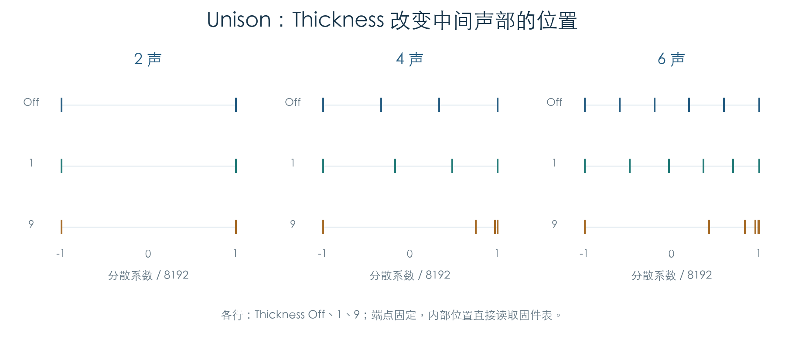

# Unison 叠加与音高分散

KROSS 2 v1.2.4 · 阶段 03 · 2026-11-01

Unison 在单音模式下，把一次 OSC Note On 扩成 2–6 次声部管理器调用。每次调用携带不同的分散索引；声部的音高计算按这个索引查表，再加入 Detune 偏移。力度层和立体声配对继续由管理器处理，因此 Unison 数量与实际占用的 TG 槽数可以不同。



## 1 叠加循环与声部链

入口 `0x1F62F0` 检查单音模式和 Unison 开关，读取声数 N，再按 `N−1 … 0` 顺序调用管理器 `0x1FDC8C`。索引暂存在 OSC `+4A2`，控制初始化把它复制到声部音高状态。

已有声部按链表顺序传入管理器。旧链长于新设定声数时，循环会处理剩余节点，额外调用的索引保持为 0。这是已有声部的遍历规则；实际复用、替换或新建仍取决于管理器分支。

管理器返回的新链先串接，再整体插入 OSC 活动链。最终节点顺序与返回链相反；同一批节点获得共同的音符组编号。400 组分发检查覆盖单音、连奏、Unison 开关、2–6 声、0/1/2/6/8 个已有节点及首次按键标志。10 组返回链检查分别让每次管理器调用返回一个或两个节点。

## 2 参数与分散表

| Program 字段 | 用途 | 参数描述符范围 |
| --- | --- | --- |
| `+50A` bit 7 | Unison 开关 | 0–1 |
| `+50A` 低三位 | 声数 | 2–6 |
| `+50B` | Detune | 0–99 |
| `+50C` | Thickness | 0–9，0 为 Off |

原 getter `0x275688` 直接读取这些字段，其中声数 getter 读取低五位。正常参数写入范围仍由描述符限制为 2–6。

查表函数 `0x1FFEB0` 支持 2–16 声，每种声数有 10 行 Thickness 数据。全部 1,350 项已与原函数返回值逐项比较；7–16 声属于内部表覆盖范围，当前界面没有开放这些声数。

各行两端固定为 `−8192` 和 `+8192`。Thickness Off 的内部点近似等距；更高档位把内部点移向正侧。两声配置只有端点，因此 Thickness 不改变它的分散位置。

## 3 Detune 的整数换算

音高更新 `0x1FF38C` 将查表系数 K 与 Detune D 相乘，执行：

```text
音高偏移 = (D × K × 331) >> 22
最终步进 = 固件指数表(基础音高 + 音高偏移)
```

右移为有符号算术右移。指数表以每半音 256 格、每八度 3072 格表示音高。以下数据使用零基础偏移的独立音高夹具：

| 三声，Detune 24，Thickness Off | 低侧 | 中间 | 高侧 |
| --- | --- | --- | --- |
| 分散系数 | −8192 | 0 | 8192 |
| 整数音高偏移 | −16 | 0 | 15 |
| 相位步进 | 8162 | 8192 | 8219 |
| 按步进比换算的音分 | −6.35 | 0 | +5.70 |

手册印刷页 8 对同一设置给出 −12/0/+12 音分示例。当前 v1.2.4 路径的整数计算与该示例存在约两倍差异，原因尚未确定。

为排除独立夹具遗漏，另用两个 Concert OSC 参数块及一个真实 ROM 区域执行完整声部初始化。104 组 Unison 输入均与匹配的关闭分散基线比较；指数偏移符合上式，并一直保留到 TG 启动入口的步进值。夹具使用音符 36，使步进低于该采样的播放上限。这个结果确认了 ARM 输出，实际音频音高仍需 TG 执行证据。

## 4 检查范围

20,000 组原音高初始化覆盖正常声数、全部 10 档 Thickness、全部 100 档 Detune 和每个声部索引。指数输入、控制状态和最终相位步进均逐项核对。

分发检查在声部管理器入口提供合成返回链；音高检查固定无关调制为零。完整控制检查保留 Concert 参数和原包络/LFO 初始化，在 TG 启动边界记录结果。后续需把单音按键、真实选层、Unison、资源耗尽和 TG 控制串成连续轨迹，并解释手册换算差异。

- [机器结果与完整分散表](../../derived/firmware/KROSS2_V124/architecture/stage03/unison-check.json)
- [叠加循环汇编](../../derived/firmware/KROSS2_V124/architecture/stage03/unison-OSC-dispatch.arm.txt) · [音高计算汇编](../../derived/firmware/KROSS2_V124/architecture/stage03/unison-pitch-update.arm.txt)
- [KROSS 2 Parameter Guide](../../downloads/KROSS2_Parameter_Guide.pdf)，印刷页 8，Unison。

```sh
python3 research/tools/firmware_unison.py --verify-arm
python3 research/tools/firmware_runtime_verify.py
```
