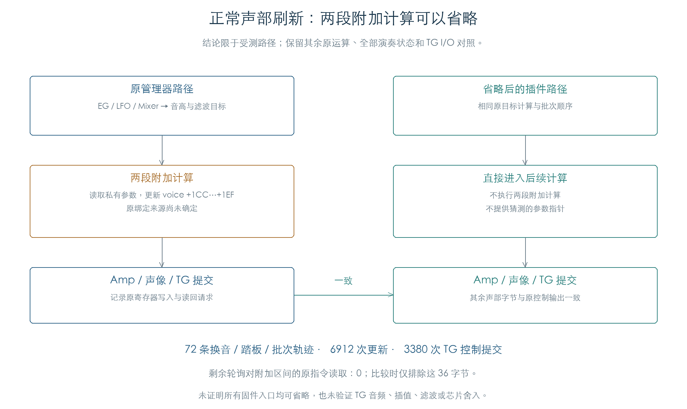

# 正常刷新中可省略的两段附加计算

KROSS 2 v1.2.4 · 插件控制路径的省略验证 · 2026-11-02

在受测正常刷新路径中，两段附加计算可以整体省略。72 条换音、踏板和批次轨迹完成 6912 次更新、3380 次 TG 提交；除附加区自身 36 字节外，两侧声部状态、其他运行内存、调用顺序和 TG I/O 一致。后续原轮询没有读取被省略的区间。

插件实现这条路径时，可以跳过这两段计算，省去此前为未知参数指针提供的私有绑定。原始绑定来源继续留档；本项不把它当作已恢复字段，也不把省略结论扩展到全部固件入口。



## 1 省略边界

原批次轮询先更新 EG、LFO、Mixer、音高与滤波目标，再处理两段附加状态，随后计算 Amp、声像并提交 TG。

| 附加块 | 原处理 |
| --- | --- |
| `voice+1CC` | 保存上一目标，读取参数首字节的低七位，经 `200F04` 计算新目标 |
| `voice+1D8` | `20010C` 先复制上一组目标，再进入 `20006C` 读取参数和调制源，生成当前值与派生量 |

两块合计占 `+1CC…+1EF`，下一块 AMS Mixer 从 `+1F0` 开始。原 `1F9828` 的 TG 提交读取音量、音高、Filter A/B、声像、发送与输出字段；通用调制源入口 `1F8608` 也未列出这两块作为来源。原指令摘录随结果保存，作为受测数据流的静态补充。

研究模型仅在 `1FE6F0` 将程序位置转到 `1FE75C`，越过这两个循环，继续执行其余原轮询。未改写镜像，没有用零返回值替换其他运算，也没有在省略侧建立附加参数指针。

## 2 连续对照

对照侧沿用[此前持续刷新](MIDI_VOICE_REFRESH.md)的私有零参数，执行完整原管理器；省略侧只跳过上述区间。两侧均直接执行原推进入口 `1FD3CC` 与原轮询 `1FE404`。

矩阵复用六组换音：A000 ↔ A061、A011 ↔ F042、GM 旋律 ↔ GM 鼓组。每组取批次 1/3/8、模式 0/3、踏板关/开，共 72 条，每条 96 次更新。流程包含音量、最大弯音、换音、新音符、表情、松键、松踏板和弯音回中；批次 3 从槽 31 开始，覆盖池尾回绕。

比较只屏蔽每个声部的这 36 字节，其余 552 字节逐字节检查；候选/成员/等待链、六个 OSC、三个音色/Part/控制缓冲、十六通道、鼓键状态、工作区及 PRNG 均完整比较。提交记录内的声部快照采用相同区间屏蔽，原 TG 读写、等待请求和函数顺序保持逐项比较。

每条 MIDI 事件、推进和轮询后分别比较。全部控制目标与提交摘要又逐条对照旧结果，6912 次更新、3380 次 TG 提交保持一致。组合跳过点累计执行 1068 次。

省略侧另监测原轮询对全部 32 个声部的内存读取：其余阶段对 `+1CC…+1EF` 的读取数为零。这比只比较最终 TG 写入多检查了一层数据依赖；它仍限于实际执行到的分支。

## 3 为什么可以停止追查绑定

[较早的参数扰动检查](VOICE_REFRESH.md)已用八个原厂 OSC 对两块私有参数施加非零变化，各推进十六步。附加状态变化，其他声部字节和 TG I/O 保持一致。本轮进一步直接省略计算和绑定，确认受测正常演奏链能完整运行。

因此，这两块真实参数来源暂不阻碍受测插件路径。相关地址和旧结果保留，后续若出现实际消费者再局部追查。GUI、整机启动及其他无关入口无需为此扩大逆向范围。

## 4 保留的限制

原控制时基、TG 活动/忙闲、振幅 16384、评分 `0x1234` 及未分配控制来源继续采用既有受控输入。原始绑定来源、其他固件入口、全部预置/Mono/Unison/耗尽组合没有在本项证明。

本项验证控制路径省略，不生成或比较 TG 声音。采样插值、TG 滤波、效果音频及芯片舍入仍需各自证据。产品源码和固件保持原值。

## 复现与证据

```text
python3 research/tools/firmware_voice_auxiliary.py --verify-arm
python3 research/tools/firmware_voice_auxiliary_figures.py
python3 research/tools/firmware_runtime_verify.py --evidence-only
```

- [72 条轨迹及逐步结果](../../derived/firmware/KROSS2_V124/architecture/stage04/voice-auxiliary-check.json)、[轨迹摘要 CSV](../../derived/firmware/KROSS2_V124/architecture/stage04/voice-auxiliary-traces.csv)、[配图指纹](../../derived/firmware/KROSS2_V124/architecture/stage04/voice-auxiliary-figure-check.json)
- 原指令：[两个轮询阶段](../../derived/firmware/KROSS2_V124/architecture/stage04/auxiliary-poll-phases.arm.txt)、[附加目标](../../derived/firmware/KROSS2_V124/architecture/stage04/auxiliary-targets.arm.txt)、[标量计算](../../derived/firmware/KROSS2_V124/architecture/stage04/auxiliary-scalar.arm.txt)、[调制源查询](../../derived/firmware/KROSS2_V124/architecture/stage04/auxiliary-modulation-getter.arm.txt)、[TG 提交](../../derived/firmware/KROSS2_V124/architecture/stage04/auxiliary-TG-commit.arm.txt)
- [检查脚本](../../tools/firmware_voice_auxiliary.py)、[配图脚本](../../tools/firmware_voice_auxiliary_figures.py)、[原有非零参数扰动结果](../../derived/firmware/KROSS2_V124/architecture/stage04/voice-refresh-check.json)
