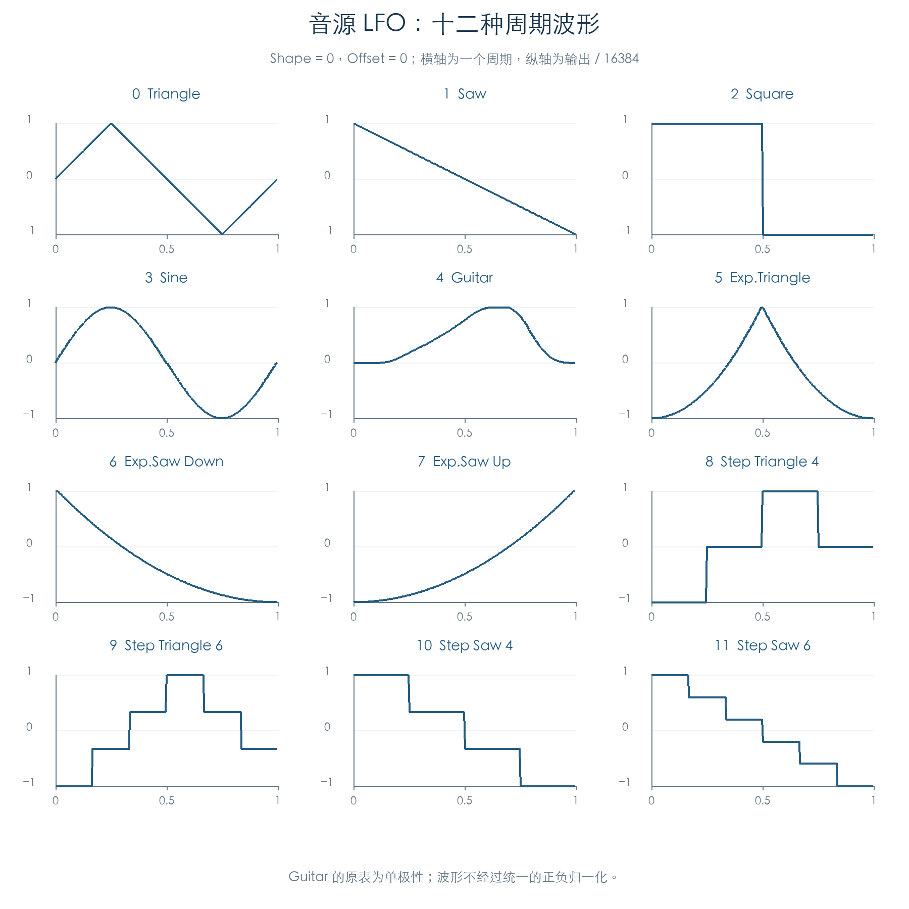
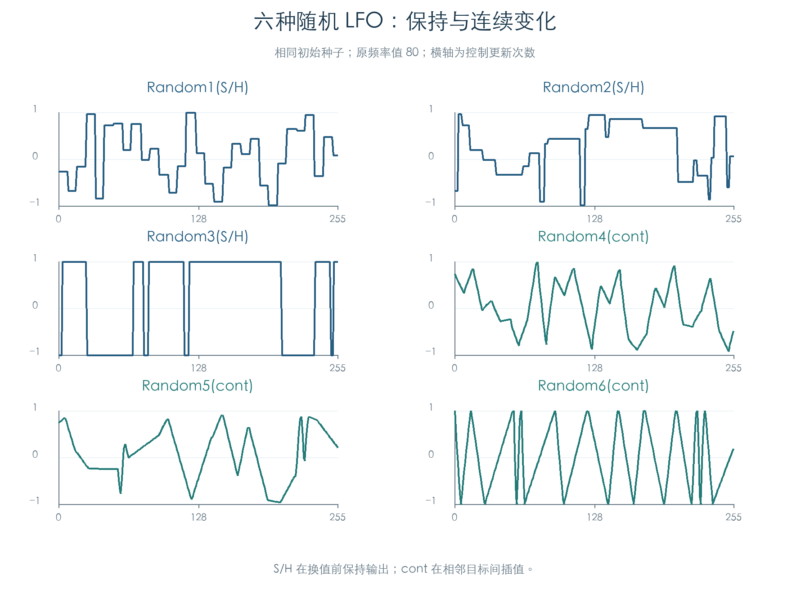
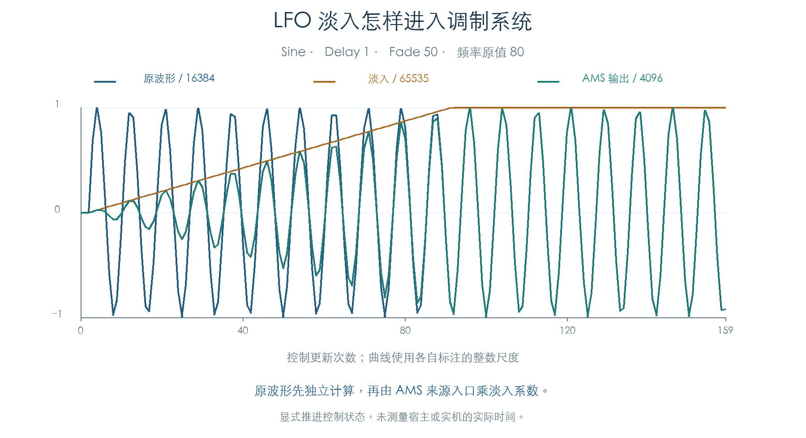

# 音源 LFO：波形、时间推进与调制输出

KROSS 2 v1.2.4 · 2026-11-02

音源 LFO 的 18 种波形、Shape/Offset、随机序列、相位推进、节拍同步和延迟淡入已恢复为独立整数模型，并与原 ARM 指令逐项比较。两路 LFO 送入 AMS 调制系统时，还会乘各自的淡入系数。这些行为决定颤音、音量起伏和滤波扫动的基础形状，属于插件需要保留的逻辑。

原厂 768 个 Program 共存储 3072 块 OSC LFO 参数，已全部读入原核心函数核对。后续[频率调制与声部调用](VOICE_LFO_INPUTS.md)又将这些参数接到原包装器、Tone Adjust 与 AMS getter。本章数量包含未启用 OSC 的数据；完整声部调度与最终音频仍需继续连接。

## 1 周期波形与六种随机模式

周期波形共十二种。Sine、Guitar 和指数曲线使用固件查表与整数插值，阶梯波形保留原分界点。



Guitar 的原表为单极性，零 Shape/Offset 时从零向正值变化。为它强制去直流或统一归一化，会改变后续调制。Sine 的下降插值也有原整数舍入，模型保留该差别。

六种随机模式共享一个 32 位状态，但换值次数与平滑规则不同：

| 模式 | 输出与换值规则 |
| --- | --- |
| Random1 S/H | 每次相位回绕抽取新值，期间保持 |
| Random2 S/H | 随机周期、随机幅度；换值时抽取两次 |
| Random3 S/H | 沿用随机周期，幅度按抽取值符号选正负满值 |
| Random4 cont | 固定基础速率，在随机目标之间连续插值 |
| Random5 cont | 随机周期，在随机目标之间连续插值 |
| Random6 cont | 随机周期，在零与正满值之间交替，再转为双极输出 |



随机周期模式在相位越界后归零，舍弃超出的部分。因此，仅给普通随机数发生器加平滑，无法保留这些模式的换值时机。

## 2 Shape 和 Offset 的实际运算

设原波形整数为 `x`，Shape 为 `p`，Offset 为 `o`。无 Shape AMS 时：

```text
a = 331 × p
x = x + ((32767 − (x² >> 15)) × a >> 16)
y = (x >> 1) + (661 × o >> 2)
```

`>>` 表示带符号算术右移。输出按 16 位存入状态。Shape 改变曲线弯曲程度，Offset 平移输出；二者都保留整数运算顺序。

Shape AMS 的 Amount 非零时，先计算 `m=clamp(Amount×来源值×331 >> 15, −32768, 32767)`，再将 `a` 改为 `clamp(331p+8m, −32768, 32768)`。只有进入该分支才做这次限幅；直接设 Shape 99 时 `a=32769`。3888 组组合核对了该边界、正负调制与偏移。

## 3 相位、延迟与淡入

相位采用 16 位一圈。十二种周期波形从原相位表取得起点；起始值 37 抽取随机相位。六种随机波形的相位起点固定为零，再按各自规则初始化随机状态。

自由速率读取 100 项频率表。基础相位步长为 `clamp(频率表值×速率尺度 >> 8, 1, 27525)`；四种随机周期模式还要乘原随机周期表的插值结果。

节拍同步使用十种时值：`[60,80,120,160,240,320,480,640,960,1920]` 个音乐计数单位，再乘 1–32。相位由当前音乐计数与起点的差计算。原逻辑只在差值**大于**周期时减去周期；恰好到周期终点时保留端点。边界测试保留此规则。

Delay 初始化为 `原值×512`，每次更新减去 `max(速率尺度,1)`。减到负数后，才将等待量归零并允许相位推进。淡入步长来自原 Fade 表的一半，累加到 65535。相位暂停标志只停止相位，Delay/Fade 仍更新。



波形核心先生成 `y`，淡入在 AMS 来源入口应用。两路来源编号分别为 6、7，其原式为：

```text
v = (s16(y) × u16(fade)) >> 16
AMS = (v × 16387) >> 16
```

这解释了原波形已经振荡、调制幅度仍逐渐增加的过程。234 组边界及一条 160 次更新的连续轨迹执行了原来源入口；两路结果均符合独立公式，声部内存保持不变。图中时间轴为控制更新次数，未据此换算实机秒数。

## 4 原厂数据与验证范围

每个 Program 存储两个 OSC，每个 OSC 含两个 28 字节 LFO 参数块。固定随机种子、外部 AMS 为零时，3072 块参数均通过原初始化、波形及显式音乐计数推进。

| 检查 | 数量 | 比较内容 |
| --- | ---: | --- |
| 周期波形 | 15456 组 | 查表区间、插值小数、阶梯分界 |
| Shape/Offset/AMS | 3888 组 | 正负边界、限幅及运算顺序 |
| 初始化 | 108 组 | 全部波形与六种起始值 |
| 随机数种子 | 517 个 | 原 32 位发生器的返回值和新状态 |
| 随机轨迹 | 18 条 | 六种模式、三种种子，各 256 次更新 |
| Delay/Fade/相位暂停 | 108 条 | 各 240 次更新 |
| 节拍同步 | 240 条 | 十种时值、倍数、起点与周期边界 |
| 两路 AMS 输出 | 234 组 + 160 次更新 | 波形、淡入乘法、来源选择及只读行为 |
| 原厂存储参数 | 3072 块 | 来源记录哈希、原核心函数及八个计数访问点 |

本章核心实验比较完整 44 字节状态、函数返回值和随机状态。Tone Adjust 辅助入口提供指定原始值，公共 AMS 输入入口提供测试信号。[后续检查](VOICE_LFO_INPUTS.md)已执行原 LFO 包装器、频率 AMS、参数 getter 与受控状态继承。完整声部调度、立体声继承对象的选择、控制周期到真实时间及最终音频全链仍需补齐。这里的音源 LFO 也不能直接替代合唱效果器内部 LFO。

## 证据与复现

| 文件偏移 | 已执行或定位的入口 |
| --- | --- |
| `0x200208` | 核心初始化 |
| `0x200A3C` | 十八种波形、Shape 与 Offset |
| `0x200778` | 延迟、淡入及相位推进 |
| `0x200598` | 自由速率与节拍同步 |
| `0x2C838C` | 32 位随机状态更新 |
| `0x1F8608` | 声部 AMS 来源读取；本章执行来源 6、7 |

- [独立模型与原函数检查](../../tools/firmware_voice_lfo.py) · [完整结果与原厂来源](../../derived/firmware/KROSS2_V124/architecture/stage04/voice-lfo-check.json)
- [初始化汇编](../../derived/firmware/KROSS2_V124/architecture/stage04/voice-lfo-init.arm.txt) · [波形汇编](../../derived/firmware/KROSS2_V124/architecture/stage04/voice-lfo-waves.arm.txt) · [随机与尺度汇编](../../derived/firmware/KROSS2_V124/architecture/stage04/voice-lfo-random-and-scale.arm.txt)
- [声部包装器](../../derived/firmware/KROSS2_V124/architecture/stage04/voice-lfo-wrapper.arm.txt) · [AMS 输出汇编](../../derived/firmware/KROSS2_V124/architecture/stage04/voice-lfo-ams-output.arm.txt)
- [配图脚本](../../tools/firmware_voice_lfo_figures.py) · [周期波形 CSV](../../derived/firmware/KROSS2_V124/architecture/stage04/voice-lfo-periodic.csv) · [随机轨迹 CSV](../../derived/firmware/KROSS2_V124/architecture/stage04/voice-lfo-random.csv) · [淡入与 AMS CSV](../../derived/firmware/KROSS2_V124/architecture/stage04/voice-lfo-fade-ams.csv)

复现：`python3 research/tools/firmware_voice_lfo.py --verify-arm`。配图使用 `python3 research/tools/firmware_voice_lfo_figures.py`。输入与脚本记录 SHA-256；实验仅在私有模拟器内执行现有材料。
