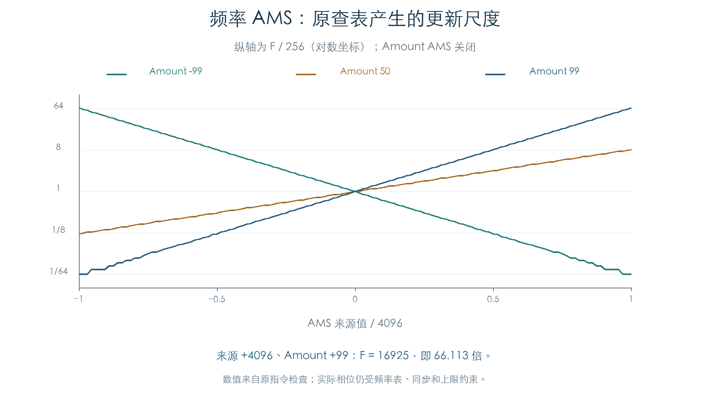
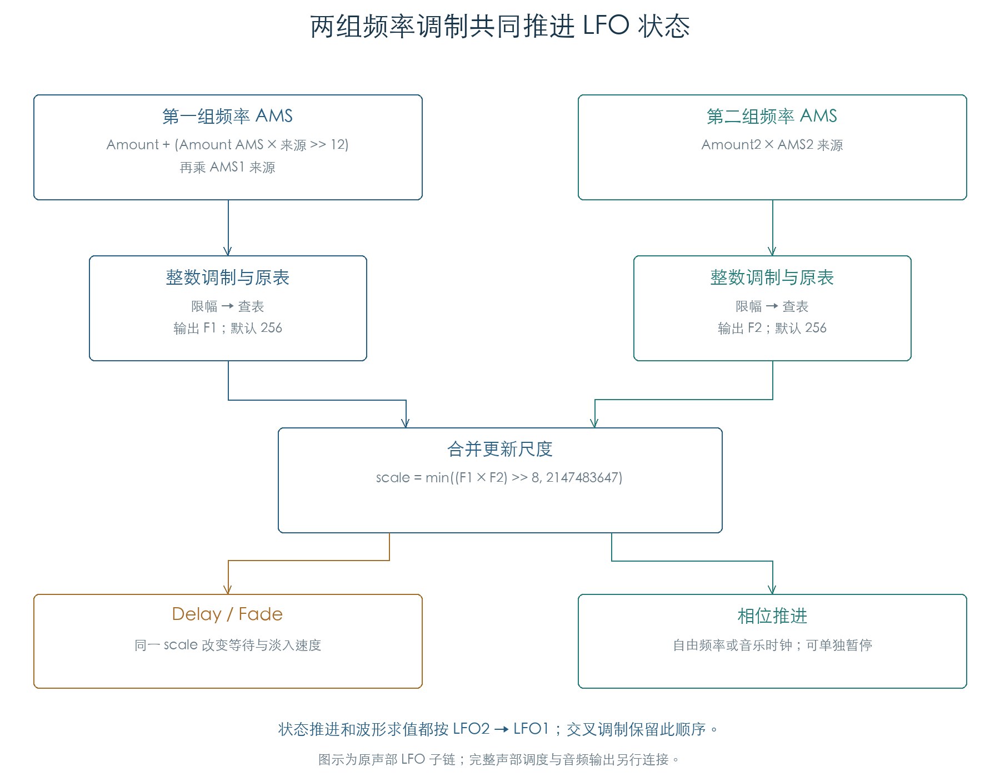

# LFO 频率调制与声部调用

KROSS 2 v1.2.4 · 2026-11-02

两路音源 LFO 已接到原声部包装器：直接读取 Program 参数，再经过原 Tone Adjust、控制器和 AMS 来源函数，进入已恢复的波形与时间核心。全部 3072 块原厂存储参数通过这层检查，覆盖两个 OSC 和两路 LFO。

频率调制会共同改变相位、等待和淡入速度。两路 LFO 的推进与波形求值均先执行 LFO2，再执行 LFO1；交叉调制需要保留这个顺序。本章补齐这些连接，波形公式见[音源 LFO 核心](VOICE_LFO.md)。

## 1 两组调制怎样改变速度

第一组频率 AMS 允许另一来源调节 Amount。设原 Amount 为 `A`、其调制强度为 `B`，两个来源值为 `S`、`T`：

```text
depth = A + (B × T >> 12)
q = clamp(depth × S × 331 >> 15, −32768, 32767)
index = clamp(3 × q >> 7, −128, 255) + 128
```

原函数按 `index` 读取 256 项增益表：索引不大于 255 时直接查表；更大时读取 `表[index−128]×256`。第二组频率 AMS 复用同一计算，Amount 不再受第三来源调节。未生效的组返回 256，两组最终合并为：

```text
scale = min((F1 × F2) >> 8, 2147483647)
```

所有右移均保留原整数语义。375 组 Amount/来源边界及 387 个曲线点由原指令核对。来源 `+4096` 时，Amount `+99` 生成 `16925/256≈66.113` 倍更新尺度；Amount `−99` 生成 `4/256=1/64` 倍。



同一个 `scale` 同时用于 Delay 递减、Fade 累加和自由相位步长。节拍同步时，相位仍从音乐计数计算，Delay/Fade 继续使用该尺度。



36 组极端输入还核对了合并尺度饱和和后续 32 位截断。尺度饱和到 `2147483647` 时，自由频率原值 50、99 的检查出现相位步长 1：原代码截取乘积右移后的低 32 位，再按有符号值判断。该行为已保留；这些是受控极端输入，尚未证明原厂音色的实际演奏会触发它。

## 2 参数读取与控制器覆盖

波形选择器从当前 Program、OSC 和 LFO 编号定位参数。Shape、Offset、Shape AMS 由原包装器直接传给核心。频率、同步时值、Delay、Fade 和相位暂停另经过下列读取：

| 参数 | Tone Adjust 编号（LFO1 / LFO2） | 本次核对的控制 |
| --- | --- | --- |
| 自由频率 | 22 / 26 | 0–99 值变换；LFO1 另读取启用的 CC76 |
| 同步时值 | 22 / 26 | 十档时值索引变换，保留原取整与限幅 |
| Delay | 24 / 28 | 0–99 值变换；LFO1 另读取启用的 CC78 |
| Fade | 23 / 27 | 0–99 值变换，无上述 CC 覆盖 |
| 相位暂停 | 25 / 29 | Tone Adjust 值非负时覆盖；负值沿用参数 bit6 |

0–99 值的 Tone Adjust 变换按方向缩放到端点：正量时 `v+((99−v)×t×331 >>15)`，负量时 `v−(v×(−t)×331 >>15)`。CC76/78 先以 64 为中心生成调整量，再使用同一变换。600 组检查执行原 getter，覆盖两个 LFO、三个标量参数、正负 Tone Adjust 和控制器关闭/0/64/127。同步时值另有 100 组检查。

本次使用原 Tone Adjust 的默认数据分支，明确设置中性调整值和暂停覆盖值；每通道另行挂接的 Tone Adjust 对象及其编辑过程尚未穷举。CC 从私有控制状态读取，未经过实时 MIDI 接收任务。

## 3 两路顺序与状态继承

原声部代码对 LFO2、LFO1 依次初始化、推进和求值。两路求值期间，一路可通过 AMS 来源编号 6、7 读取另一路的当前输出与淡入量。因此同一轮中，LFO1 的交叉调制能够看到本轮已求值的 LFO2；LFO2 读取的 LFO1 波形仍来自此前求值。

128 次连续交叉调制检查保留了这个顺序，两路输出、相位、尺度、完整状态和随机状态都与独立模型一致。另有 108 条轨迹，每条 32 次更新，覆盖十八种波形、自由/同步、暂停覆盖，以及变化中的键位、力度与 CC。

参数 bit7 会禁止使用传入的继承状态。允许继承时，核心只复制时钟起点、剩余 Delay、标志、Fade 当前量和相位；Fade 步长与初始相位仍留在本对象。144 组初始化核对了十八种波形、两路 LFO、有无继承指针及 bit7。此处控制继承指针的输入，尚未执行完整分配器选择立体声继承对象的过程。

## 4 原厂覆盖与验证边界

全部 768 个 Program、1536 个存储 OSC、3072 块 LFO 参数均执行原初始化、原参数 getter 和两路连续调用。每个 OSC 访问八个明确的音乐计数位置，使用键位 60、力度 100、中性 Tone Adjust、关闭的外部控制器，以及零 EG/Mixer/键盘跟踪/公共 LFO 状态。

| 本章检查 | 数量 |
| --- | ---: |
| 频率 AMS 组合 | 375 组 |
| 原表曲线点 | 387 个 |
| 原标量参数读取 | 600 组 |
| 同步时值读取 | 100 组 |
| 继承与重置初始化 | 144 组 |
| 极端尺度与截断 | 36 组 |
| 自由/同步/覆盖连续轨迹 | 108 条 × 32 次更新 |
| 两路交叉调制 | 128 次更新 |
| 原厂数据 | 1536 个 OSC，各含两路 LFO |

包装器、参数读取、AMS 来源、数学助手和波形核心均执行原指令。只在固件断言入口设置失败陷阱，本轮未触发；计算函数没有替代实现。期望结果来自独立整数模型，逐次比较两路完整 44 字节状态及共享随机状态。

这些检查补齐了 LFO 子链。[后续目标检查](LFO_TARGETS.md)已连接原音高、Filter A/B 和音量入口，核对基础深度与 AMS 深度的不同淡入路径。完整声部调度、EG/Mixer 等来源自身的连续更新、立体声继承选择、真实时间及最终音频仍待连接。原厂数据中的未启用 OSC 也参与存储参数检查，本章不据此统计可听音色数量。

## 证据与复现

- [原函数与独立模型检查](../../tools/firmware_voice_lfo_integration.py) · [完整结果与原厂记录哈希](../../derived/firmware/KROSS2_V124/architecture/stage04/voice-lfo-integration-check.json)
- [标量参数读取](../../derived/firmware/KROSS2_V124/architecture/stage04/voice-lfo-input-getters.arm.txt) · [同步时值读取](../../derived/firmware/KROSS2_V124/architecture/stage04/voice-lfo-sync-getter.arm.txt) · [Tone Adjust 与波形选择](../../derived/firmware/KROSS2_V124/architecture/stage04/voice-lfo-tone-getters.arm.txt)
- [声部 AMS 来源](../../derived/firmware/KROSS2_V124/architecture/stage04/voice-lfo-voice-getter.arm.txt) · [公共 AMS 来源](../../derived/firmware/KROSS2_V124/architecture/stage04/voice-lfo-native-source.arm.txt) · [增益表读取](../../derived/firmware/KROSS2_V124/architecture/stage04/voice-lfo-rate-table.arm.txt)
- [原状态推进顺序](../../derived/firmware/KROSS2_V124/architecture/stage04/voice-lfo-call-order.arm.txt) · [原波形求值顺序](../../derived/firmware/KROSS2_V124/architecture/stage04/voice-lfo-wave-order.arm.txt)
- [配图脚本](../../tools/firmware_voice_lfo_input_figures.py) · [速率曲线 CSV](../../derived/firmware/KROSS2_V124/architecture/stage04/voice-lfo-rate-factors.csv) · [交叉调制 CSV](../../derived/firmware/KROSS2_V124/architecture/stage04/voice-lfo-feedback.csv)

复现：`python3 research/tools/firmware_voice_lfo_integration.py --verify-arm`。图由 `python3 research/tools/firmware_voice_lfo_input_figures.py` 生成。仅用现有离线材料；固件、预载文件和依赖脚本均记录 SHA-256。
