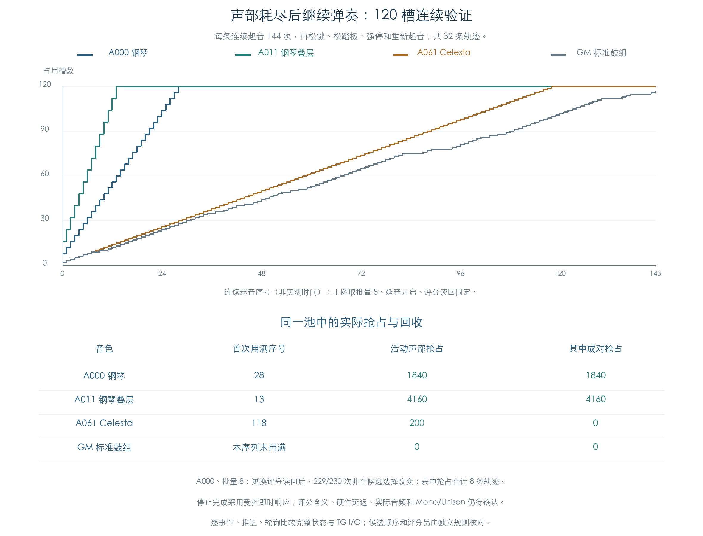

# 密集起音、声部耗尽与立体声抢占

KROSS 2 v1.2.4 · 插件声部管理 · 2026-11-02

固件按候选队列和缓存评分选择替换槽。评分来自此前的 TG 控制提交读回；分配器选择时使用缓存。抢占立体声任一侧时，原路径停止两侧并清理配对，选中槽立即重新使用，另一槽可供后续申请。

本轮将真实 MIDI 起音接到 120 个普通槽、正常推进和轮询，再检查持续起音后的抢占、松键、踏板与停止后再起音。32 条轨迹完成 5632 次更新、6481 次正常控制提交，逐阶段状态与 TG I/O 对照通过。共发生 6200 次活动声部抢占，其中 6000 次带立体声配对；GM 鼓组在本序列下未耗尽，作为对照保留。



| 音色 | 首次用满的更新序号 | 活动声部抢占合计 | 其中成对抢占 |
| --- | ---: | ---: | ---: |
| A000 | 28 | 1840 | 1840 |
| A011 | 13 | 4160 | 4160 |
| A061 | 118 | 200 | 0 |
| GM 标准鼓组 | 未用满，峰值 117 槽 | 0 | 0 |

首次用满取批量 8、延音开启、固定评分的代表轨迹；抢占数合计该音色的八条组合。它们描述受测分配状态，不能当作声音电平或实机复音性能。

## 1 连续流程

| 条件 | 输入 |
| --- | --- |
| 音色 | A000 Kross Grand Piano、A011 Pop Grand Piano、A061 Celesta、GM 标准鼓组 |
| 池容量 | 120 个普通槽；单个按键可占多个槽 |
| 模式与通道 | 模式 3、通道 7、单个主音色，保留其原 OSC 数量与参数 |
| 控制批量 | 每次推进/轮询的预算为 1 或 8 |
| 延音 | 关闭，或起音前打开、全部松键后关闭 |
| TG 评分读回 | 固定 4660；另一组按槽号提供含 0、4、5、9、300、65535、1000 的确定序列 |

四个音色与其余三项开关交叉，共 32 条轨迹。每条先发一个音符 48，再将音符 36 到 83 连续重复三轮，共 144 次新起音，力度均为 100。每次事件后调用原管理器推进和轮询，同一个声部池持续使用。

| 更新序号 | 操作 |
| --- | --- |
| 0–143 | 连续起音，随后正常推进/轮询 |
| 144 | 按相同次数松开所有测试按键，包含初始音符 |
| 148 | CC64 归零 |
| 152 | CC120 强停 |
| 156、164 | 再起音 86、88 |
| 160、168 | 分别松键 |
| 175 | 本条轨迹最后一次推进/轮询 |

更新序号只表示实验调用顺序。预算、受控活动位和即时停止响应均会影响轨迹，不能将此矩阵当作实机最大复音数或实际时间的测量。

## 2 替换目标怎样选择

候选选择入口 `0x1FC7F0` 从实际链表首项开始，以 65535 初始化当前最优分数：

```text
候选 = 队首
最佳分数 = 65535
依次检查队列中的槽：
    若 TG 活动位有效，且缓存评分严格小于最佳分数：
        候选 = 当前槽
        最佳分数 = 当前槽的缓存评分
        若评分 <= 4：立即停止搜索
返回候选；空队列返回空
```

相同评分保留较早出现的候选；没有任何严格改善时保留队首。启动入口 `0x1F9028` 先把该缓存写为 32767；之后的正常提交在活动位有效时更新读回值。低评分只影响查找顺序，当前证据没有确定该值的物理量，不能直接称为响度。

实验在原函数入口读取实际队列、缓存和受控活动位，用独立规则计算结果，在原函数返回处核对选中节点。正常提交继续检查评分写回的槽号，并用既有独立整数公式核对音量、音高和滤波控制字。

A000、批量 8、延音关闭时，两种评分读回让 230 次非空候选选择中的 229 次改变。批量 1 的同组轨迹未出现正常控制提交，评分输入没有改变选择顺序。这些结果对应本页调用序列，说明缓存更新属于声部管理的一部分；插件替换目标不能只按按键先后决定。

## 3 立体声抢占与停止完成

`0x1FC89C` 处理选中槽及其伙伴。选中次侧时先停止主侧；选中主侧时先停止自身。停止后两侧标志、配对类型与伙伴指针清零，成员节点移出原 OSC 列表。实验记录每次原复位入口 `0x1F8BF8` 的顺序、清理结果和可用计数。

原复位代码向 TG 发出槽位掩码与 `+22C` 命令 1，再等待对应活动位清零。启动掩码则随命令 2 提交。夹具分别对两个命令清除或设置指定活动位，每次请求和响应均记录；参数编程入口本身不提前置活动位。原复位、等待与列表代码继续执行；此处提供的是受控即时响应，硬件时延和芯片内部执行仍未知。

## 4 比较范围

两侧各有独立模拟内存：一侧执行原管理器推进/轮询，另一侧按已恢复的顺序调用原计算函数。每次 MIDI 事件、推进及轮询后，逐字节比较全部 120 个 588 字节声部、管理器与列表、六个 OSC、三个音色/Part/控制缓冲、16 通道、逐键鼓组控制、工作区及随机状态，并比较 TG I/O 和提交顺序。

新声部的采样、区域、权重、电平、立体声共享控制和采样寄存器另与独立冷启动参照核对。来源在构造入口保存，增益在初始化返回后检查，采样写入按每次 TG 启动函数的边界截取；调用结束后另检查最终存活的最新构造，避免把同一地址的多次使用混为一次。冷参照使用原 32 槽夹具，每个音色检查 50 个键位。连续池扩展为 120 槽时，将声部和节点搬到互不重叠的私有区，保留原索引与布局。

强停后的空节点适配沿用[已有验证](MIDI_STOP_REUSE.md)：原指令一侧允许写入私有零页，主机一侧省略双空链接的重复摘除。两侧的写入次数与省略次数成对核对；实机零页映射仍未确认。只有 Note On 前的临时栈规范化，活动声部、列表和控制器不重置。

完整状态在执行中逐阶段比较。结果文件保存每步状态摘要、声部池哈希、完整候选顺序/评分、原抢占与停止记录，以及所有控制提交；未重复保存每步的整池字节。

本轮核对 12400 次候选函数调用，含空队列查询；16344 次新声部构造均保留到该次外层起音结束。最初遗漏启动响应的夹具曾出现同次起音重复用槽；启动/停止响应配齐后，最终 32 条轨迹未再出现，旧现象不作为固件结论。强停后的 128 次私有零页写入对应主机的 64 次空摘除省略。

## 5 剩余工作

本项针对受控 TG 边界下的连续软件行为。实际采样推进、声音尾音、评分物理含义、控制周期与宿主音频时基尚未确认。Mono/Unison、多个音色共享资源、发生器与踏板的组合及完整预置集继续保留缺口。

本轮仅新增研究脚本、结果与图文说明，产品、固件和源采样保持原值。

## 复现与证据

```text
python3 research/tools/firmware_voice_pressure.py --verify-arm
python3 research/tools/firmware_voice_pressure_figures.py
python3 research/tools/firmware_runtime_verify.py --evidence-only
```

- [连续演奏脚本](../../tools/firmware_voice_pressure.py)、[配图脚本](../../tools/firmware_voice_pressure_figures.py)
- [完整结果与输入指纹](../../derived/firmware/KROSS2_V124/architecture/stage04/voice-pressure-check.json)、[5632 行更新 CSV](../../derived/firmware/KROSS2_V124/architecture/stage04/voice-pressure-updates.csv)、[配图指纹](../../derived/firmware/KROSS2_V124/architecture/stage04/voice-pressure-figure-check.json)
- 前序：[声部复用](VOICE_REUSE.md)、[正常刷新](VOICE_REFRESH.md)、[停止后的连续复用](MIDI_STOP_REUSE_LIVE.md)
