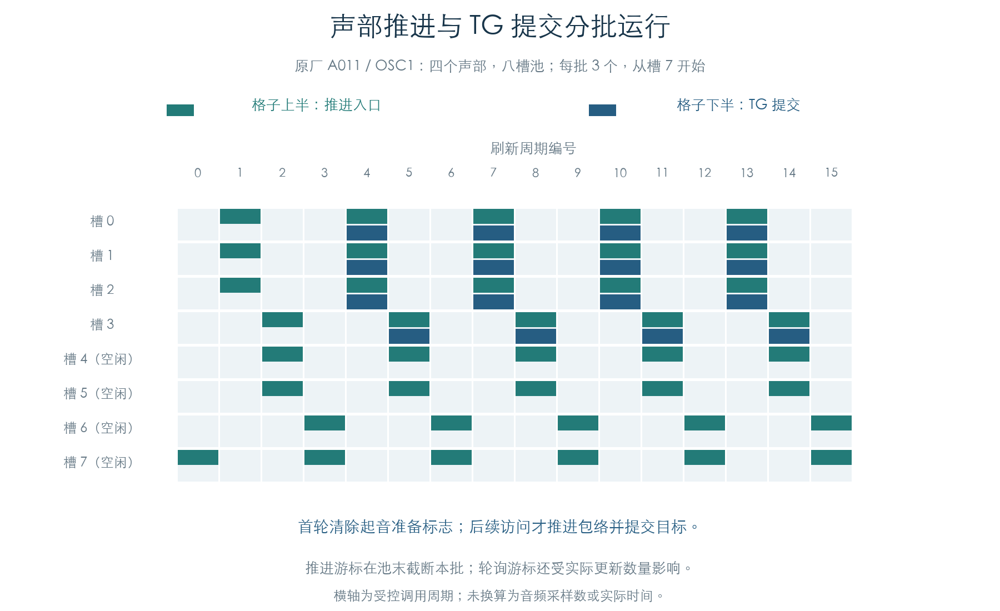
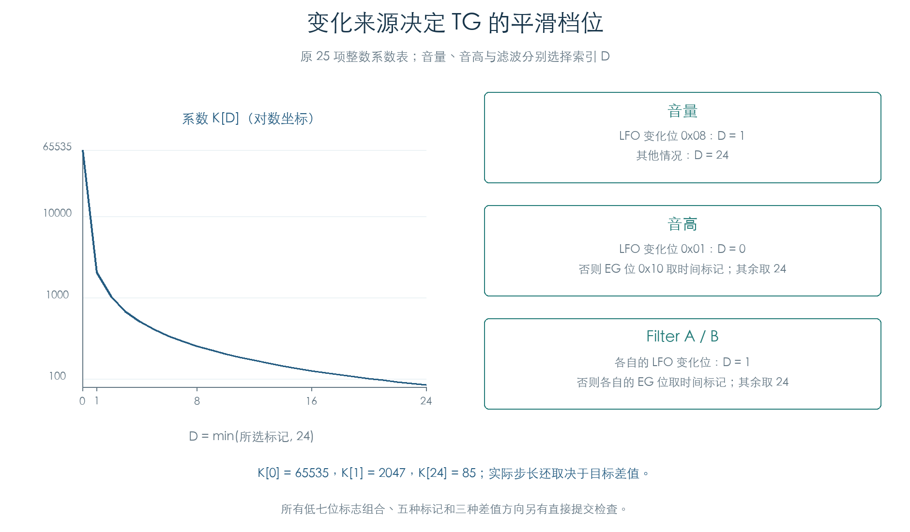

# 正常演奏中的声部刷新

KROSS 2 v1.2.4 · 插件音源逻辑 · 2026-11-02

声部建立后，固件分批推进包络、LFO 和滑音，再收集需要更新的声部，按阶段计算调制目标，最后提交 TG 命令。推进和轮询使用两个游标，因此一次管理器调用不会总是更新全部声部。

## 1 两个游标怎样分工

推进入口使用管理器 `+E1` 游标。每次处理一个连续槽段，到池末截断，下一次从零开始。忙碌标志有效时，整次推进直接返回，等待列表也保持原状。

轮询入口使用 `+E9` 游标。它检查等待起音、运行状态和结束标志，收集带有更新结果的声部；更新预算耗尽或游标走完一圈后结束。批内每个阶段依次遍历这些声部。



图中四个实际声部来自 A011 的交叉立体声层，池中另四槽空闲。初次访问会清除起音准备标志；随后正常推进才产生待提交目标。图里的批大小与起始游标用于检查边界，未据此推算原琴的控制频率。

## 2 一批声部的计算顺序

| 阶段 | 执行顺序 |
| --- | --- |
| 推进 | 每个受访声部推进三类 EG、LFO2、LFO1；同时保留滑音与等待门槛 |
| 波形输出 | 对收集到的每个声部，先读取 LFO2，再读取 LFO1 |
| 包络刷新 | 先遍历全部 Pitch EG，再遍历 Filter EG、Amp EG |
| 调制混合 | 先更新全部 Mixer1，再更新全部 Mixer2 |
| 目标计算 | 音高、滤波、两段附加控制计算、音量、声像分别遍历整个批次 |
| 提交 | 逐声部写入 TG，最后处理管理器尾部请求 |

这种阶段顺序会影响共享随机状态和调制源的读取时点。插件若改成“一个声部做完所有阶段再处理下一个”，需要重新核对这些依赖。

本轮将原厂真实采样声部接入原推进与轮询入口；另一条路径按上表显式调度原计算函数。每个阶段比较完整声部、链表、管理器、控制器、随机状态和 TG 读写顺序。EG、LFO、Mixer 自身的独立数学模型见各专项章节；本轮调度对照没有把同一原函数的两次执行算作独立算法验证。

## 3 变化来源决定平滑系数



提交入口使用 25 项整数表，索引最多取 24。三个常见值为 `K[0]=65535`、`K[1]=2047`、`K[24]=85`。

| 控制目标 | 索引 D 的选择，按优先顺序 |
| --- | --- |
| 音量 | LFO 变化位 `0x08` 有效时取 1；其余取 24 |
| 音高 | LFO 位 `0x01` 有效时取 0；否则 EG 位 `0x10` 有效时取 Pitch EG 的时间标记；其余取 24 |
| Filter A/B | 各自 LFO 变化位有效时取 1；否则各自 EG 位有效时取 Filter EG 的时间标记；其余取 24 |

普通音量提交先比较新旧目标，相等时不写音量命令。存在差值时，设目标为 `T`、上次目标为 `C`：

```text
P = signed32(K[min(D,24)] × (T − C)) >> 16
S = P + 1    当 P ≥ 0
S = P − 1    当 P < 0
音量命令 = ((S & 65535) << 16) | T
```

音高步长先将表系数右移四位，再乘以新旧采样步进的差值，作有符号右移十二位，最后同样向外增加一步。滤波对每路四个控制字分别计算步长，再打包为对应 TG 写入。

本轮另在真实初始化的声部上指定变化字节低七位的全部 128 种组合、时间标记 `0/1/2/24/5000` 和正/零/负三种差值，共 1920 组直接提交检查。它补齐代表音色轨迹没有触发的编码分支；这些组合的原厂可达性分别保留。

这里得到的是 TG 控制命令。芯片如何在音频采样之间执行步长，仍需实际音频算法的证据。

## 4 两段附加计算的绑定缺口

后续：[省略验证](VOICE_AUXILIARY.md)已在 72 条换音/踏板轨迹中跳过这两段计算，其余状态与 TG I/O 一致。下文保留当时的私有参数实验；受测插件路径可以省去附加绑定，原始来源继续留档。

首次接入完整刷新时，声部 `+1CC`、`+1D8` 两个附加控制块的参数指针为零。当前已执行的启动链没有建立这两处绑定。本轮为它们提供明确的私有参数内存，继续执行原计算函数，避免把未知绑定猜成某个 Program 字段。

另选八个原厂 OSC，各执行十六次更新，对这两段参数施加变化。附加块的状态确实变化，其余声部字节与全部 TG 读写保持一致。该结果说明它们在这些受测路径中没有改变音频提交；真实绑定来源及其他使用方式仍作为独立缺口保留。

## 5 检查结果与范围

| 内容 | 覆盖 |
| --- | --- |
| 原厂代表配置 | 24 个 OSC，包含全部 18 种存储 LFO 波形、四种滤波路由及立即/等待/松键起音 |
| 连续调度对照 | 72 条轨迹，每条 128 次更新，共 9216 次 |
| 原 TG 提交 | 4449 次，独立核对音量、音高、滤波目标/步长、路由字及评分缓存 |
| 直接提交边界 | 1920 组低七位变化标志、时间标记与差值方向 |
| 忙碌门槛 | 六组批大小与游标组合 |
| 附加参数影响 | 八组，每组十六次更新 |

轨迹在第 32 次调用送入原 OSC 松键入口；启用延音的场景在第 64 次松开踏板，第 80 次启用受控 CC7/CC11 输入。代表配置包含十八种波形，不代表每种波形都在这段轨迹内走完一个周期。

采样与声部参数来自[原厂真实声部链](FACTORY_VOICE_CHAIN.md)。每条轨迹使用新的八槽池、一致的空白启动堆栈和时钟起点。TG 活跃位由实验指定；复位时电平读回为零，运行释放读回为 16384，评分读回为 `0x1234`。立体声起音的硬件等待只记录请求值，未操作计时器。

本轮没有执行完整 MIDI 解析器、系统任务、硬件或 TG 音频。两处附加绑定与芯片内插值分别保留，鼓组和扩展资源的真实声部路径继续连接。

[完整检查结果](../../derived/firmware/KROSS2_V124/architecture/stage04/voice-refresh-check.json) · [游标与访问 CSV](../../derived/firmware/KROSS2_V124/architecture/stage04/voice-refresh-cadence.csv) · [目标与步长 CSV](../../derived/firmware/KROSS2_V124/architecture/stage04/voice-refresh-commits.csv) · [原批次函数](../../derived/firmware/KROSS2_V124/architecture/stage04/voice-refresh-batch.arm.txt) · [原 TG 刷新](../../derived/firmware/KROSS2_V124/architecture/stage04/voice-refresh-TG.arm.txt)

```sh
python3 research/tools/firmware_voice_refresh.py --verify-arm
python3 research/tools/firmware_voice_refresh_figures.py
python3 research/tools/firmware_runtime_verify.py
```
