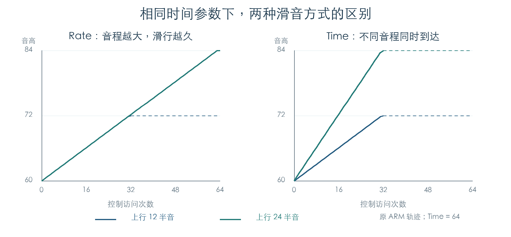

# 声部复用、立体声抢占与滑音

KROSS 2 v1.2.4 · 阶段 03 · 2026-11-01

普通单音连奏可以直接修改已有声部，保留原采样、力度、包络和 LFO。复音耗尽后，分配器若选中立体声的一侧，会同时重置两侧：选中槽用于新声音，另一槽回到可用队列。滑音则由独立的整数累加状态推进。

## 1 连奏何时复用已有声音

管理器 `0x1FDC8C` 同时满足三个条件时走复用分支：模式判断允许复用、传入已有声部、该声部仍有 key-on 标志 `0x80`。随后调用 `0x1F7B68`，返回空的新声部链；其余情况重新进入选层。

模式判断 `0x272BBC` 使用 Program `+508` 的 bit 7、`+509` 的 bit 4/5，以及音色配置 `+1C` 的低两位。bit 5 会关闭这一复用路径。相关行为与手册的 Mono Legato / Normal 和 Use Legato Offset 两种方式对应。[R1]

256 组原始位组合检查覆盖两项模式判断，192 组管理器调用核对了已有声部、key-on 与模式门槛。组合中包含超出正常界面范围的原始值，用于确定分支规则。

## 2 复用时改动哪些状态

`0x1F7B68` 更新音符、音高和四组键盘跟踪，重算相关滤波与音量控制，并设置控制更新标志。它不重新查找采样区域，也不调用 TG 启动。

42 组检查先执行完整原控制初始化，再改变音符与音色移调。结果如下：

| 状态 | 连奏更新结果 |
| --- | --- |
| 当前音符、音高与键盘跟踪 | 更新 |
| 原处理后力度 | 保留，本夹具为 85 |
| 采样与区域指针 | 保留 |
| 音高、滤波、幅度包络状态 | 逐字节保留 |
| 两路 LFO 状态 | 逐字节保留 |
| 立体声类型和另一侧指针 | 保留 |
| TG 启动调用 | 无 |

夹具采用两个 Concert 振荡器的原参数和一个独立真实区域。它验证正常复用入口的行为；后续[单音按键检查](MONO_KEYS.md)已核对优先级与松键回退。跨素材音域的听感仍需音频证据。

## 3 抢占立体声会释放两侧

`0x1FC89C` 先把配对侧归还分配器，再重置两个声部的控制状态、配对类型和指针。无论候选是主声部还是次声部，重置顺序都为主侧、次侧。

八槽耗尽实验逐一选中全部八个槽，并交换 TG 槽号顺序，共 16 组。每次抢占后，可用数从 0 变为 1；选中槽被立即复用，下一次申请取得其原配对槽，可用数回到 0。TG 复位函数在边界截获，分配器与列表操作使用原指令。

## 4 滑音的两种步长



滑音入口 `0x1F82C0` 从 128 项系数表选择基本步长。时间参数越大，系数越小；第 0 项为零，表示不建立滑音。音色覆盖值为 `-1` 时采用 OSC 参数，否则使用覆盖值。

OSC `+80` 的 bit 2 控制步长是否按音程缩放：

```text
未置位：步长绝对值 = 查表系数
置位：  步长绝对值 = max(1, floor(查表系数 × 音高差 / 3072))
```

音高差以每半音 256 格计，3072 对应十二个半音。固定步长让大音程花更久；按音程缩放使到达时间接近一致，与手册的 Rate / Time 定义相符。[R2]

6,144 组初始化检查覆盖全部时间档位、上行/下行/同音、前音缺失、两种模式及覆盖值。图中的四条曲线直接来自原 `0x1F8140` 的完整步进轨迹。横轴为控制访问次数；本实验不把它换算为实机秒数。

到达目标后会夹住位置。恰好落在终点时，步长保留到下一次访问，再清零。正、负方向均已检查。

## 5 Fingered Portamento 的门槛

OSC 把上一次音高保存在 `+4A0`，`−1` 表示没有可用前音。Note On 先决定是否传入这个音高，再由上一节的累加器计算滑音。

| 条件 | 传给管理器的前音 |
| --- | --- |
| Portamento 关闭 | `−1` |
| Portamento 开启，Fingered 关闭 | 缓存音高 |
| Portamento 与 Fingered 开启，普通连奏复用，链中没有 key-on 声部 | `−1` |
| Portamento 与 Fingered 开启，普通连奏复用，仍有 key-on 声部 | 缓存音高 |

Fingered 开启后，原 OSC Note Off 在音色按键计数降为零时清掉缓存；周期访问在管理器报告无活动状态时也会清掉缓存。这两条路径使断奏后的首音直接到达目标音高。普通连奏入口另外检查 key-on 标志，避免把仅处于释放阶段的声音当成仍按住的前音。

控制器覆盖由 `0x1F5FE8` 处理。允许覆盖且状态为 0 时强制关闭；状态为 `−1` 时沿用 OSC 设置。状态为 1 时，单 OSC 可直接开启；双 OSC 需要两个原始 Enable 位一致，否则各自保留原设置。这里使用原 `0x2738E8` 检查一致性，银行查询只提供夹具 Program。

96 组覆盖值、64 组 Note On 门槛和 24 组缓存清除检查全部通过。OSC 分支与链表执行原指令；管理器分发、释放及活动状态在边界记录或提供固定值。

## 6 后续连通

[单音优先级与回退](MONO_KEYS.md)、[Unison 音高分散](UNISON.md)和滑音门槛已有分段原指令检查。下一步将这些状态接成连续演奏轨迹，并将节拍同步延迟接入音乐时钟。

- [原指令检查](../../derived/firmware/KROSS2_V124/architecture/stage03/voice-reuse-check.json)
- [连奏调音汇编](../../derived/firmware/KROSS2_V124/architecture/stage03/legato-voice-retune.arm.txt) · [立体声抢占汇编](../../derived/firmware/KROSS2_V124/architecture/stage03/stereo-voice-steal.arm.txt)
- [Fingered 与覆盖值检查](../../derived/firmware/KROSS2_V124/architecture/stage03/portamento-gate-check.json) · [门槛和缓存汇编](../../derived/firmware/KROSS2_V124/architecture/stage03/portamento-enable-cache.arm.txt)
- [R1/R2：KROSS 2 Parameter Guide](../../downloads/KROSS2_Parameter_Guide.pdf)，印刷页 7（Mono Legato）和 17（Portamento）。

```sh
python3 research/tools/firmware_voice_reuse.py --verify-arm
python3 research/tools/firmware_portamento_gate.py --verify-arm
python3 research/tools/firmware_runtime_verify.py
```
