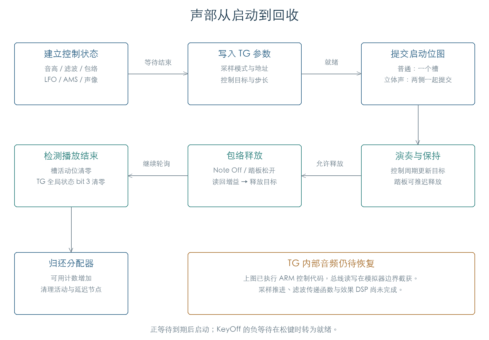

# 从声部控制到 TG 启动与回收

KROSS 2 v1.2.4 · 阶段 03 · 2026-11-01

固件先计算声部的音高、滤波、包络和调制状态，再把采样地址与控制字写给 TG。松键后，Amp EG 生成新的增益目标；轮询检测到 TG 播放结束，才把槽位归还分配器。这条路径已经用原 ARM 指令连通到总线边界。



## 1 控制状态怎样初始化

入口 `0x1F7278` 依次建立输出路由、键盘跟踪、两路 LFO、两个 AMS Mixer、音高/滤波/幅度包络，以及音高、滤波、音量和声像控制。最后设置等待值，决定立即调用 TG 启动，还是留待后续轮询。

两个 Concert 振荡器各覆盖 128 个音符、128 个处理后力度，共 **32,768 组**。检查实际执行完整初始化，并独立核对层增益、力度增益、四项键盘跟踪和两路 LFO 的所属声部指针。素材采用一个真实区域与采样记录，单独选作计算输入；这组实验验证入口行为，不包含 Concert 在所有音符上的实际选样。[E1]

立体声次声部复制主声部的包络、滤波、调制与等待状态，随后修正自己的 LFO 指针并重新计算声像。六组普通、延迟和 KeyOff 情况的复制检查通过。

## 2 延迟与松键触发

OSC 延迟和音色延迟都通过 `0x406226` 的有符号半字表转换。表有 98 个有效编号；编号 96 对应 2500，编号 97 对应 `-1`。普通分支把两个查表结果相加，任一结果为 `-1` 时保留负等待。用户手册将最后一项称为 **KeyOff**。[E1][R1]

等待为零时立即启动；正等待由延迟队列推进；负等待在松键时转为就绪。另有节拍同步分支，仍需连通音乐时钟核对。

就绪入口 `0x1F969C → 0x1F963C` 清除等待，更新音高并启动 TG。立体声主声部同时启动次声部，再统一提交两侧的槽位图。45 组检查覆盖单声部、主/次配对类型和跨 16/32 位边界的槽号；次声部直接进入此入口时返回，不自行启动。[E2]

## 3 TG 收到哪些参数

启动入口 `0x1F9028` 设置采样模式、地址、音高、滤波、幅度和输出控制。72 组完整初始化已执行到所有总线写入，覆盖两路振荡器、三个音符、三个力度和四个槽号。以下偏移均相对于 TG 基址 `0x60000000`；含义来自 ARM 端的数据流。

| 寄存器 | 固件写入内容 |
| --- | --- |
| `+400` | 当前槽号 |
| `+200` | 由采样描述符标志重排得到的模式字 |
| `+208` | 播放地址，受循环和反向选择影响 |
| `+20C` | 采样描述符 `+18` 的值减 1 |
| `+210` | 根据起始偏移、循环和反向选择的另一地址 |
| `+21C` | 以采样描述符有符号 `+2` 为索引取得的半字表值 |
| `+220` | 描述符 `+8/+A` 两个半字合并值 |
| `+418` | 高 16 位为有符号增益步长，低 16 位为目标值 |
| `+420 / +424` | 两个输出控制字 |
| `+230…+23C` | 四个 32 位槽位图字；随后向 `+22C` 写入命令 2 |

采样模式的低位、反向开关、起始偏移和偏移边界共检查 **2,304 组**。测试用互不相同的地址字段区分每个分支，核对写入值。任意标志组合用于穷举打包行为；实际 ROM 是否使用该组合，需要另查素材记录。[E2]

固件的底层总线函数把 32 位值拆成两次 16 位访问：高半字位于基址，低半字位于基址 `+2`。七组原指令读写检查覆盖零、边界和非对称值。恢复 TG 接口时需要保留这个顺序。

## 4 松键后怎样更新增益

`0x1F8AF4` 进入 Amp EG 释放段，推进包络并计算增益目标，然后两次读取 TG `+42C`，采用第二次结果。该值缓存到声部 `+152`，目标保存在 `+150`。

如果读回值恰好等于目标，固件会把缓存改成相邻值：非零时减 1，零时改为 1。接着由 `0x12D288` 计算渐变命令：

```text
k = 系数表[min(时长, 24)]
p = (k × (目标 − 缓存)) >> 16
步长 = p + 1（p ≥ 0），或 p − 1（p < 0）
命令 = (步长的低 16 位 << 16) | 目标
```

系数表共 25 项：第 0 项为 65535，其余第 i 项为 `floor(65535 / (32 × i))`。120 组检查运行了原包络释放、目标计算和命令生成，覆盖两个振荡器、三档力度、四个释放时点，以及目标附近的读回值。[E2]

## 5 何时真正回收槽位

声部轮询首先排除等待中的声音，再读取对应的 TG 活动位：寄存器为 `+240 + 4 × floor(槽号 / 32)`，位号为 `槽号 mod 32`。活动位清零后，还要检查 TG 基址状态字的 bit 3；该位仍有效时继续等待。

两项状态都清零时，固件执行停止控制、清除声部标志，返回完成位。管理器 `0x1FE404` 随后移除延迟记录、归还分配器槽位并清理列表节点。576 组状态检查覆盖等待值、活动位、全局状态和控制标志。

八槽连通实验先占用四槽。模拟 TG 报告这四槽全部结束后，原管理器把可用数从 4 恢复到 8，并清空四个活动节点。普通 Note Off 只把声部列为可替换候选；这次完成轮询才确认它们已经可用。释放组的匹配与踏板保持见[释放分析](VOICE_RELEASE.md)。[E2]

## 6 当前证据范围

这些检查已经执行 ARM 端的控制初始化、TG 参数打包、释放更新和结束回收。总线读值由测试提供，写值逐条记录；TG 芯片内部的采样推进、定点滤波和音频输出尚未执行。构造失败的预留槽归还见[失败路径分析](VOICE_FAILURES.md)。完整原厂选样连通、单音/连奏、立体声抢占、节拍同步延迟及硬件忙时序仍需继续恢复。

**证据与复现**

- [E1：完整控制初始化与立体声复制](../../derived/firmware/KROSS2_V124/architecture/stage03/voice-start-check.json)
- [E2：TG 命令、释放与回收检查](../../derived/firmware/KROSS2_V124/architecture/stage03/voice-tg-check.json)
- [TG 启动汇编](../../derived/firmware/KROSS2_V124/architecture/stage03/TG-voice-start.arm.txt) · [就绪与结束轮询](../../derived/firmware/KROSS2_V124/architecture/stage03/voice-completion-and-ready.arm.txt)
- [R1：KROSS 2 Parameter Guide](../../downloads/KROSS2_Parameter_Guide.pdf)，P–BASIC / Note-On Control，印刷页 8。

```sh
python3 research/tools/firmware_voice_start.py --verify-arm
python3 research/tools/firmware_voice_tg.py --verify-arm
python3 research/tools/firmware_runtime_verify.py
```
